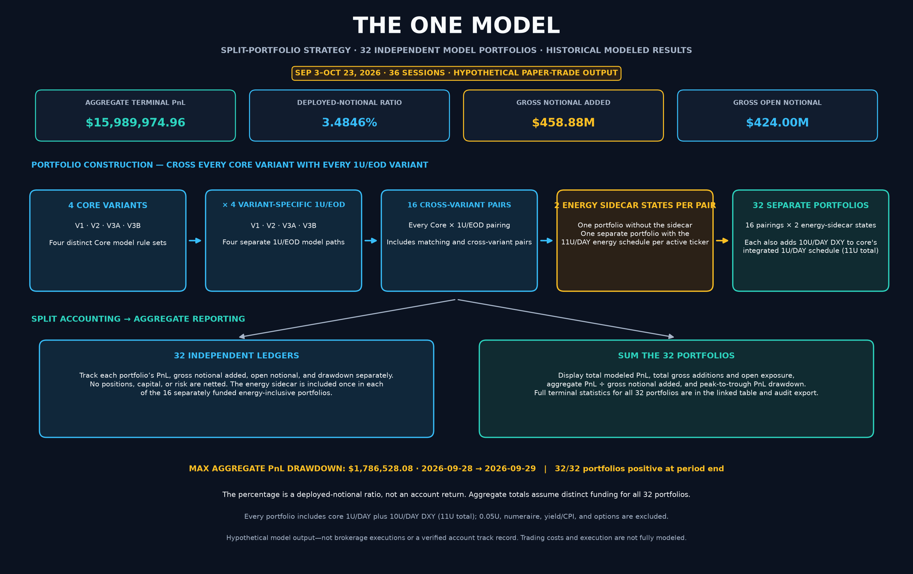
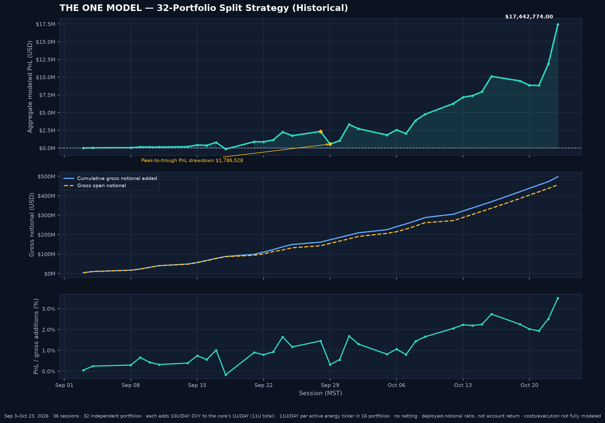

# Hypothetical Securities Offering Briefing

**Working discussion draft · Fall (Arizona) [2026] paper-trade model · Not an offering document**

> **Important status notice.** This is an educational description of a hypothetical model architecture. It is not a prospectus, private-placement memorandum, offer to sell or solicitation to buy a security, investment recommendation, or promise of return. No actual issuer, security, price, minimum subscription, use of proceeds, fee schedule, redemption right, liquidity term, or offering authorization has been supplied; the illustrative unit price at the end is not an actual offering term. Do not circulate it as offering material without appropriate securities counsel, compliance review, complete offering terms, and substantiated performance disclosures.
>
> **Participation designation (user-directed):** This hypothetical model is designated for **Debit Investors Only**. **Accredited Investors may NOT participate.** This statement records the requested scope in a working educational draft; it does not authorize an offering, verify investor status, or replace legal and compliance review.
>
> **ATS / manual position separation — separate reconciliation, not included in the cutoff replay:** The user reports vision-confirmed ATS activity on Oct. 23 but is unsure of the exact executed size. The requested labels are **AUTOMATED TRADING SYSTEM LIVE POSITIONS** and **MANUAL LIVE TEST POSITIONS**. For a transparent sizing proxy only, each tagged 50U BRENT/OIL Weekend Oil lot is split into an ATS ceiling of 40U and a 10U manual remainder. The ATS exit/short is shown at user-provided $118 BRENT / $103.50 OIL in 20U/30U/40U scenarios, not as a verified fill. The prior 10U trim/short events remain in the historical replay for audit continuity but are superseded, not stacked, in the separate scenario. The four Oct. 25 10U replenishments remain manual test positions; the 35U/34U orders are **MANUALLY APPROVED SHORT CLOSURE**, applied first to any remaining ATS short, with only excess units left long. The existing 50U-per-ticker ATS LONG entries at fixed $115 BRENT / $101 OIL are modeled for Oct. 26, with time unspecified. The user clarified a separate additional 50U ATS USOIL mirror LONG @ $101.11 at 07:51 MST, synchronized with the 50U manual BRENT entry; the mirror description applies to this new $101.11 lot, not the older $101.00 OIL lot. Later user-reported additions include 10U per ticker via a manually approved ATS order ($115.025 BRENT / $100.96 OIL; date/time not supplied), 16U BRENT @ $114.90 and 17U OIL @ $100.85 (classification/date/time not specified, date inferred from context), and a separate 50U manual BRENT LONG @ $115.51 at 07:51:14 MST from a TradingView screenshot (date inferred; LONG inferred from handwritten “PICK UP OPPORTUNITY”). These are user-reported modeled positions, not independently verified brokerage fills. In the 40U-per-ticker ceiling scenario the tagged campaign totals 161U / 161U. See [`ATS and Manual Live Position Reconciliation.md`](ATS%20and%20Manual%20Live%20Position%20Reconciliation.md) and [`data/ats_manual_live_positions_v1.csv`](data/ats_manual_live_positions_v1.csv).
>
> **Current-model snapshot — user-provided TradingView benchmark through 2026-10-26.** The current core spans 37 regular-session marks across 31 direct-price tickers plus the integrated chart-directed 1U/DAY/DXY index-return sleeve. The Oct. 26 direct-price list and DXY close (102.017) are retained as user-provided marks, not independently verified quotes; USOIL maps to internal ticker `OIL`. BTC/ETH remain excluded pending recalibration; XRH0’s five missing session marks are transparently carried forward from prior supplied TradingView closes. The core includes logged events through Oct. 26, including user-directed modeled INTC/META closes; the 6U INTC long is independently applied to each core variant, not treated as a combined-account 24U position. ATS/manual reports remain separated from model events, and no reported action is represented as a verified brokerage fill. THE ONE MODEL retains its additional 10U/DAY DXY schedule (11U/DAY including core) and 11U/DAY energy sizing; the generic strategy-comparison energy schedule remains 10U/DAY. The separate whole-portfolio DXY/yield views remain historical through Oct. 23; hourly charts remain through Oct. 22. See [`Model Performance Comparison.md`](Model%20Performance%20Comparison.md), [`TradingView Energy and Currency Desk Sidecars.md`](TradingView%20Energy%20and%20Currency%20Desk%20Sidecars.md), [`ATS and Manual Live Position Reconciliation.md`](ATS%20and%20Manual%20Live%20Position%20Reconciliation.md), and [`research/notes/tradingview-benchmark-import-20261024.md`](research/notes/tradingview-benchmark-import-20261024.md).
>
> The figures remain hypothetical historical model results, **not** a verified account track record, customer return, offering performance claim, or investment recommendation.

## 1. Purpose and operating model

The model is a historical paper-trade replay built from chart posts and manually entered trade records. The source ledger is maintained in [`trades/`](trades/) and [`trades.zip`](trades.zip); assumptions and calculation rules are in [`Model Calculation Guide.md`](Model%20Calculation%20Guide.md). The refreshed current replay covers 116 price-covered direct-trade events and a separate DXY direction signal through Oct. 26, 2026, across 37 sessions. User-reported live/manual actions remain separately classified where specified and are not conflated with modeled positions or verified execution. The historical source ledger also retains BTC/ETH, FX, yield/index events and superseded or post-cutoff baseline records; those are not all direct-price core positions. DXY is replayed as an index-return proxy sleeve, not a direct-price security position.

The scripts can replay logged records and produce reports. **A broker-connected automated trading system is hypothetical, not operational.** This model is built to be operated manually by **Harshal Priyavadan Patel**: he reviews chart posts and trade records, makes discretionary decisions, enters or updates records, and manually reviews and places any paper or hypothetical order. No live automated order routing, real-time signal validation, or independently verified execution is represented here.

For a logged trade, the chart-posting price recorded in the trade log is the entry basis used by the model. Later minute or EOD prices mark the open lot; they do not replace the chart-posting entry. For example, the September 24 INTC short uses the chart-posting price of **$115.11**. This is a model convention, not evidence of a broker fill.

### What the historical replay does—and does not—show

- It compares rule-defined hypothetical position paths on one manually assembled paper-trade book; it is not a verified client account or audited investment track record.
- The current core replay covers 31 direct-price TradingView symbols plus an integrated chart-directed 1U/DAY/DXY index-return sleeve on a common EOD calendar through Oct. 26, 2026 (37 sessions). BTC/ETH remain outside the core pending recalibration. Intraday source coverage is separate and shorter.
- All current core marks, including BRENT and OIL, use the normalized user-provided TradingView lists in [`data/tradingview_benchmark_session_marks_20261026.csv`](data/tradingview_benchmark_session_marks_20261026.csv). The revised Part B archive is pinned in [`data/tradingview_benchmark_source_manifest_part_b_20261024.json`](data/tradingview_benchmark_source_manifest_part_b_20261024.json); it corrects LLY's Oct. 20 close to $1,283.66. The 1U/DAY/DXY schedule is integrated in each core result. THE ONE MODEL additionally includes the 10U/DAY DXY schedule in each of its 32 portfolios; energy-inclusive variants use 11U/DAY per active BRENT and OIL ticker. The 0.05U DXY schedule remains an alternative. XRH0 has five flagged provisional carry-forwards; no legacy price fills are used.
- The current core uses only the supplied TradingView lists; their source files, coverage, and mark statuses are recorded in the benchmark manifest and session-mark data. The archived source registry applies to historical views only.
- The replay does not comprehensively charge commissions, bid/ask spread, slippage, taxes, borrow, financing, margin, market impact, option premium, or operational costs. It does not establish executable capacity or customer-level returns.
- “PnL,” “deployed notional,” “open notional,” and percentage-gain ratios are model measures. The percentage-gain chart uses cumulative PnL divided by cumulative gross notional added; it is a **deployed-notional ratio, not an account return**.

## 2. Component models in the superstructure

The sections below distinguish the implemented historical models from the proposed combination layer. Similar names do not mean that the model books are interchangeable or automatically additive. In this brief, **1U / 1 Unit = $10,000 of entry notional**. Notional is not cash, equity, margin, or a guarantee of maximum loss.

### 2.1 Core V1 — 1U Open

V1 opens a lot for each logged LONG, REBUY, or SHORT using the logged unit size. A generic EXIT or TAKE PROFIT closes all open long lots; a specifically tagged Manual-Automatic target trim closes only the logged quantity from its tagged entry and leaves other lots untouched. A later LONG/REBUY does **not** automatically cover an existing short, so long and short lots in the same ticker may coexist. “Open” means there is no LONG-triggered short-cover rule; explicit exits still operate.

**How to read it:** V1 is a position-persistence baseline. Its open exposure can remain larger than a reader expects when a signal changes direction. It is not a netted or cash-neutral book.

### 2.2 Core V2 — 1U SAR

V2 uses the same entries, logged sizes, and explicit long exits as V1. In addition, a LONG or REBUY closes all open short lots for that ticker at the new event’s logged price before opening the new long. A new SHORT does not automatically close existing longs; the implemented SAR rule is therefore asymmetric rather than a symmetric “close the opposite side” rule.

**How to read it:** V2 can reduce short exposure when a long signal arrives, but a new short may coexist with open longs until an explicit exit handles them.

### 2.3 Core V3A — Nu Open

V3A follows V1’s open/exit behavior. For a SHORT specifically tagged “Compounded short,” if the preceding full exit for that ticker recorded more than one unit, that short is sized using the preceding exit’s unit count. This does not scale ordinary long entries or every later short; it is a qualifying event rule.

**How to read it:** V3A combines the open-book path with selective short sizing. Larger exposure can magnify both favorable and adverse moves.

### 2.4 Core V3B — Nu SAR

V3B combines V3A’s qualifying compounded-short sizing with V2’s LONG/REBUY-triggered short cover. Like V2, a new SHORT does not automatically close open longs.

**How to read it:** V3B adds both a sizing override for qualifying compounded shorts and the asymmetric SAR close rule. It is a distinct rule set, not a blend of V2 and V3A results after the fact.

### 2.5 Fixed-$500/EOD exponential alternative

After a ticker has a carried LONG/SHORT/REBUY direction, this alternative adds one **fixed $500 notional** lot per active ticker at every priced EOD. It closes all prior lots at the EOD mark when the carried direction flips. The $500 tranche does not grow with PnL, so this model is not compounding the tranche size.

**Interpretation:** it is a separate, smaller-sized daily accumulation strategy. It is not a $500 add-on to the 1U force model unless a comparison explicitly defines that composite.

### 2.6 Shared-direction 1U/EOD force alternative

This model uses the same direction state, EOD schedule, and flip logic as the fixed-$500 model, but adds one **1U ($10,000 notional)** tranche per active ticker per priced EOD. It is called a force multiplier in the repository, but it is a different tranche-size alternative—not an instruction to leverage or multiply an account balance. PnL is not reinvested into later tranche size.

**Interpretation:** when direction state and trade handling are identical, the unrounded exposure and PnL scale about 20× the fixed-$500 alternative. That is a sizing relationship, not proof of superior risk-adjusted performance.

### 2.7 Variant-specific 1U/EOD force family

These four separate daily-addition models place one 1U tranche per active ticker/EOD while applying the corresponding V1, V2, V3A, or V3B position-handling rule. Explicit EXIT/TAKE PROFIT events close open long lots at their logged prices but do not clear the carried direction; if a direction remains active, the scheduled EOD addition still occurs. They are alternatives to the shared-direction 1U force model and to each other.

#### Variant-specific 1U V1 — Open

Keeps opposite-direction lots open as V1 does; explicit exits close long lots. New daily lots follow the carried direction.

#### Variant-specific 1U V2 — SAR

LONG/REBUY closes open short lots at the logged signal price before the scheduled EOD long tranche. SHORT does not close existing longs.

#### Variant-specific 1U V3A — Nu Open

Uses V1 open behavior plus the qualifying compounded-short event-day sizing override. The event-day tranche can use the preceding full-exit unit count; following carried days return to the baseline 1U addition.

#### Variant-specific 1U V3B — Nu SAR

Uses V2’s LONG/REBUY short-cover behavior and V3A’s qualifying compounded-short event-day sizing override.

**Interpretation of the family:** its comparison includes each member standalone, with the energy sidecar, and in all 16 core-variant × 1U-variant pairings (matching and cross-variant), with and without the energy sidecar. Composite PnL and notionals are additive reporting sums; holdings, cash, collateral, and risk are not netted.

### 2.8 Energy-desk EOD accumulation sidecar

The current energy sidecar is a separate long-only schedule: add **10U ($100,000 notional)** in each energy instrument at every supplied EOD session. BRENT has 23 covered sessions and OIL has 32, for $5.5 million of cumulative daily-buy notional. Each lot is bought at the exact supplied EOD close, remains open through the terminal date, and its PnL is not reinvested into future lot size. No sidecar exits, fees, financing, or margin are modeled.

The 10U energy sidecar’s Oct. 23 daily-buy PnL is **$500,808.26** on $5,500,000.00 cumulative daily-buy notional, before considering the separately shown chart-opened energy positions. Those chart-opened positions already belong to the core book; a composite adds only the sidecar’s incremental daily-buy lots, never those core positions a second time. The large daily notional means the energy sleeve can dominate raw-dollar composites.

**Interpretation:** this is a capital-intensive hypothetical, not a forecast and not an automatic hedge. Treat it as its own sleeve with its own capital, commodity, roll/contract, liquidity, and concentration analysis.

### 2.9 Whole-portfolio DXY numeraire and FX positions

The separate DXY-equivalent analysis divides USD account value by the daily DXY close to express the same account in DXY-equivalent units. **DXY is a numeraire in that historical report, not an added $10,000 position and not a live conversion instruction.** The current core's 1U/DAY/DXY index-return sleeve is a separate modeled exposure, already included in core PnL; do not add it to the DXY-numeraire conversion. The numeraire analysis retains a prior benchmark and separate capital basis, with FX/US30Y marks as documented in [`DXY-Equivalent Portfolio Snapshot.md`](DXY-Equivalent%20Portfolio%20Snapshot.md).

The current model does not decide when to convert USD into a DXY-linked instrument or back, nor does it apply a dynamic “DXY weight.” A true conversion sleeve would require a defined tradable vehicle, currency and settlement convention, allocation formula, rebalance timing, spread/fee/slippage inputs, custody/cash treatment, and limits. A numeraire comparison alone does not implement or validate that sleeve.

### 2.10 Yield multipliers and inflation-adjusted management

Two different yield-related calculations appear in the repository and should not be conflated:

1. **Legacy per-model additive US10Y carry** is preserved as a reference in the core comparison. It applies a spread over the 4.865% baseline to cumulative deployed notional over actual calendar days. It is not the active whole-account scenario and is not CPI inflation.
2. **Whole-account US10Y / US30Y scenarios** apply compounded yield-spread factors to a separate portfolio account basis. The combined scenario is US10Y × US30Y. The yields are not additional $10,000 positions; a separately logged US30Y trade, where included, remains distinct from the blanket factor.

Neither calculation is a Treasury total-return model or an inflation-adjusted return. To report real purchasing power, the model would need a selected CPI series, base date, release-lag convention, interval methodology, and an explicit account-level formula. “Yield maximizing” is not an implemented or validated objective; the factors are scenarios, not an optimizer.

### 2.11 Composite stacks and “options stacking”

The existing comparison’s “stacking” is **additive model composition**, not trading options contracts. A reported composite can add a chosen core model to one permitted sizing alternative and/or the incremental energy daily-buy sidecar, if the chart/table labels that combination. In all such comparisons:

- Do not stack the fixed-$500 alternative and a competing 1U force alternative as if both were one strategy.
- Do not stack the shared-direction force model with a variant-specific force model, or combine multiple variant rules into one book.
- Every core model already includes one shared 1U/DAY/DXY index-return sleeve (36 daily lots; $360,000 gross notional added; +$3,413.80 terminal proxy PnL). Do not add that 1U schedule twice. The 10U/DAY DXY schedule is separately added to each THE ONE MODEL portfolio; 0.05U remains an alternative.
- Do not add core chart-opened BRENT/OIL positions to the energy sidecar a second time.
- Report PnL, cumulative gross notional, open notional, and the assumed account capital separately. Additive PnL lines do not net shares, contracts, cash, margin, or correlated risk.
- The all-32 percentage-gain view is cumulative composite PnL ÷ cumulative gross notional added. It is a deployed-notional ratio, **not an account return**.

No listed-options or other derivative-option strategy is modeled. There are no option chains, strikes, premiums, implied volatilities, Greeks, expirations, exercise/assignment treatment, or option collateral assumptions in these historical calculations. Any future option layer would be a separate model with separate authorization, risk limits, and disclosure; it cannot be inferred from the word “stacking.”

## 3. Current TradingView-only comparison snapshot

These are hypothetical model outputs through the **Oct. 26, 2026 EOD close**, not customer returns or estimates of future performance. The current core uses 31 direct-price TradingView symbols plus the integrated chart-directed 1U/DAY/DXY index-return sleeve. All Oct. 26 direct-price marks and the DXY close of 102.017 are user-provided, not independently verified. USOIL maps to internal ticker `OIL`. BTC/ETH remain excluded pending recalibration; XRH0 has five explicitly flagged carried-forward marks. User-directed modeled closes are not verified fills. ATS/manual position categories and user-reported live actions are documented separately. These outputs do not imply verified brokerage execution and do not include full transaction costs, financing, taxes, borrow, margin, or slippage.

| Current model/output | Terminal PnL | Cumulative gross notional added | Scope note |
|---|---:|---:|---|
| Core V1 — 1U Open | $+114,524.25 | $4,585,000.00 | 31 direct-price tickers plus 36 active 1U/DAY DXY lots |
| Core V2 — 1U SAR | $+111,926.39 | $4,585,000.00 | Same mark and event scope; SAR handling differs |
| Core V3A — Nu Open | $+135,836.06 | $4,675,000.00 | Qualifying compounded-short sizing differs |
| Core V3B — Nu SAR | $+123,093.10 | $4,675,000.00 | Nu sizing plus SAR handling |
| Fixed-$500/EOD direction-following alternative | $+7,206.51 | $343,500.00 | Separate alternative; $500 per active ticker/EOD |
| Shared-direction 1U/EOD force alternative | $+144,130.20 | $6,870,000.00 | Separate alternative; $10,000 per active ticker/EOD |
| Variant-specific 1U/EOD V1 | $+138,138.01 | $6,870,000.00 | V1 close/size rules |
| Variant-specific 1U/EOD V2 | $+139,076.81 | $6,870,000.00 | V2 close/size rules |
| Variant-specific 1U/EOD V3A | $+158,468.56 | $6,960,000.00 | V3A close/size rules |
| Variant-specific 1U/EOD V3B | $+149,758.20 | $6,960,000.00 | V3B close/size rules |
| 10U TradingView energy sidecar | $+386,290.08 | $5,700,000.00 | Standalone daily-buy lots; standard composites add this sidecar once |

The DXY sizing alternatives are distinct from the integrated core sleeve. Through the current mark window, the 0.05U schedule models 36 active daily lots and $18,000.00 gross notional; the 1U core sleeve models 36 active daily lots and $360,000.00; THE ONE MODEL’s separate 10U add-on models $3,600,000.00. Its 10U DXY sleeve is not part of the standard core variants. All are index-return proxies, not modeled futures/ETF contracts; see [`TradingView Energy and Currency Desk Sidecars.md`](TradingView%20Energy%20and%20Currency%20Desk%20Sidecars.md).

### Core composites with standalone add-ons — terminal PnL

| Core variant | Core only | + $500 model | + 1U force multiplier | + energy desk | + $500 and energy | + force multiplier and energy |
|---|---:|---:|---:|---:|---:|---:|
| Variant 1 — 1U Open | $+114,524.25 | $+121,730.76 | $+258,654.45 | $+500,814.33 | $+508,020.84 | $+644,944.53 |
| Variant 2 — 1U SAR | $+111,926.39 | $+119,132.90 | $+256,056.59 | $+498,216.47 | $+505,422.98 | $+642,346.67 |
| Variant 3A — Nu Open | $+135,836.06 | $+143,042.57 | $+279,966.26 | $+522,126.14 | $+529,332.65 | $+666,256.34 |
| Variant 3B — Nu SAR | $+123,093.10 | $+130,299.61 | $+267,223.30 | $+509,383.18 | $+516,589.69 | $+653,513.38 |

These additive examples combine current core PnL with separate modeled schedules. The integrated DXY sleeve remains counted only through core. Core chart-opened BRENT/OIL positions are not duplicated in the energy sidecar. The generic strategy-comparison energy schedule remains 10U/DAY; THE ONE MODEL uses 11U/DAY per active energy ticker.

## 4. “THE ONE MODEL” — 32-portfolio split strategy

**Construction:** each portfolio pairs one of four current core variants with one of four variant-specific 1U/EOD models. All **16 Core × 1U/EOD pairings** are represented once without and once with an energy sidecar, for **32 independently tracked portfolios**. The energy-inclusive 16 use **11U/DAY per active BRENT and OIL ticker**, meeting the combined DXY exposure of **11U/DAY** (the core-integrated 1U plus the 10U DXY add-on). The other 16 remain explicit no-energy alternatives. DXY is counted once in core and once as the selected 10U sidecar; the 0.05U DXY schedule remains an alternative.

### Aggregate split-portfolio result (Sep. 3–Oct. 26, 2026; 37 sessions)

| Aggregate statistic | Result |
|---|---:|
| Portfolios in aggregate | 32 (16 without energy + 16 with energy) |
| Terminal aggregate modeled PnL | **$16,457,691.52** |
| Cumulative gross notional added, summed across all portfolios | **$584,960,000.00** |
| Gross open notional at period end, summed across all portfolios | **$478,800,000.00** |
| Aggregate PnL ÷ cumulative gross notional added | **2.813473%** |
| Aggregate PnL peak-to-trough decline | **$1,786,528.08** |
| Peak to trough | **2026-09-28: $2,344,610.48 → 2026-09-29: $558,082.40** |
| Portfolios with positive terminal modeled PnL | **32 of 32** |
| Mean / median terminal PnL per portfolio | $514,302.86 / $518,782.02 |

**Energy/currency unit rule:** in every energy-inclusive portfolio, each active energy ticker receives an 11U tranche per scheduled session, matching the 11U/DAY combined DXY exposure. BRENT’s supplied daily schedule starts Sep. 23; OIL’s starts Sep. 10. No earlier energy entries or prices are invented. On sessions when both energy schedules are active, the combined energy allocation is 22U/DAY across BRENT and OIL. The 16 no-energy states are intentional alternatives, not energy-inclusive portfolios.

The 11U energy sidecar contributes $424,919.09 terminal modeled PnL on $6,270,000.00 cumulative additions per energy-inclusive portfolio. Across the 16 such portfolios, it contributes $6,798,705.44 on $100,320,000.00 additions.

**DXY exposure:** every portfolio has 36 daily 1U core lots plus 36 daily 10U sidecar lots, or **11U/DAY**. Per portfolio the 10U add-on contributes $34,137.97 terminal proxy PnL on $3,600,000.00 additions; combined with the 1U core sleeve, DXY contributes **$37,551.77** on **$3,960,000.00** per portfolio. The 0.05U schedule and the separate one-time chart-opened DXY position are excluded. The user-provided Oct. 26 DXY close is 102.017. The separate 40% withdrawal scenario removes 154U ($1.54M initial-notional basis) from the 385U pre-request allocation: modeled Oct. 26 value is $1,555,020.71, leaving 231U / $2,310,000.00 basis. The cash/oil bridge models $690,000 toward logged oil buys and $865,020.71 as excess modeled cash support, with no modeled shortfall or incremental portfolio size. These are scenario calculations, not actual cash or verified proceeds; future DXY sizing stays 11U/DAY and baseline figures are unchanged. See [`TradingView Energy and Currency Desk Sidecars.md`](TradingView%20Energy%20and%20Currency%20Desk%20Sidecars.md) and [`data/dxy_cash_oil_bridge_v1.csv`](data/dxy_cash_oil_bridge_v1.csv).

The aggregate percentage is a **deployed-notional ratio, not an account return**. Drawdown is the peak-to-trough change in summed modeled PnL, not a loss percentage on defined account equity. The sum assumes distinct funding and gross exposures for all 32 portfolios; positions, capital, and risk are not netted or shared. The Manual-Automatic lots are part of each core path, as are other core entries; the 32-book sum follows the existing independent-portfolio construction. The separate Weekend Oil attribution is not added again.

The best individual terminal PnL was **V3A Core + V3A 1U/EOD with the 11U energy sidecar**: $753,361.68 on $21,505,000.00 gross additions and $18,275,000.00 open. The lowest was **V2 Core + V1 1U/EOD without the energy sidecar**: $284,202.37 on $15,055,000.00 added and $11,915,000.00 open. These remain members of the fixed portfolio universe, not a selector that chose a winner.

### Terminal statistics for all 32 portfolios

Every row includes the integrated 1U/DAY DXY core sleeve plus the 10U/DAY DXY sidecar (11U/DAY total). “11U/DAY” under Energy means an 11U tranche for each active energy ticker; “No” preserves the no-energy variant.

| Core variant | 1U/EOD variant | Energy sidecar | DXY 10U sidecar | Combined DXY | Terminal PnL | Gross notional added | Gross open notional | PnL / gross added |
|---|---|:---:|:---:|:---:|---:|---:|---:|---:|
| V1 | V1 | No | Yes | 11U/DAY | $286,800.23 | $15,055,000.00 | $11,915,000.00 | 1.905016% |
| V1 | V1 | 11U/DAY | Yes | 11U/DAY | $711,719.32 | $21,325,000.00 | $18,185,000.00 | 3.337488% |
| V1 | V2 | No | Yes | 11U/DAY | $287,739.03 | $15,055,000.00 | $11,695,000.00 | 1.911252% |
| V1 | V2 | 11U/DAY | Yes | 11U/DAY | $712,658.12 | $21,325,000.00 | $17,965,000.00 | 3.341890% |
| V1 | V3A | No | Yes | 11U/DAY | $307,130.78 | $15,145,000.00 | $12,005,000.00 | 2.027935% |
| V1 | V3A | 11U/DAY | Yes | 11U/DAY | $732,049.87 | $21,415,000.00 | $18,275,000.00 | 3.418398% |
| V1 | V3B | No | Yes | 11U/DAY | $298,420.42 | $15,145,000.00 | $11,695,000.00 | 1.970422% |
| V1 | V3B | 11U/DAY | Yes | 11U/DAY | $723,339.51 | $21,415,000.00 | $17,965,000.00 | 3.377724% |
| V2 | V1 | No | Yes | 11U/DAY | $284,202.37 | $15,055,000.00 | $11,915,000.00 | 1.887761% |
| V2 | V1 | 11U/DAY | Yes | 11U/DAY | $709,121.46 | $21,325,000.00 | $18,185,000.00 | 3.325306% |
| V2 | V2 | No | Yes | 11U/DAY | $285,141.17 | $15,055,000.00 | $11,695,000.00 | 1.893996% |
| V2 | V2 | 11U/DAY | Yes | 11U/DAY | $710,060.26 | $21,325,000.00 | $17,965,000.00 | 3.329708% |
| V2 | V3A | No | Yes | 11U/DAY | $304,532.92 | $15,145,000.00 | $12,005,000.00 | 2.010782% |
| V2 | V3A | 11U/DAY | Yes | 11U/DAY | $729,452.01 | $21,415,000.00 | $18,275,000.00 | 3.406267% |
| V2 | V3B | No | Yes | 11U/DAY | $295,822.56 | $15,145,000.00 | $11,695,000.00 | 1.953269% |
| V2 | V3B | 11U/DAY | Yes | 11U/DAY | $720,741.65 | $21,415,000.00 | $17,965,000.00 | 3.365593% |
| V3A | V1 | No | Yes | 11U/DAY | $308,112.04 | $15,145,000.00 | $11,915,000.00 | 2.034414% |
| V3A | V1 | 11U/DAY | Yes | 11U/DAY | $733,031.13 | $21,415,000.00 | $18,185,000.00 | 3.422980% |
| V3A | V2 | No | Yes | 11U/DAY | $309,050.84 | $15,145,000.00 | $11,695,000.00 | 2.040613% |
| V3A | V2 | 11U/DAY | Yes | 11U/DAY | $733,969.93 | $21,415,000.00 | $17,965,000.00 | 3.427364% |
| V3A | V3A | No | Yes | 11U/DAY | $328,442.59 | $15,235,000.00 | $12,005,000.00 | 2.155842% |
| V3A | V3A | 11U/DAY | Yes | 11U/DAY | $753,361.68 | $21,505,000.00 | $18,275,000.00 | 3.503193% |
| V3A | V3B | No | Yes | 11U/DAY | $319,732.23 | $15,235,000.00 | $11,695,000.00 | 2.098669% |
| V3A | V3B | 11U/DAY | Yes | 11U/DAY | $744,651.32 | $21,505,000.00 | $17,965,000.00 | 3.462689% |
| V3B | V1 | No | Yes | 11U/DAY | $295,369.08 | $15,145,000.00 | $11,915,000.00 | 1.950275% |
| V3B | V1 | 11U/DAY | Yes | 11U/DAY | $720,288.17 | $21,415,000.00 | $18,185,000.00 | 3.363475% |
| V3B | V2 | No | Yes | 11U/DAY | $296,307.88 | $15,145,000.00 | $11,695,000.00 | 1.956473% |
| V3B | V2 | 11U/DAY | Yes | 11U/DAY | $721,226.97 | $21,415,000.00 | $17,965,000.00 | 3.367859% |
| V3B | V3A | No | Yes | 11U/DAY | $315,699.63 | $15,235,000.00 | $12,005,000.00 | 2.072200% |
| V3B | V3A | 11U/DAY | Yes | 11U/DAY | $740,618.72 | $21,505,000.00 | $18,275,000.00 | 3.443937% |
| V3B | V3B | No | Yes | 11U/DAY | $306,989.27 | $15,235,000.00 | $11,695,000.00 | 2.015026% |
| V3B | V3B | 11U/DAY | Yes | 11U/DAY | $731,908.36 | $21,505,000.00 | $17,965,000.00 | 3.403433% |

Full daily audit series: [`the_one_model_split_portfolios_v1.csv`](data/the_one_model_split_portfolios_v1.csv). Derived 11U energy schedule by ticker: [`the_one_model_energy_11u_sidecar_daily_v1.csv`](data/the_one_model_energy_11u_sidecar_daily_v1.csv). Machine-readable summary and portfolio-level drawdowns: [`the_one_model_split_portfolios_v1_summary.json`](data/the_one_model_split_portfolios_v1_summary.json). The source daily Core × variant-specific 1U/EOD series and generic strategy-comparison composites retain their existing 10U energy size; this split aggregator scales that energy component to 11U only for THE ONE MODEL’s 16 energy-inclusive portfolios.

### Scope and interpretation

- These are **historical hypothetical paper-model outputs**, not actual brokerage executions, a verified account track record, or a customer account return. The aggregate requires enough distinct capital to operate 32 portfolios concurrently.
- Each of the 16 energy-inclusive portfolios receives an 11U/DAY schedule per active BRENT and OIL ticker. The other 16 intentionally contain no energy sidecar. Every portfolio has a 10U/DAY DXY add-on in addition to the 1U/DAY DXY core sleeve; the 0.05U DXY size and one-time chart-opened position remain separate/excluded.
- Cumulative gross notional added is not initial equity, cash, margin, or a denominator for account return; the percentage shown is only aggregate PnL divided by the sum of gross notional added.
- Fixed-$500/EOD and shared-direction 1U/EOD schedules are separate alternatives, not additional members of this 32-portfolio universe. Whole-book DXY-numeraire conversion/weighting, FX trade marks, US10Y/US30Y yield scenarios, CPI adjustment, and options are excluded.
- Trading costs, spread, slippage, taxes, borrow, financing, margin, and operational costs are not fully modeled. Energy marks use the exact user-provided EOD marks described above.
- The underlying records are chart posts and manually entered historical trades; the system remains manually operated by Harshal Priyavadan Patel. The 32-way sum does not represent an autonomous selector or a claim that a live allocation policy is optimal.
### What must be resolved before any customer-facing offering

- Legal issuer, security type, rights, price, unit size, minimum, use of proceeds, fees, liquidity/redemption, transfer, custody, valuation, tax, conflicts, and risk disclosures.
- A complete audited/independently reviewed record distinguishing manually logged paper trades, model simulations, and any live account history.
- A frozen and versioned specification for all 32 portfolio constituents, their capital allocations, sidecar treatment, and any optional DXY/FX, yield, inflation, or eventual options layers.
- Realistic trading costs, execution assumptions, margin/borrow/market impact, capacity, outage and data-error handling, and customer capital/accounting methodology.
- Appropriate legal and compliance review before the material is used to solicit or accept capital.

## 5. $20B Paper Portfolio — historical two-stage record

> **User-estimated paper scenario only:** the $20,000,000,000 starting pool is not independently verified profit, cash, or account equity. It represents the user's stated estimate for this experiment; it is not an offering claim, brokerage balance, or evidence of realized profit.

The user describes this paper portfolio as developed over approximately the prior 45 days through TradingView Paper Trading. The current GitHub core replay covers 37 regular-session marks from 2026-09-03 through 2026-10-26. The record is maintained as a two-stage process: (1) paper trading and review in TradingView; (2) manually porting activity, marks, and decisions into the GitHub trade ledger and reports. It is not an automatic sync. Once ported here, the archived history remains available if the TradingView paper account is reset; the repository does not independently verify the TradingView activity or brokerage execution.

For the $20B pool bridge, the selected model cost is **current open gross notional**; lifetime cumulative additions are retained for historical context, not deducted as if all turnover remained invested. The model portfolio deductions currently include THE ONE MODEL's 32-portfolio aggregate ($478,800,000.00), the separately funded 27.201116× WINNING MODEL ($497,100,395.26 open gross notional), and $11,345,500.00 of selected minor standalone books. The winner is a selected constituent of THE ONE universe, but it is intentionally treated as a separate scaled paper book here per the experiment definition. Components already represented in THE ONE, historical account views, and the uncertain ATS/manual maximum-size scenario are not charged again.

| Paper-pool bridge | Amount |
|---|---:|
| User-estimated starting pool | $20,000,000,000.00 |
| Selected model-book active gross notional | ($987,245,895.26) |
| **Remaining for the $200 LONG PORTFOLIO** | **$19,012,754,104.74** |
| BRENT — user-reported Sep. 23 entry basis $102.315; 50% allocation | $9,506,377,052.37 |
| OIL/USOIL — user-reported Sep. 22 entry basis $89.89; 50% allocation | $9,506,377,052.37 |

The remaining capital converts to 9 Large Units ($1B each) and 50,637 Small Units ($10,000 each) per ticker, with $7,052.37 cash per ticker below the small-unit denomination. The price-divided quantity equivalents are not contract, barrel, share, or broker-order quantities. The supplied 2026-10-26 TradingView marks are BRENT $115.38 and OIL $101.30; the $200 LONG PORTFOLIO remains locked until **both** supplied BRENT and OIL EOD marks reach $200.00. For the original residual-pool allocation alone, the modeled price-only mark change is $2,420,578,411.58; this is not actual account PnL, verified execution, or withdrawable cash and is not added to the model-book deductions. Separately, the user requests a full additional **$20B hypothetical order** at **$115 BRENT / $101 OIL**, split evenly into $10B per ticker. From that full order, the existing 50U BRENT / 50U OIL lots ($500,000 each) are reallocated to THE WINNING MODEL, a $1,000,000 total transfer. The remaining $9,999,500,000 per oil ticker combines with the earlier pool allocation for a $39,011,754,104.74 locked foundation ($19,505,877,052.37 per ticker), with quantity-weighted blended bases of $108.44731174 BRENT and $95.26185815 OIL. THE WINNING MODEL's allocation increases from $497,100,395.26 to $498,100,395.26; its historical model PnL is unchanged. At the supplied 2026-10-26 marks, the conditional combined oil-foundation price-only change is $2,483,321,722.81, while the moved lots' conditional mark change is $3,137.32. The added order date/time was not supplied; this mark calculation is conditional on the hypothetical lots being open then. It is outside the original $20B bridge and assumes a separate fully funded $20B, for a $40B total scenario capitalization including the original pool. No order, fill, brokerage execution, or additional capital is independently verified. The transferred 50U source lots retain their ATS provenance in the reconciliation; the Winner assignment is a single reclassification, not a duplicate position or verified fill. The user-stated dates are Sep. 23 for BRENT and Sep. 22 for OIL; the year was not supplied and is aligned to 2026 for this model run. The BRENT opening context comes from the user-supplied TradingView LONG screenshot and stated price/date; OIL's Sep. 22 / $89.89 entry is user-reported alongside the USOIL chart context. The Sep. 22 screenshot note is not treated as a fill or close event. Neither source verifies brokerage execution. Quantity equivalents, model-book costs, exclusions, and the machine-readable allocation are in [`Units Experiment Pool Allocation.md`](Units%20Experiment%20Pool%20Allocation.md), [`data/units_experiment_model_costs_20261026.csv`](data/units_experiment_model_costs_20261026.csv), and [`data/units_experiment_pool_allocation_20261026.csv`](data/units_experiment_pool_allocation_20261026.csv). The restored order and combined lot arithmetic are audited in [`data/units_experiment_oil_foundation_lots_20261027.csv`](data/units_experiment_oil_foundation_lots_20261027.csv). No orders are placed or brokerage executions represented.

## 6. Key references

- [THE ONE MODEL vs THE WINNING MODEL](THE%20ONE%20MODEL%20vs%20THE%20WINNING%20MODEL.md) — equal-terminal-gross-additions comparison; the selected winner is an ex-post, same-period benchmark.
- [Model Performance Comparison](Model%20Performance%20Comparison.md)
- [Oil Cost Basis Savings Model](Oil%20Cost%20Basis%20Savings%20Model.md) — realized target-trim and modeled SHORT-exit credits reclassified into the effective basis of the residual-plus-replenishment long lots; no double counting of PnL.
- [Model Calculation Guide](Model%20Calculation%20Guide.md)
- [Strategy and Sidecar Comparison](Strategy%20and%20Sidecar%20Comparison.md)
- [TradingView Energy and Currency Desk Sidecars](TradingView%20Energy%20and%20Currency%20Desk%20Sidecars.md)
- [Part B benchmark source manifest](data/tradingview_benchmark_source_manifest_part_b_20261024.json)
- [Weekend Oil 50U Position Hypothetical](Weekend%20Oil%2050U%20Position%20Hypothetical.md) — lot-level attribution for the Oct. 19 core-integrated BRENT/USOIL Manual-Automatic entries; not an additional overlay.
- [Historical Oil Desk EOD Accumulation Hypothetical](Oil%20Desk%20EOD%20Accumulation%20Hypothetical.md)
- [Historical DXY-Equivalent Portfolio Snapshot](DXY-Equivalent%20Portfolio%20Snapshot.md)
- [`data/energy_provider_eod_marks_v1.csv`](data/energy_provider_eod_marks_v1.csv)
- [`data/active_price_source_registry_v3.csv`](data/active_price_source_registry_v3.csv)

---

### Hypothetical instrument price

Illustrative only; this is not an actual offering price or a commitment to issue a security. It is separate from the model’s **1U / 1 Unit = $10,000 entry-notional** convention unless final security terms explicitly equate them.

**$10,000/Unit**
