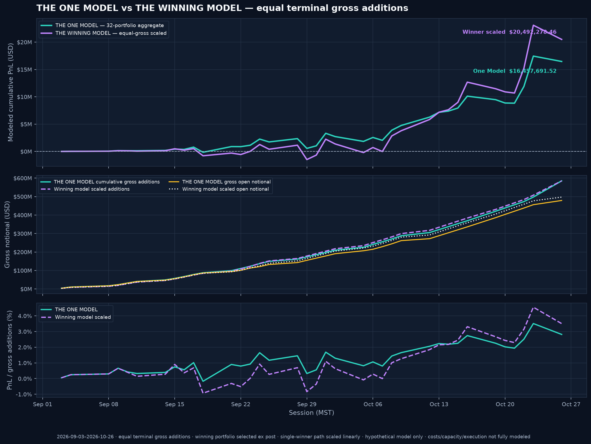
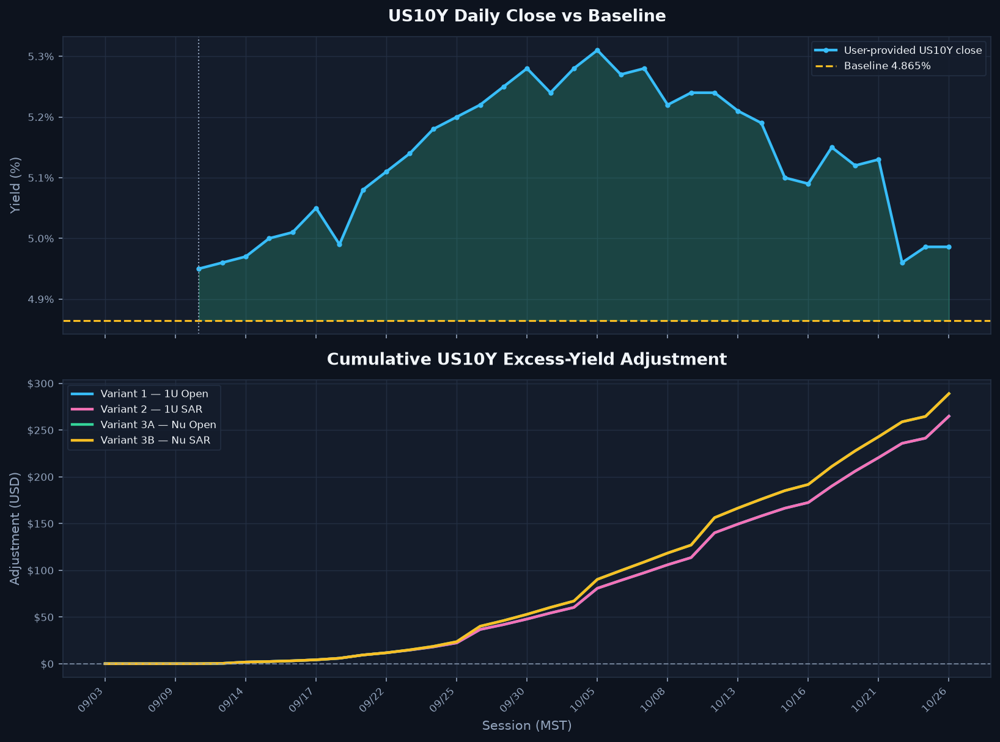
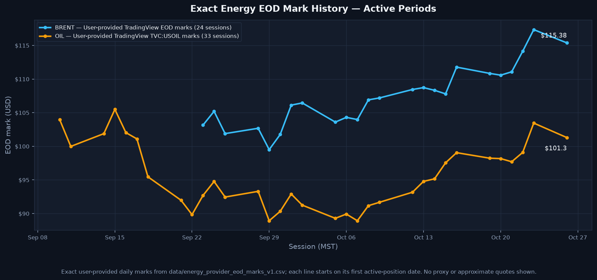
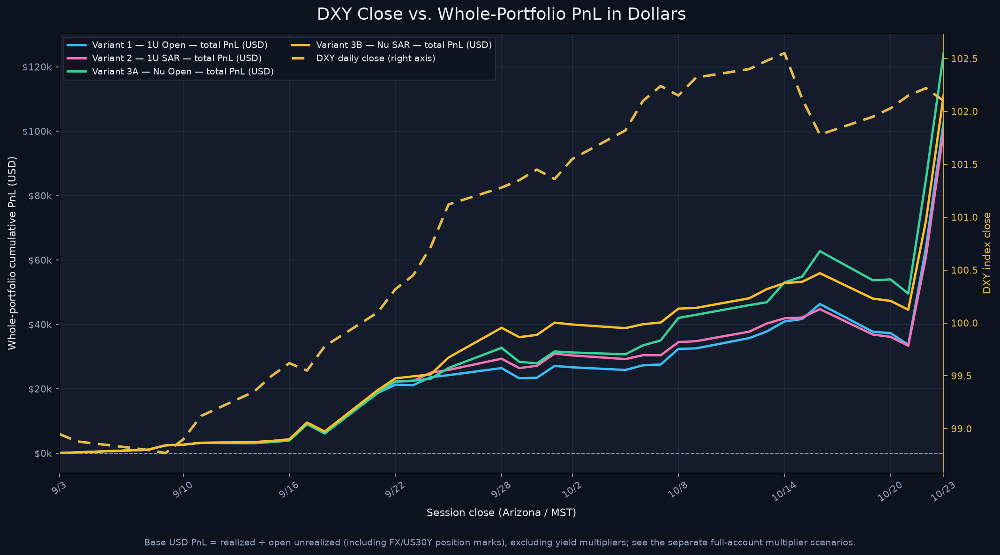
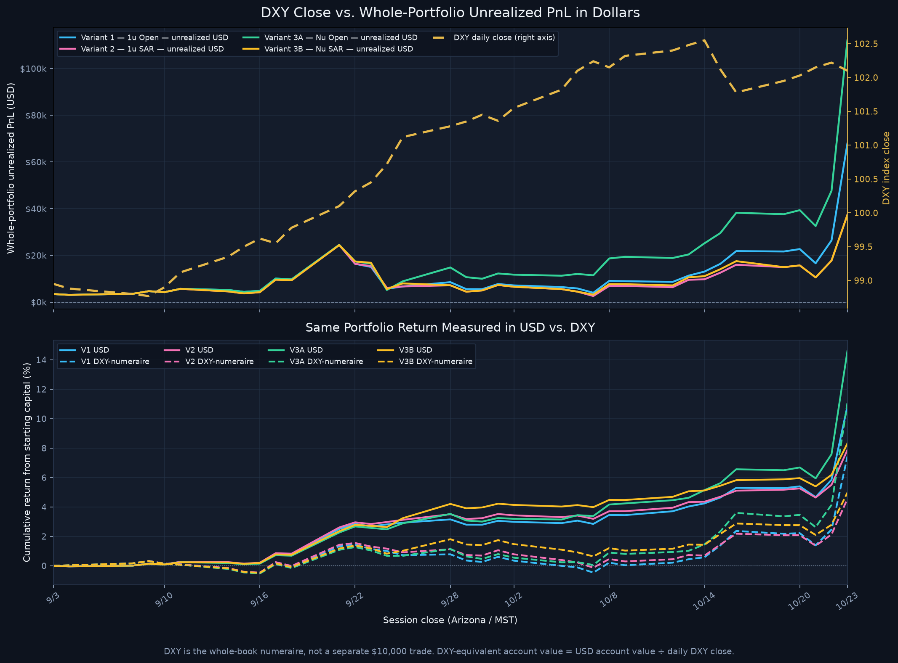
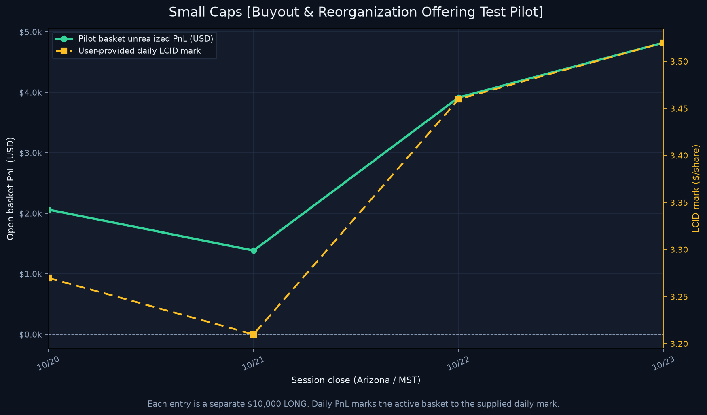

# THE ONE MODEL

*Equal-gross comparison with the top terminal-PnL constituent selected ex post from this same period; its daily path is scaled to match THE ONE MODEL's terminal gross additions. This is a hypothetical, selection-biased comparison—not out-of-sample evidence.*

> **TradingView-only model update — 2026-10-26.** Core results combine the 31 direct-price TradingView symbols with the integrated 1U/DAY/DXY currency-index sleeve across 37 common sessions. The Oct. 26 user-provided EOD update supplies all 31 core marks plus DXY at 102.017; the DXY sleeve adds one 1U tranche per active EOD in the charted direction and is not double-counted. BTC and ETH remain excluded pending recalibration. No legacy or substitute prices are used. XRH0’s five historical missing-session marks remain transparently carried forward, and its Oct. 26 close is supplied at 770.00. See [`data/tradingview_benchmark_coverage_20261026.csv`](data/tradingview_benchmark_coverage_20261026.csv), [`data/tradingview_benchmark_session_marks_20261026.csv`](data/tradingview_benchmark_session_marks_20261026.csv), and the [crypto pending page](Crypto%20Sidecar%20%E2%80%94%20Pending%20TradingView%20Recalibration.md).
> **Updated source archive:** the revised Part B ZIP changes LLY's Oct. 20 TradingView mark from `$12,833.66` to `$1,283.66`; all model results below use the revised source and have been regenerated. See [`research/notes/tradingview-benchmark-import-20261024.md`](research/notes/tradingview-benchmark-import-20261024.md) and the Part B manifest.

*Four-by-four Core × variant-specific 1U/EOD pairings, each tracked with and without its own energy sidecar; all 32 portfolios are summed without netting.*

*Aggregate of 32 independent portfolios; percentage is PnL ÷ gross notional added, not an account return.*

## Model Performance Comparison — *Fall (Arizona) [2026]*

Day-by-day (and, where market data supports it, intraday) comparison of the four portfolio models carried on the same standardized book: **[`trades/`](trades/)** / **[`trades.zip`](trades.zip)** — `31` direct-price core tickers plus the integrated 1U/DAY/DXY sleeve, `116` direct-price events plus `1` DXY direction signals out of `126` total 2026 log events (`9` other events outside scope; `0` direct events after cutoff), `1U = $10,000.00` standard notional, all timestamps in Arizona year-round **`MST` / `UTC-07:00`**, marked against the **Monday, October 26, 2026** EOD close. Intraday plots remain on their supplied Oct. 22 hourly scope.

> **Oil target-trim force-multiplier shorts:** separate hypothetical 10U SHORT lots in BRENT at $117 and OIL at $102 use the Oct. 23 target-level EOD marks as modeled entry triggers; intraday touches and fills are unverified. They were closed by modeled exits at $114.627 BRENT and $100.74 OIL on Oct. 25 at 20:35 MST. The exits follow the four earlier 10U replenishments and occur with separate 35U BRENT / 34U OIL approved orders. The buys are distinct LONG supply; covering shorts reduces short exposure and does not count as buy supply. The exits produce modeled realized short PnL of $2,028.21 BRENT + $1,235.29 OIL = $3,263.50 before costs, included once in the Oct. 26 replay and excluded from the preserved Oct. 23 baseline. After the short closures, the existing 65U BRENT + 66U OIL core longs plus the excess approved-order quantities produce 100U LONG per ticker in the core replay ($2,000,000 fixed-unit notional); gross exposure is not netted. All times/prices remain hypothetical model inputs, not verified brokerage executions.
> **Oil cost-basis savings:** realized target-trim PnL, modeled SHORT-exit PnL, and paired cash-out PnL are credited against tagged residual/replenishment lots as basis reclassifications—not additional profit. The Oct. 25 short exits and Oct. 26 paired cash-outs are included once in the current replay, while the preserved Oct. 23 baseline remains historical. The separate 35U BRENT and 34U OIL approved-order longs are not folded into the narrower 60U tagged basis-credit basket. See [`Oil Cost Basis Savings Model.md`](Oil%20Cost%20Basis%20Savings%20Model.md) and [`oil_cost_basis_savings_v1.csv`](data/oil_cost_basis_savings_v1.csv).
> **Core basis after closure credits:** the same economic basis-credit method is applied to current open BRENT, USOIL, META, and INTC model lots, including the user-reported paired 50U oil cash-out PnL credited against remaining oil longs and variant-specific INTC/META short-cover credits. Credits reclassify realized PnL; they do not create additional portfolio PnL. Brokerage basis and execution remain unverified. See [`Core Cost Basis After Closure Credits.md`](Core%20Cost%20Basis%20After%20Closure%20Credits.md), [`Oil Cost Basis Savings Model.md`](Oil%20Cost%20Basis%20Savings%20Model.md), and [`core_cost_basis_closure_credits_v1.csv`](data/core_cost_basis_closure_credits_v1.csv).

> **ATS / manual live-position reconciliation:** a separate ledger uses the tagged 50U-per-ticker Weekend Oil lots as a sizing proxy (ATS ceiling 40U, manual remainder 10U). Because the user-reported Oct. 23 ATS quantity is uncertain, matched ATS sales/shorts at $118 BRENT / $103.50 OIL are shown as 10U / 20U / 30U / 40U scenarios, with the Oct. 25 10U modeled covers attached as partial ATS covers. The earlier Oct. 23 10U trim/short records remain in this historical replay for audit continuity but are superseded—not stacked—in the new reconciliation. The four Oct. 25 10U replenishments are labeled **MANUAL LIVE TEST POSITIONS**; the 35U/34U orders are **MANUALLY APPROVED SHORT CLOSURE**, allocated to remaining ATS shorts first, with only any excess left long and counted as new buy supply in the reconciliation. The historical replay retains the earlier 69U long-buy treatment for audit continuity. The existing Oct. 26 ATS fixed-price LONG entries remain 50U each at $115 BRENT / $101 OIL (time unspecified); the user identifies a separate 50U ATS USOIL mirror LONG @ $101.11 at 07:51 MST, synchronized with the 50U manual BRENT entry and distinct from the earlier OIL @ $101.00 lot. Later user-reported additions are 10U per ticker via a manually approved ATS order ($115.025 BRENT / $100.96 OIL; date inferred from context, time unspecified), plus 16U BRENT @ $114.90 and 17U OIL @ $100.85 (date inferred, category/time unspecified), and a 50U manual BRENT LONG @ $115.51 at 07:51:14 MST from a TradingView screenshot (date inferred; LONG inferred from handwritten “PICK UP OPPORTUNITY”; not a verified fill). Under the maximum ATS short scenario, the tagged campaign totals 161U BRENT / 161U OIL. These scenario records do not modify the Oct. 23 core results or represent verified brokerage fills. See [`ATS and Manual Live Position Reconciliation.md`](ATS%20and%20Manual%20Live%20Position%20Reconciliation.md) and [`ats_manual_live_positions_v1.csv`](data/ats_manual_live_positions_v1.csv).
> **Interactive version:** open **[`Model Performance Explorer.html`](Model%20Performance%20Explorer.html)** for a self-contained explorer with toggleable series, a hover crosshair, and per-ticker breakdowns. Machine-readable exports live in [`data/`](data/): [`model_performance_daily.csv`](data/model_performance_daily.csv), [`model_performance_tickers.csv`](data/model_performance_tickers.csv), [`model_performance_summary.json`](data/model_performance_summary.json).
> **DXY and historical account views:** the 1U/DAY/DXY index-return sleeve is included once in every core variant. THE ONE MODEL adds its 10U/DAY DXY schedule to each of 32 portfolios (11U/DAY combined). The supplied 2026-10-26 DXY close is 102.017. The requested 40% withdrawal scenario is valued at $1,555,020.71 using the 385U pre-request allocation (154U / $1.54M basis); the Oct. 26 daily addition is excluded from that withdrawal base. It models up to $690,000 for the logged oil buys and $865,020.71 excess cash support, but no actual withdrawal or transfer is reported executed. Future DXY sizing remains 11U/DAY. Historical results through Oct. 23 remain preserved. See [`TradingView Energy and Currency Desk Sidecars.md`](TradingView%20Energy%20and%20Currency%20Desk%20Sidecars.md), [`data/dxy_withdrawal_scenario_v1.csv`](data/dxy_withdrawal_scenario_v1.csv), and [`data/dxy_cash_oil_bridge_v1.csv`](data/dxy_cash_oil_bridge_v1.csv). Do not add the 1U sleeve twice. The 0.05U schedule remains an alternative. The DXY-numeraire/yield views are separate sensitivities and may retain older FX/yield input coverage.
> **Small Caps pilot:** **[`Small Caps [Buyout & Reorganization Offering Test Pilot].md`](Small%20Caps%20%5BBuyout%20%26%20Reorganization%20Offering%20Test%20Pilot%5D.md)** tracks the five LCID entries; all five are included in the current four-model replay through Oct. 26.
> **Energy and DXY sizing:** **[`TradingView Energy and Currency Desk Sidecars.md`](TradingView%20Energy%20and%20Currency%20Desk%20Sidecars.md)** provides the standard energy sizes and DXY schedule audit. The DXY 1U/DAY series is included in core variants. THE ONE MODEL adds the 10U/DAY DXY schedule to every split portfolio (11U/DAY combined) and uses 11U/DAY energy tranches per active ticker in its 16 energy-inclusive portfolios. The strategy-comparison composites below retain their existing 10U energy schedule; 0.05U DXY remains an alternative. The user-specified 50U-long BRENT plus 50U-long USOIL Manual-Automatic entries and their targeted 10U trims are now included in all four core variants and flow into downstream core-based results. [`Weekend Oil 50U Position Hypothetical.md`](Weekend%20Oil%2050U%20Position%20Hypothetical.md) is a lot-level attribution of those same core lots, not an additional overlay.
> **Strategy and sidecar comparison:** **[`Strategy and Sidecar Comparison.md`](Strategy%20and%20Sidecar%20Comparison.md)** compares the existing variants, the fixed-$500/EOD and shared/variant-specific 1U/EOD force models, and additive composites using the 10U TradingView energy schedule.
> **How the models work:** **[`Model Calculation Guide.md`](Model%20Calculation%20Guide.md)** explains unit sizing, day-by-day lot handling, close/reversal behavior, and PnL formulas.

## The Four Models

| Model | Rule | Units deployed | Realized | Unrealized | Base PnL | Legacy additive US10Y carry (reference) | **Legacy adjusted PnL** | **Legacy adjusted ROI** |
|---|---|---:|---:|---:|---:|---:|---:|---:|
| **Variant 1 — 1U Open** | logged entry sizes; explicit exits close longs | 458.5U ($4,585,000) | $60,841.50 | $53,682.75 | $114,524.25 | $264.81 | **$114,789.06** | **2.50%** |
| **Variant 2 — 1U SAR** | V1 sizing plus LONG/REBUY closes open shorts | 458.5U ($4,585,000) | $58,243.65 | $53,682.74 | $111,926.39 | $264.81 | **$112,191.20** | **2.45%** |
| **Variant 3A — Nu Open** | V1 behavior; qualifying compounded shorts use preceding full-exit units | 467.5U ($4,675,000) | $82,153.31 | $53,682.75 | $135,836.06 | $288.94 | **$136,125.00** | **2.91%** |
| **Variant 3B — Nu SAR** | V2 behavior plus qualifying compounded shorts | 467.5U ($4,675,000) | $69,410.35 | $53,682.75 | $123,093.10 | $288.94 | **$123,382.04** | **2.64%** |

Displayed dollar components are rounded to cents and reconciled so realized plus unrealized equals Base PnL; legacy adjusted PnL equals displayed Base PnL plus the displayed carry. Unrounded replay values drive model calculations and charts.

## TradingView Benchmark and Alignment

The 31 directly priced core tickers use the normalized user-provided Part A and Part B TradingView lists plus the user-provided Oct. 26 EOD update, aligned to the 37-session common calendar. A 1U/DAY/DXY index-return sleeve, activated by charted direction, is integrated into each model total and deployed-notional denominator; DXY is not represented as a directly traded security or counted twice. The session marks and provenance are in [`tradingview_benchmark_session_marks_20261026.csv`](data/tradingview_benchmark_session_marks_20261026.csv), with the Oct. 26 inputs in [`tradingview_eod_marks_20261026.csv`](data/tradingview_eod_marks_20261026.csv); raw imported rows, coverage, and archive hashes are preserved alongside them. BTC and ETH have no marks in this core and remain pending recalibration.

**Provisional XRH0 convention:** five missing source sessions (`2026-09-15`, `2026-10-07`, `2026-10-08`, `2026-10-19`, and `2026-10-22`) carry forward the previous supplied TradingView close. Each row is explicitly flagged. No external or legacy price is inserted; revisit this convention if a different gap treatment is preferred.

Crypto status: [**Crypto Sidecar — Pending TradingView Recalibration**](Crypto%20Sidecar%20%E2%80%94%20Pending%20TradingView%20Recalibration.md). Energy schedules, DXY index-return assumptions, and standalone DXY sizing alternatives: [**TradingView Energy and Currency Desk Sidecars**](TradingView%20Energy%20and%20Currency%20Desk%20Sidecars.md). The 1U/DAY/DXY schedule from that page is already included in core PnL.

## Legacy Model-Level US10Y Additive Carry (Reference Only)

This inherited per-model additive overlay is retained for audit comparison, but it is not the active whole-portfolio blanket factor and is not included in the new DXY-view scenarios. Use the linked Whole Portfolio Yield Multiplier Explorer to compare the full account value with no yield factor, US10Y alone, and US10Y compounded with US30Y. This yield-based overlay is not a CPI inflation measure or Treasury total-return calculation. It treats the user-provided daily US10Y closes as annualized carry relative to the `4.865%` baseline from `2026-09-10`. For each interval, the adjustment is the model's cumulative deployed notional (the same denominator used for ROI; it does not fall after a position closes) × ((yield close − 4.865) / 100) × actual calendar days / 365. Values above baseline add positive adjustment; below baseline subtract. Per your confirmation, the Oct 9 close (5.24%) is carried across the Oct 12 Treasury holiday; the export records the original source date. The Oct 23 close (4.986%) is the latest supplied yield and is transparently carried to the Oct 26 session; the Oct 22-to-Oct 23 carry interval uses the Oct 22 close (4.96%) under the existing start-of-interval convention.

Session-level rates, forward-fill dates, actual/365 accruals, and adjusted totals: [`model_performance_us10y_adjustment.csv`](data/model_performance_us10y_adjustment.csv).

## TradingView Energy Sidecar

Brent and WTI core positions use the supplied aligned TradingView marks. Energy and DXY sizing alternatives are documented with per-session source flags in [`TradingView Energy and Currency Desk Sidecars.md`](TradingView%20Energy%20and%20Currency%20Desk%20Sidecars.md). The 1U/DAY/DXY index-return sleeve is already included in each core variant; do not add the 1U DXY schedule twice. Standard strategy composites add the 10U energy schedule. THE ONE MODEL separately uses 11U/DAY per active energy ticker in its 16 energy-inclusive portfolios; its derived machine-readable schedule is [`the_one_model_energy_11u_sidecar_daily_v1.csv`](data/the_one_model_energy_11u_sidecar_daily_v1.csv). Chart-opened core energy positions are shown separately and are not double-counted. Machine-readable standard schedules: [`tradingview_energy_sidecar_daily_20261026.csv`](data/tradingview_energy_sidecar_daily_20261026.csv) and [`dxy_currency_desk_sidecar_daily_20261026.csv`](data/dxy_currency_desk_sidecar_daily_20261026.csv).
**Integrated 1U/DAY/DXY sleeve (same across all four core variants):** 36 daily units, **$360,000.00** gross notional added, terminal proxy PnL **$+3,413.80**. This is already included in the four-model results above.

All four models agree on `27` of the `31` tickers. They diverge only on **`CAT`, `INTC`, `META` and `PLTR`** — the four symbols where a short is followed by a long (or a full exit is compounded into a short). Everything below is driven by those four.

## Headline Chart

**Reading it:** the models begin close together, then spread as the reversal-sensitive positions develop. At the latest supplied Oct. 26 close the base and legacy additive US10Y-adjusted rankings are **V3A > V3B > V1 > V2** and **V3A > V3B > V1 > V2**, respectively.

## Base Return on Capital

This chart shows base trading PnL before the legacy additive US10Y carry; the legacy adjusted ROI is shown for reference in the model table above and selectable in the interactive explorer. For whole-account factor scenarios, use the linked Yield Multiplier Explorer.

Raw dollars flatter V3A/V3B because they deploy more capital — `467.5` units (`$4,675,000.00`) against V1/V2's `458.5` units (`$4,585,000.00`). ROI normalises for that, and the terminal ranking is unchanged: compounding shorts into full exits beats flat sizing on both capital bases, and *not* stop-and-reversing beats stop-and-reversing on both.

## Day-by-Day Moves

| Session | V1 | V2 | V3A | V3B | Note |
|---|---:|---:|---:|---:|---|
| `2026-09-03` | +59.27 | +59.27 | +59.27 | +59.27 | Season open |
| `2026-09-04` | +220.34 | +220.34 | +220.34 | +220.34 |  |
| `2026-09-08` | +795.47 | +795.47 | +795.47 | +795.47 |  |
| `2026-09-09` | +1,369.90 | +1,369.90 | +1,369.90 | +1,369.90 |  |
| `2026-09-10` | +191.53 | +191.53 | +191.53 | +191.53 |  |
| `2026-09-11` | +601.19 | +601.19 | +601.19 | +601.19 |  |
| `2026-09-14` | -45.86 | +282.95 | -45.86 | +282.95 |  |
| `2026-09-15` | +404.96 | +364.40 | +404.96 | +364.40 |  |
| `2026-09-16` | +468.60 | +564.86 | +468.60 | +564.86 |  |
| `2026-09-17` | +4,993.41 | +5,096.16 | +4,993.41 | +5,096.16 |  |
| `2026-09-18` | -2,750.54 | -2,674.82 | -2,750.54 | -2,674.82 |  |
| `2026-09-21` | +12,567.08 | +12,861.82 | +12,567.08 | +12,861.82 |  |
| `2026-09-22` | +2,559.14 | +2,661.89 | +3,581.87 | +3,684.63 | widest split (V3B best, V1 worst) |
| `2026-09-23` | +95.27 | +463.02 | +491.78 | +859.53 | widest split (V3B best, V1 worst) |
| `2026-09-24` | +2,681.45 | +2,724.72 | +751.46 | +794.73 | widest split (V2 best, V3A worst) |
| `2026-09-25` | +684.88 | +933.61 | +3,414.32 | +5,289.65 | widest split (V3B best, V1 worst) |
| `2026-09-28` | +2,397.03 | +3,685.84 | +6,463.93 | +9,444.64 | widest split (V3B best, V1 worst) |
| `2026-09-29` | -3,106.04 | -2,849.06 | -4,279.05 | -2,849.06 | widest split (V2 best, V3A worst) |
| `2026-09-30` | +313.03 | +852.33 | -332.62 | +852.33 | widest split (V2 best, V3A worst) |
| `2026-10-01` | +3,638.52 | +3,771.89 | +3,671.91 | +3,771.89 |  |
| `2026-10-02` | -392.62 | -545.36 | -293.54 | -545.36 |  |
| `2026-10-05` | -660.79 | -965.85 | -391.10 | -965.85 | widest split (V3A best, V2 worst) |
| `2026-10-06` | +1,404.45 | +1,169.14 | +2,737.21 | +1,183.71 | widest split (V3A best, V2 worst) |
| `2026-10-07` | +317.60 | +32.36 | +1,609.59 | +606.09 | widest split (V3A best, V2 worst) |
| `2026-10-08` | +4,727.52 | +3,974.18 | +6,854.18 | +4,178.30 | widest split (V3A best, V2 worst) |
| `2026-10-09` | +216.74 | +349.29 | +1,031.49 | +299.68 | widest split (V3A best, V1 worst) |
| `2026-10-12` | +3,230.48 | +2,988.87 | +3,034.70 | +3,001.59 |  |
| `2026-10-13` | +2,038.33 | +2,516.12 | +870.61 | +2,823.63 | widest split (V3B best, V3A worst) |
| `2026-10-14` | +3,080.41 | +1,563.20 | +6,129.07 | +1,838.44 | widest split (V3A best, V2 worst) |
| `2026-10-15` | +514.60 | +23.27 | +1,576.89 | +177.54 | widest split (V3A best, V2 worst) |
| `2026-10-16` | +4,673.10 | +2,620.71 | +7,890.72 | +2,677.15 | widest split (V3A best, V2 worst) |
| `2026-10-19` | -8,537.33 | -7,830.20 | -8,969.63 | -7,816.55 | widest split (V3B best, V3A worst) |
| `2026-10-20` | -575.22 | -868.55 | +125.56 | -868.55 | widest split (V3A best, V2 worst) |
| `2026-10-21` | -3,665.40 | -2,746.32 | -4,408.17 | -2,746.32 | widest split (V2 best, V3A worst) |
| `2026-10-22` | +30,024.23 | +27,437.84 | +35,323.21 | +27,437.84 | widest split (V3A best, V3B worst) |
| `2026-10-23` | +39,056.55 | +39,052.04 | +39,115.00 | +39,052.04 |  |
| `2026-10-26` | +10,932.99 | +11,178.33 | +10,961.31 | +11,178.33 | Terminal mark |

## Where the Models Diverge

- **Stop-and-reverse (V1 − V2) ends at $2,597.85; (V3A − V3B) ends at $12,742.96.**
- **Compounding (V3A − V1) ends at $21,311.81** — the single largest structural effect in the book.

## Risk — Drawdown from Running Peak

| Model | Peak | Peak day | Trough | Trough day | Max drawdown | Max DD day | Best day | Worst day |
|---|---:|---|---:|---:|---|---:|---|---:|
| **Variant 1 — 1U Open** | $114,524.25 | `2026-10-26` | $59.27 | `2026-09-03` | -$12,777.95 | `2026-10-21` | $39,056.55 (`2026-10-23`) | -$8,537.33 (`2026-10-19`) |
| **Variant 2 — 1U SAR** | $111,926.39 | `2026-10-26` | $59.27 | `2026-09-03` | -$11,445.07 | `2026-10-21` | $39,052.04 (`2026-10-23`) | -$7,830.20 (`2026-10-19`) |
| **Variant 3A — Nu Open** | $135,836.06 | `2026-10-26` | $59.27 | `2026-09-03` | -$13,252.24 | `2026-10-21` | $39,115.00 (`2026-10-23`) | -$8,969.63 (`2026-10-19`) |
| **Variant 3B — Nu SAR** | $123,093.10 | `2026-10-26` | $59.27 | `2026-09-03` | -$11,431.43 | `2026-10-21` | $39,052.04 (`2026-10-23`) | -$7,816.55 (`2026-10-19`) |

## Terminal Composition

| Model | Realized (closed) | Unrealized (open) | Closed lots | Open lots |
|---|---:|---:|---:|---:|
| **Variant 1 — 1U Open** | $60,841.50 | $53,682.75 | 29 | 108 |
| **Variant 2 — 1U SAR** | $58,243.65 | $53,682.74 | 29 | 108 |
| **Variant 3A — Nu Open** | $82,153.31 | $53,682.75 | 30 | 108 |
| **Variant 3B — Nu SAR** | $69,410.35 | $53,682.75 | 29 | 108 |

## Contribution by Ticker

### The four divergence tickers

| Ticker | V1 | V2 | V3A | V3B |
|---|---:|---:|---:|---:|
| `CAT` | $3,458.81 | $3,034.15 | $5,446.08 | $4,596.77 |
| `INTC` | $14,222.71 | $11,383.61 | $26,671.77 | $18,435.77 |
| `META` | $9,568.26 | $8,487.37 | $16,443.73 | $11,039.29 |
| `PLTR` | $1,888.38 | $3,635.18 | $1,888.38 | $3,635.18 |

### Top contributors (V3A)

| Ticker | Units | Realized | Unrealized | **Total** |
|---|---:|---:|---:|---:|
| `BRENT` | 170U | $15,263.89 | $20,799.95 | **$36,063.84** |
| `OIL` | 170U | $12,136.16 | $16,112.31 | **$28,248.47** |
| `INTC` | 20U | $28,911.54 | -$2,239.77 | **$26,671.77** |
| `META` | 14U | $19,024.70 | -$2,580.97 | **$16,443.73** |
| `LMT` | 4U | $0.00 | $9,402.64 | **$9,402.64** |
| `CAT` | 5U | $5,959.39 | -$513.31 | **$5,446.08** |
| `DXY` | 36U | $0.00 | $3,413.80 | **$3,413.80** |
| `CVX` | 3U | $0.00 | $3,234.46 | **$3,234.46** |
| `LCID` | 5U | $0.00 | $2,953.35 | **$2,953.35** |
| `SPCX` | 4U | $0.00 | $2,632.11 | **$2,632.11** |

Ticker units preserve fractional logged sizes. Each ticker total equals its cent-rounded realized plus unrealized components; summing independently rounded ticker rows can differ from the unrounded model total by a few cents.

### Bottom contributors (V3A)

| Ticker | Units | Realized | Unrealized | **Total** |
|---|---:|---:|---:|---:|
| `RIVN` | 2U | $0.00 | -$2,295.86 | **-$2,295.86** |
| `UPS` | 3U | $0.00 | -$1,289.60 | **-$1,289.60** |
| `GEV` | 2U | $0.00 | -$1,124.55 | **-$1,124.55** |
| `DIS` | 3U | -$310.50 | -$603.75 | **-$914.25** |
| `TSLA` | 1U | -$720.26 | $0.00 | **-$720.26** |
| `NVDA` | 1U | $0.00 | -$591.92 | **-$591.92** |
| `NFLX` | 1U | $0.00 | -$471.22 | **-$471.22** |
| `AMZN` | 1U | $0.00 | -$369.32 | **-$369.32** |
| `XRH0` | 1U | $0.00 | -$253.16 | **-$253.16** |
| `ORCL` | 3.5U | $0.00 | -$123.53 | **-$123.53** |

## Intraday — Hour by Hour

Daily closes hide *when* inside a session the models pull apart. Zooming to **hourly bars** (7 per session: `06:30`→`13:00 MST`) resolves that.

> **Scope:** the intraday view covers **`CAT`, `INTC`, `META` and `PLTR`** — the divergence sub-book. The other `27` tickers produce byte-identical PnL under all four models, so they cancel exactly out of every comparison below. Every number here is therefore *exact*, not interpolated.

### Terminal, divergence sub-book only

| Model | Realized | Unrealized | **Sub-book total** |
|---|---:|---:|---:|
| **Variant 1 — 1U Open** | $25,871.93 | $1,195.66 | **$27,067.59** |
| **Variant 2 — 1U SAR** | $31,696.07 | -$7,467.17 | **$24,228.90** |
| **Variant 3A — Nu Open** | $25,871.93 | $22,420.70 | **$48,292.63** |
| **Variant 3B — Nu SAR** | $42,862.77 | -$7,467.17 | **$35,395.60** |

The sub-book totals differ from the full-portfolio totals above by exactly the 27 invariant tickers, which contribute the same amount to every model.

### The regime flips

| Spread | First > 0 | Stays > 0 from | Peak | Trough | Terminal |
|---|---|---|---:|---:|---:|
| **V1-V2** | `10-15 07:30 MST` | `10-16 07:30 MST` | $2,861.47 @ `10-22 12:30 MST` | -$4,916.98 @ `10-02 07:30 MST` | **$2,838.69** |
| **V3A-V3B** | `10-14 09:30 MST` | `10-14 13:00 MST` | $13,114.19 @ `10-22 11:30 MST` | -$11,985.25 @ `10-02 07:30 MST` | **$12,897.03** |
| **V3A-V1** | `09-22 13:00 MST` | `09-25 07:30 MST` | $21,433.86 @ `10-22 11:30 MST` | -$510.75 @ `09-24 13:00 MST` | **$21,225.04** |
| **V3B-V2** | `09-22 13:00 MST` | `09-25 07:30 MST` | $11,345.49 @ `10-15 07:30 MST` | -$510.75 @ `09-24 13:00 MST` | **$11,166.70** |

**What this says — stop-and-reverse is a help early and a drag late.** Both spreads open the season deeply *negative*, meaning the **SAR books lead** out of the gate: at `10-02 07:30 MST` `V2` is ahead of `V1` by $4,916.98 and `V3B` is ahead of `V3A` by $11,985.25 — the widest SAR lead of the whole season, on the same bar. Flipping a position instead of stacking a new one protects capital while prices run *against* the earlier direction.

That lead then erodes as the trend matures, and the **open books take over for good in the `Oct 14`–`Oct 16` window**: `V3A − V3B` first prints positive at `10-14 09:30 MST` and never looks back from `10-14 13:00 MST`; `V1 − V2` flips a day later and holds from `10-16 07:30 MST`. Once the moves are directional, reversing out of the original entry throws away the winner — which is why the two spreads end the season on opposite sides of zero, and `4.5×` apart in magnitude.

Compounding shorts into full exits, by contrast, is unambiguous: `V3A − V1` turns positive on `09-22 13:00 MST` — the moment the `INTC` `5-unit` full exit at `$127.11` is compounded — and never crosses back.

### Which ticker drives each edge

Intraday per-ticker contribution at the Oct 22 close (the hourly archive has no Oct 23 bars):

| Ticker | V1 | V2 | V3A | V3B | Intraday peak bar (V3A) |
|---|---:|---:|---:|---:|---|
| `CAT` | $1,507.94 | -$349.93 | $3,365.81 | -$349.93 | `10-15 07:30 MST` |
| `INTC` | $188.67 | -$5,658.85 | $13,285.99 | -$5,658.85 | `10-22 13:00 MST` |
| `META` | -$401.02 | -$1,968.48 | $5,868.83 | -$1,968.48 | `09-24 12:30 MST` |
| `PLTR` | -$99.94 | $510.09 | -$99.94 | $510.09 | `10-09 13:00 MST` |

Full per-bar series: [`model_performance_intraday.csv`](data/model_performance_intraday.csv) (245 rows).

## Supplemental Portfolio, Pilot, and Sidecar Graphs

The following views extend beyond the four core direct-price variants. They use distinct account bases or sidecar schedules where noted; they are not all on a common capital base, and their positions/capital must not be netted or stacked implicitly.

### Whole-Portfolio DXY Numeraire and Yield Scenarios

> **Historical only—not recalculated on the current TradingView core.** The DXY-numeraire and yield-multiplier graphs below retain their previous portfolio benchmark and must not be read as current results. The current 1U/DAY/DXY index-return sleeve is integrated into the core; its sizing alternatives are in [`TradingView Energy and Currency Desk Sidecars.md`](TradingView%20Energy%20and%20Currency%20Desk%20Sidecars.md).

### LCID Small-Caps Pilot

The five-entry LCID pilot is already included in the four-model replay through the supplied Oct. 26 mark; this graph is a focused component view, not another add-on to the core totals. See [`Small Caps [Buyout & Reorganization Offering Test Pilot].md`](Small%20Caps%20%5BBuyout%20%26%20Reorganization%20Offering%20Test%20Pilot%5D.md) for entry and mark details.

### TradingView Energy and Currency Desk Sidecars

The sidecar report presents 0.05U, 1U, and 10U sizing schedules. The chart-directed 1U/DAY/DXY index-return sleeve is integrated in every core variant; THE ONE MODEL adds the 10U schedule to each split portfolio, while 0.05U remains an alternative. Strategy-comparison composites retain their original scope and add the 10U energy schedule, not the DXY 10U schedule. See [`TradingView Energy and Currency Desk Sidecars.md`](TradingView%20Energy%20and%20Currency%20Desk%20Sidecars.md).

*The three panels show 0.05U, 1U, and 10U daily-lot PnL paths on separate scales. The 1U schedule is already included in core PnL; THE ONE MODEL adds the 10U schedule to every split portfolio (11U/DAY combined), while 0.05U remains an alternative.*

The user-specified 50U-long BRENT and 50U-long USOIL Manual-Automatic lots were added to each core variant at the supplied Oct. 19 TradingView marks, with 10U target trims at $117 and $102 respectively. Their first recorded EOD marks at/above target are on Oct. 23; the daily closes do not verify an intraday touch or fill. The lots are included in the core replay and downstream aggregates; [`Weekend Oil 50U Position Hypothetical.md`](Weekend%20Oil%2050U%20Position%20Hypothetical.md) isolates their PnL for attribution only. Existing separate 1U core lots are not trimmed.

### EOD Add-On and Variant-Specific 1U/EOD Comparisons

The fixed-$500/EOD model and 1U/EOD alternatives are separate model families, not stacked on top of one another. The broad comparison distinguishes standalone results from additive composites; composites sum PnL and gross notionals without netting positions or capital. See [`Strategy and Sidecar Comparison.md`](Strategy%20and%20Sidecar%20Comparison.md) and [`Model Calculation Guide.md`](Model%20Calculation%20Guide.md) for full rules and tables.

The next chart contains all **16 Core × variant-specific 1U/EOD pairings**, including matching and cross-variant pairs, each with the 10U TradingView energy daily-buy sidecar. These are additive USD totals; positions and capital are not netted, and the core's chart-opened energy lots are not duplicated in the sidecar.

The percentage-gain view plots all **32 series**: the same 16 Core × 1U pairings, each with and without the energy sidecar. Gain is cumulative PnL divided by cumulative gross notional added—a deployed-notional ratio, **not an account return**. Only the top four terminal performers are named in the legend; all 32 are plotted. The earlier **8.88% static single-composite proxy is not a result for this 32-portfolio split**. The leading terminal ratios are Core V3A + 1U V3A with energy sidecar, **3.93%**; Core V3A + 1U V3B with energy sidecar, **3.88%**; Core V3B + 1U V3A with energy sidecar, **3.85%**; Core V3A + 1U V2 with energy sidecar, **3.83%**.

## Method & Caveats

- **Model coverage:** the four variants directly price `31` TradingView tickers and include the chart-directed 1U/DAY/DXY index-return sleeve. `116` direct-price trade events plus `1` DXY direction signal are in scope through `2026-10-26`; `0` direct-price events after the latest mark are excluded. `9` other BTC, ETH, EURUSD, JPYUSD, US10Y, and US30Y log events are not replayed as direct-price positions. The two US10Y events establish yield-adjustment context; this report's additive carry is retained only as a legacy reference. Whole-account US10Y and compounded US30Y multiplier scenarios remain historical. DXY uses an index-return proxy, not an exchange-traded contract model.
- **Price source:** direct-price core marks use the normalized user-provided TradingView Part A/Part B lists plus the 2026-10-26 user-provided update in [`data/tradingview_eod_marks_20261026.csv`](data/tradingview_eod_marks_20261026.csv), aligned in [`data/tradingview_benchmark_session_marks_20261026.csv`](data/tradingview_benchmark_session_marks_20261026.csv). DXY's 1U/day proxy uses the supplied TradingView index marks, including the 2026-10-26 close of 102.017, and the charted direction signal; it is integrated into core totals once, not treated as a directly traded security. BTC/ETH remain pending and outside the core. Five historical XRH0 sessions use the last prior supplied TradingView close, with each carry-forward row explicitly flagged; its 2026-10-26 close is supplied at 770.00. No Yahoo or historical-series fill is used.
- **Benchmark provenance and alignment:** Part A and Part B raw observations, per-ticker coverage, and archive hashes are preserved in the paired CSV/JSON artifacts under `data/`. DXY is marked separately from the 31 direct-price tickers but its chart-directed 1U/day proxy is integrated into this core portfolio. EURUSD, JPYUSD, US10Y, and US30Y remain outside. Do not interpret the historical whole-portfolio DXY/yield pages as recalculated from this benchmark.
- **Session calendar:** `37` U.S. equity regular sessions from `2026-09-03` to `2026-10-26`. DXY index marks align to the same sessions; BTC/ETH remain excluded pending recalibration.
- **XRH0 interim marks:** the source list omits five common sessions (`2026-09-15`, `2026-10-07`, `2026-10-08`, `2026-10-19`, and `2026-10-22`). Those are carried forward from the prior supplied TradingView close and flagged in the session-mark CSV; no external price is inserted. Treat its interim path as provisional.
- **Performance scope:** logged core trade entries/exits retain their chart-posting prices; the additional DXY sleeve adds 1U at each active EOD in the latest charted direction, marked to the supplied TradingView index close. The integrated core totals therefore include DXY daily-investment PnL and notional. Historical whole-account/yield outputs and the master ledger are not recalculated by this run.
- **ROI** is cumulative PnL divided by notional deployed *to date* (units opened on or before that session × 1U standard notional), so early sessions show larger percentages on less capital.
- **Open units** are units still held at each session close; they decline when a position closes. This differs from cumulative units deployed, which continues to include previously closed units.
- **All-actionable-ticker audit:** an independent replay reconciles all 31 TradingView-priced core tickers, the integrated 1U/DAY/DXY sleeve, energy/DXY sizing schedules, position exports, and all 32 portfolio aggregates. See the current [`data/actionable_ticker_reconciliation_20261026_v1.csv`](data/actionable_ticker_reconciliation_20261026_v1.csv) audit output.
- Entry fills use the chart-posting prices recorded in the trade log, not later minute or session closes; the Sep. 24 INTC short uses the chart-posting price `$115.11`. Exits are realised on their log date.
- Excludes commissions, borrow fees, and overnight financing.

---

Master ledger: **[`Trades Zip PnL.md`](Trades%20Zip%20PnL.md)** · Chart-signal report: **[`Triangle Signals.md`](Triangle%20Signals.md)** · Visual book: **[`Unrealized PnL.md`](Unrealized%20PnL.md)** · Pre-2026: **[`2024 Trades PnL.md`](reports/2024/2024%20Trades%20PnL.md)**
