# Model Performance Comparison — *Fall (Arizona) [2026]*

Day-by-day (and, where market data supports it, intraday) comparison of the four portfolio models carried on the same standardized book: **[`trades/`](trades/)** / **[`trades.zip`](trades.zip)** — `32` symbols, `77` standardized log lines, `1 unit = $10,000.00` initial notional, all timestamps in Arizona year-round **`MST` / `UTC-07:00`**, marked against the **Thursday, October 22, 2026** close.

> **Interactive version:** open **[`Model Performance Explorer.html`](Model%20Performance%20Explorer.html)** for a self-contained explorer with toggleable series, a hover crosshair, and per-ticker breakdowns. Machine-readable exports live in [`data/`](data/): [`model_performance_daily.csv`](data/model_performance_daily.csv), [`model_performance_tickers.csv`](data/model_performance_tickers.csv), [`model_performance_summary.json`](data/model_performance_summary.json).

## The Four Models

| Model | Rule | Units deployed | Realized | Unrealized | **Total PnL** | **ROI** |
|---|---|---:|---:|---:|---:|---:|
| **Variant 1 — 1u Open** | every line is 1 unit; positions stay open | 72u ($720,000) | $23,083.77 | $20,319.85 | **$43,403.62** | **6.03%** |
| **Variant 2 — 1u SAR** | every line is 1 unit; LONG/REBUY stops-and-reverses open shorts | 72u ($720,000) | $28,907.91 | $11,657.03 | **$40,564.93** | **5.63%** |
| **Variant 3A — Nu Open** | compounded shorts sized to the preceding full exit; positions stay open | 81u ($810,000) | $23,083.77 | $41,544.89 | **$64,628.66** | **7.98%** |
| **Variant 3B — Nu SAR** | compounded shorts *and* stop-and-reverse | 81u ($810,000) | $40,074.61 | $11,657.03 | **$51,731.64** | **6.39%** |

All four models agree on `28` of the `32` tickers. They diverge only on **`CAT`, `INTC`, `META` and `PLTR`** — the four symbols where a short is followed by a long (or a full exit is compounded into a short). Everything below is driven by those four.

## Headline Chart

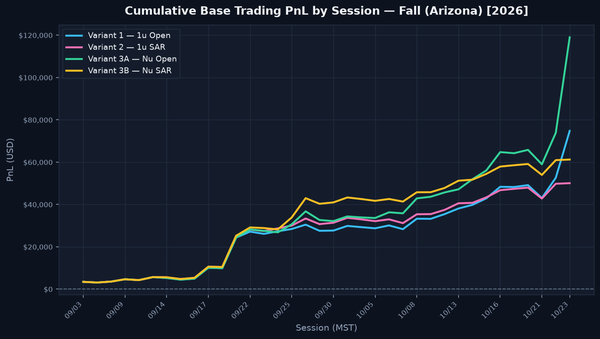

**Reading it:** all four models track each other almost exactly for the first four weeks, then fan out in October. Ranking is stable from `Oct 6` onward: **V3A > V3B > V1 > V2** on absolute dollars.

## Return on Capital

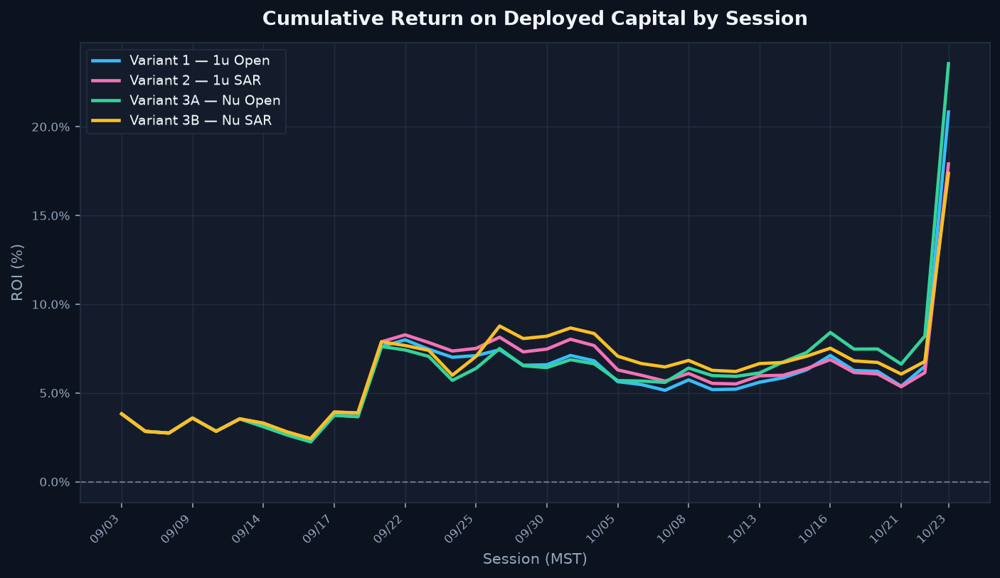

Raw dollars flatter V3A/V3B because they deploy more capital — `81` units (`$810,000`) against V1/V2's `72` units (`$720,000`). ROI normalises for that, and the ranking is unchanged: compounding shorts into full exits beats flat sizing on both capital bases, and *not* stop-and-reversing beats stop-and-reversing on both.

## Day-by-Day Moves

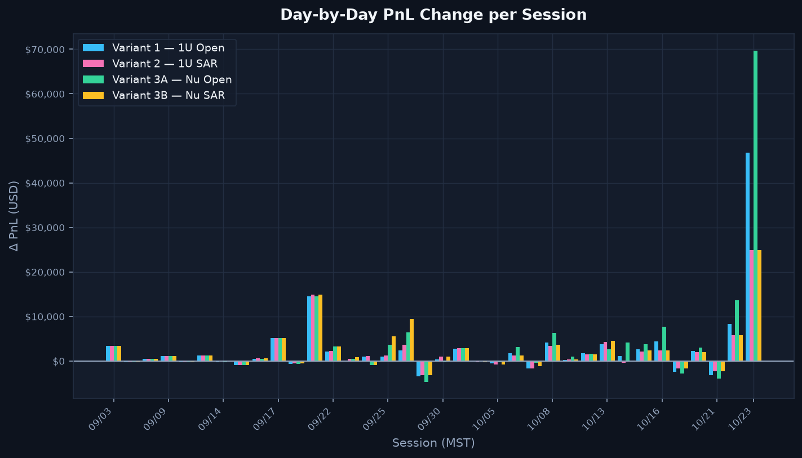

| Session | V1 | V2 | V3A | V3B | Note |
|---|---:|---:|---:|---:|---|
| `2026-09-03` | +3,439.92 | +3,439.92 | +3,439.92 | +3,439.92 | Season open |
| `2026-09-04` | -781.98 | -781.98 | -781.98 | -781.98 |  |
| `2026-09-08` | +497.98 | +497.98 | +497.98 | +497.98 |  |
| `2026-09-09` | +447.03 | +447.03 | +447.03 | +447.03 |  |
| `2026-09-10` | -794.70 | -794.70 | -794.70 | -794.70 |  |
| `2026-09-11` | +1,588.67 | +1,588.67 | +1,588.67 | +1,588.67 |  |
| `2026-09-14` | -817.03 | -488.22 | -817.03 | -488.22 |  |
| `2026-09-15` | -1,321.03 | -1,361.59 | -1,321.03 | -1,361.59 |  |
| `2026-09-16` | +764.76 | +861.02 | +764.76 | +861.02 |  |
| `2026-09-17` | +5,059.46 | +5,162.22 | +5,059.46 | +5,162.22 |  |
| `2026-09-18` | +222.98 | +298.69 | +222.98 | +298.69 |  |
| `2026-09-21` | +13,709.56 | +14,004.30 | +13,709.56 | +14,004.30 |  |
| `2026-09-22` | +3,001.57 | +3,104.32 | +4,024.30 | +4,127.06 | widest split (V3B best, V1 worst) |
| `2026-09-23` | -927.95 | -560.21 | -531.45 | -163.70 | widest split (V3B best, V1 worst) |
| `2026-09-24` | +475.40 | +518.66 | -1,454.59 | -1,411.33 | widest split (V2 best, V3A worst) |
| `2026-09-25` | +1,526.59 | +1,775.33 | +4,256.03 | +6,131.36 | widest split (V3B best, V1 worst) |
| `2026-09-28` | +2,019.86 | +3,308.67 | +6,086.76 | +9,067.46 | widest split (V3B best, V1 worst) |
| `2026-09-29` | -2,228.36 | -1,971.37 | -3,401.37 | -1,971.37 | widest split (V2 best, V3A worst) |
| `2026-09-30` | -107.05 | +432.25 | -752.70 | +432.25 | widest split (V2 best, V3A worst) |
| `2026-10-01` | +1,691.02 | +1,824.39 | +1,724.41 | +1,824.39 |  |
| `2026-10-02` | -218.39 | -371.13 | -119.32 | -371.13 |  |
| `2026-10-05` | +395.35 | +90.30 | +665.05 | +90.30 | widest split (V3A best, V2 worst) |
| `2026-10-06` | +1,284.58 | +778.86 | +2,617.34 | +793.43 | widest split (V3A best, V2 worst) |
| `2026-10-07` | -1,390.08 | -1,404.92 | -98.10 | -831.20 | widest split (V3A best, V2 worst) |
| `2026-10-08` | +3,577.96 | +2,824.62 | +5,704.62 | +3,028.74 | widest split (V3A best, V2 worst) |
| `2026-10-09` | -189.65 | -57.09 | +625.10 | -106.70 | widest split (V3A best, V1 worst) |
| `2026-10-12` | +1,509.64 | +1,268.03 | +1,313.86 | +1,280.76 |  |
| `2026-10-13` | +2,521.44 | +2,999.23 | +1,353.72 | +3,306.74 | widest split (V3B best, V3A worst) |
| `2026-10-14` | +1,264.04 | -253.17 | +4,312.70 | +22.07 | widest split (V3A best, V2 worst) |
| `2026-10-15` | +2,628.81 | +2,137.49 | +3,691.11 | +2,291.76 | widest split (V3A best, V2 worst) |
| `2026-10-16` | +4,087.88 | +2,035.56 | +7,305.25 | +2,092.00 | widest split (V3A best, V2 worst) |
| `2026-10-19` | -497.97 | +207.67 | -924.29 | +221.31 | widest split (V3B best, V3A worst) |
| `2026-10-20` | -782.98 | -1,074.87 | -87.92 | -1,074.87 | widest split (V3A best, V2 worst) |
| `2026-10-21` | -4,490.58 | -3,571.51 | -5,233.35 | -3,571.51 | widest split (V2 best, V3A worst) |
| `2026-10-22` | +6,236.86 | +3,650.47 | +11,535.85 | +3,650.47 | Terminal mark; widest split (V3A best, V2 worst) |

## Where the Models Diverge

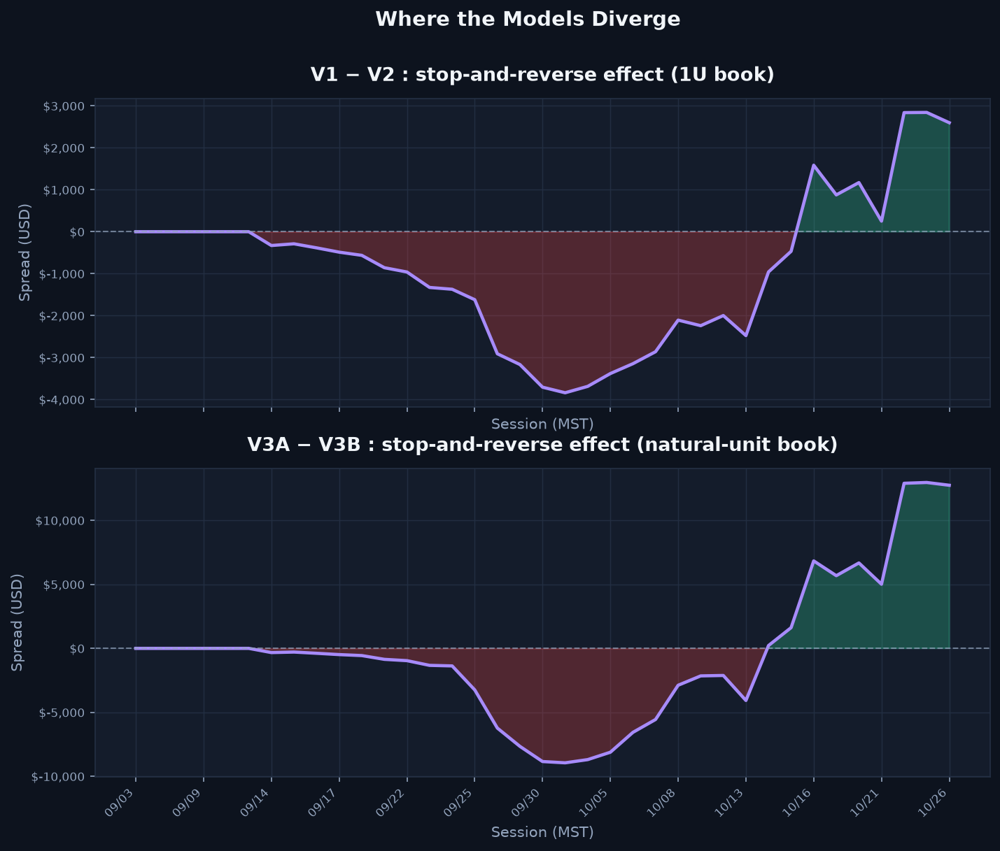

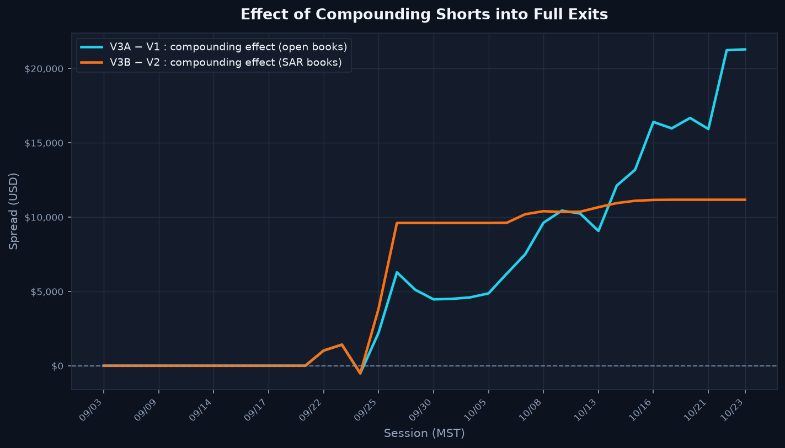

- **Stop-and-reverse (V1 − V2) ends at $2,838.69; (V3A − V3B) ends at $12,897.03.**
- **Compounding (V3A − V1) ends at $21,225.04** — the single largest structural effect in the book.

## Risk — Drawdown from Running Peak

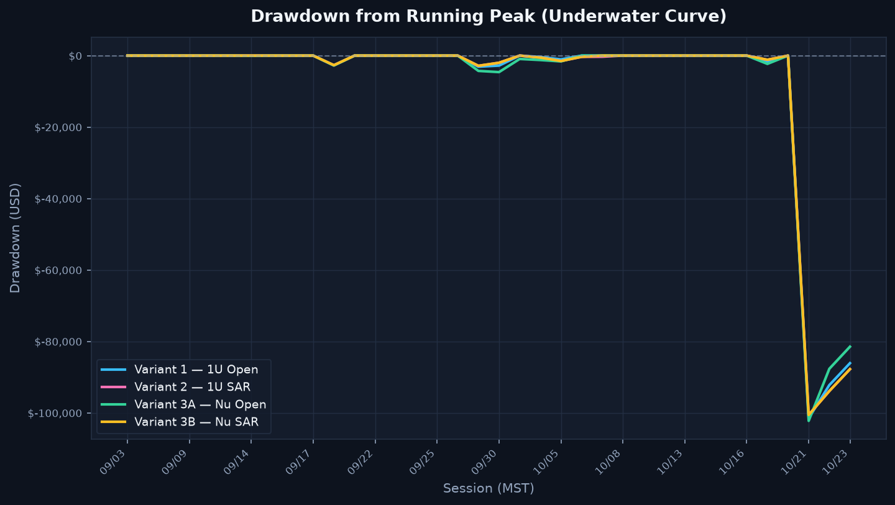

| Model | Peak | Peak day | Trough | Trough day | Max drawdown | Max DD day | Best day | Worst day |
|---|---:|---|---:|---:|---|---:|---|---:|
| **Variant 1 — 1u Open** | $43,403.62 | `2026-10-22` | $2,258.87 | `2026-09-15` | -$5,771.53 | `2026-10-21` | $13,709.56 (`2026-09-21`) | -$4,490.58 (`2026-10-21`) |
| **Variant 2 — 1u SAR** | $41,560.84 | `2026-10-19` | $2,547.12 | `2026-09-15` | -$4,646.38 | `2026-10-21` | $14,004.30 (`2026-09-21`) | -$3,571.51 (`2026-10-21`) |
| **Variant 3A — Nu Open** | $64,628.66 | `2026-10-22` | $2,258.87 | `2026-09-15` | -$6,245.56 | `2026-10-21` | $13,709.56 (`2026-09-21`) | -$5,233.35 (`2026-10-21`) |
| **Variant 3B — Nu SAR** | $52,727.54 | `2026-10-19` | $2,547.12 | `2026-09-15` | -$4,646.38 | `2026-10-21` | $14,004.30 (`2026-09-21`) | -$3,571.51 (`2026-10-21`) |

## Terminal Composition

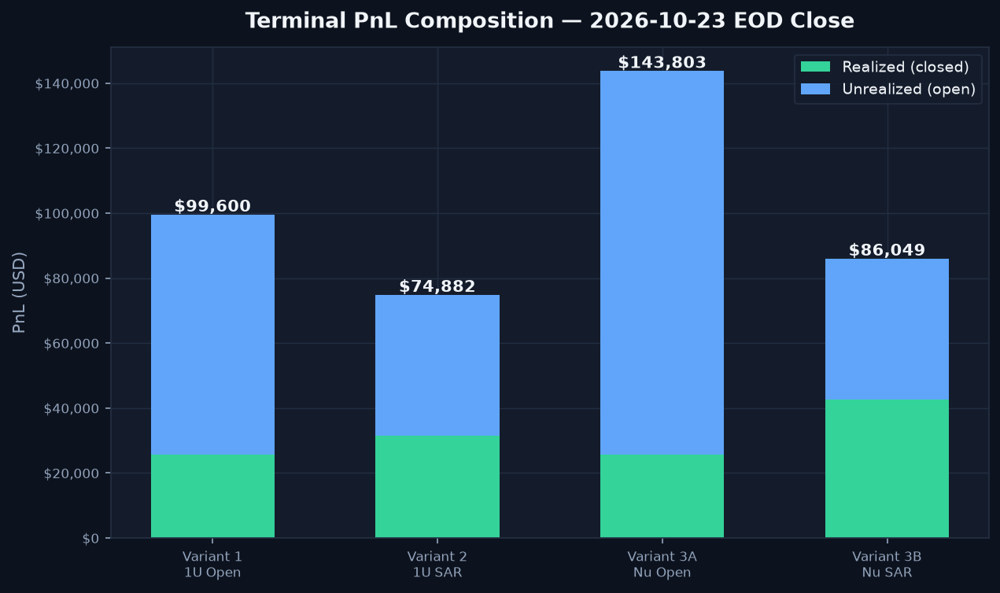

| Model | Realized (closed) | Unrealized (open) | Closed lots | Open lots |
|---|---:|---:|---:|---:|
| **Variant 1 — 1u Open** | $23,083.77 | $20,319.85 | 14 | 58 |
| **Variant 2 — 1u SAR** | $28,907.91 | $11,657.03 | 19 | 53 |
| **Variant 3A — Nu Open** | $23,083.77 | $41,544.89 | 14 | 58 |
| **Variant 3B — Nu SAR** | $40,074.61 | $11,657.03 | 19 | 53 |

## Contribution by Ticker

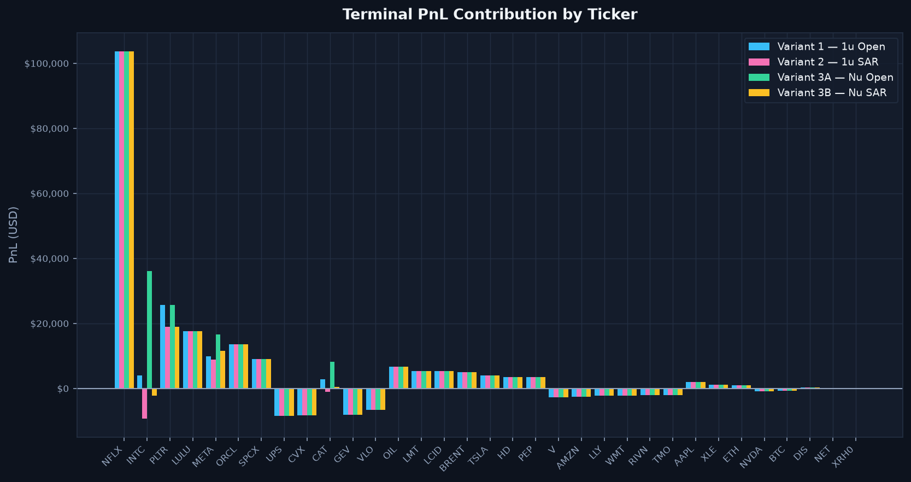

### The four divergence tickers

| Ticker | V1 | V2 | V3A | V3B |
|---|---:|---:|---:|---:|
| `CAT` | $3,492.78 | $3,197.53 | $5,350.65 | $4,760.15 |
| `INTC` | $11,144.66 | $7,964.53 | $24,241.98 | $15,016.69 |
| `META` | $7,551.68 | $6,622.19 | $13,821.53 | $9,174.11 |
| `PLTR` | $2,400.81 | $3,966.98 | $2,400.81 | $3,966.98 |

### Top contributors (V3A)

| Ticker | Units | Realized | Unrealized | **Total** |
|---|---:|---:|---:|---:|
| `INTC` | 14u | $10,955.99 | $13,285.99 | **$24,241.98** |
| `META` | 12u | $7,952.70 | $5,868.83 | **$13,821.53** |
| `LMT` | 4u | $0.00 | $5,880.21 | **$5,880.21** |
| `CAT` | 5u | $1,984.84 | $3,365.81 | **$5,350.65** |
| `OIL` | 4u | $0.00 | $3,219.53 | **$3,219.53** |
| `SPCX` | 3u | $0.00 | $2,929.12 | **$2,929.12** |
| `BTC` | 2u | $0.00 | $2,920.54 | **$2,920.54** |
| `BRENT` | 4u | $0.00 | $2,437.10 | **$2,437.10** |
| `PLTR` | 4u | $2,500.75 | -$99.94 | **$2,400.81** |
| `WMT` | 1u | $0.00 | $1,617.11 | **$1,617.11** |

### Bottom contributors (V3A)

| Ticker | Units | Realized | Unrealized | **Total** |
|---|---:|---:|---:|---:|
| `GEV` | 1u | $0.00 | -$1,779.81 | **-$1,779.81** |
| `RIVN` | 1u | $0.00 | -$1,566.43 | **-$1,566.43** |
| `UPS` | 2u | $0.00 | -$1,519.99 | **-$1,519.99** |
| `DIS` | 2u | -$310.50 | -$853.88 | **-$1,164.38** |
| `NET` | 1u | $0.00 | -$781.44 | **-$781.44** |
| `NVDA` | 1u | $0.00 | -$757.00 | **-$757.00** |
| `AMZN` | 1u | $0.00 | -$317.12 | **-$317.12** |
| `ORCL` | 1u | $0.00 | -$209.78 | **-$209.78** |
| `ETH` | 1u | $0.00 | -$190.39 | **-$190.39** |
| `TSLA` | 1u | $0.00 | -$177.15 | **-$177.15** |

## Intraday — Hour by Hour

Daily closes hide *when* inside a session the models pull apart. Zooming to **hourly bars** (7 per session: `06:30`→`13:00 MST`) resolves that.

> **Scope:** the intraday view covers **`CAT`, `INTC`, `META` and `PLTR`** — the divergence sub-book. The other `28` tickers produce byte-identical PnL under all four models, so they cancel exactly out of every comparison below. Every number here is therefore *exact*, not interpolated.

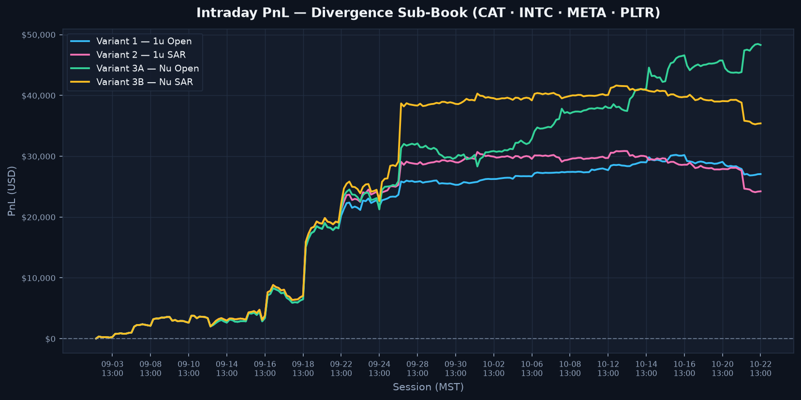

### Terminal, divergence sub-book only

| Model | Realized | Unrealized | **Sub-book total** |
|---|---:|---:|---:|
| **Variant 1 — 1u Open** | $23,394.27 | $1,195.66 | **$24,589.93** |
| **Variant 2 — 1u SAR** | $29,218.40 | -$7,467.17 | **$21,751.24** |
| **Variant 3A — Nu Open** | $23,394.27 | $22,420.70 | **$45,814.97** |
| **Variant 3B — Nu SAR** | $40,385.11 | -$7,467.17 | **$32,917.94** |

The sub-book totals differ from the full-portfolio totals above by exactly the 28 invariant tickers, which contribute the same amount to every model.

### The regime flips

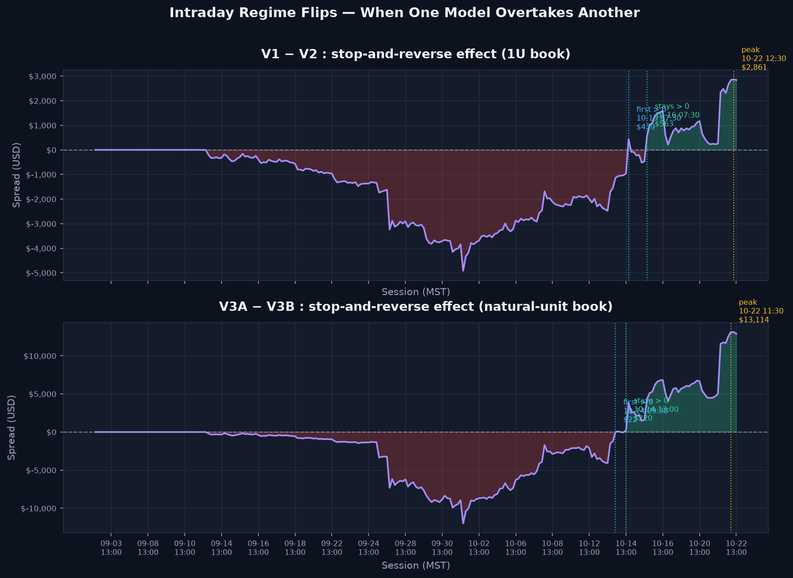

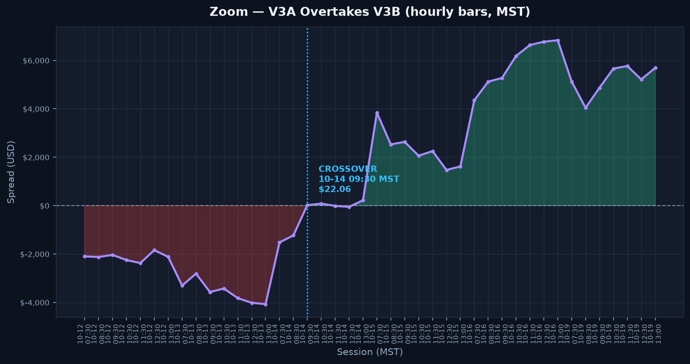

| Spread | First > 0 | Stays > 0 from | Peak | Trough | Terminal |
|---|---|---|---:|---:|---:|
| **V1-V2** | `10-15 07:30 MST` | `10-16 07:30 MST` | $2,861.47 @ `10-22 12:30 MST` | -$4,916.98 @ `10-02 07:30 MST` | **$2,838.69** |
| **V3A-V3B** | `10-14 09:30 MST` | `10-14 13:00 MST` | $13,114.19 @ `10-22 11:30 MST` | -$11,985.25 @ `10-02 07:30 MST` | **$12,897.03** |
| **V3A-V1** | `09-22 13:00 MST` | `09-25 07:30 MST` | $21,433.86 @ `10-22 11:30 MST` | -$510.75 @ `09-24 13:00 MST` | **$21,225.04** |
| **V3B-V2** | `09-22 13:00 MST` | `09-25 07:30 MST` | $11,345.49 @ `10-15 07:30 MST` | -$510.75 @ `09-24 13:00 MST` | **$11,166.70** |

**What this says — stop-and-reverse is a help early and a drag late.** Both spreads open the season deeply *negative*, meaning the **SAR books lead** out of the gate: at `10-02 07:30 MST` `V2` is ahead of `V1` by $4,916.98 and `V3B` is ahead of `V3A` by $11,985.25 — the widest SAR lead of the whole season, on the same bar. Flipping a position instead of stacking a new one protects capital while prices run *against* the earlier direction.

That lead then erodes as the trend matures, and the **open books take over for good in the `Oct 14`–`Oct 16` window**: `V3A − V3B` first prints positive at `10-14 09:30 MST` and never looks back from `10-14 13:00 MST`; `V1 − V2` flips a day later and holds from `10-16 07:30 MST`. Once the moves are directional, reversing out of the original entry throws away the winner — which is why the two spreads end the season on opposite sides of zero, and `4.5×` apart in magnitude.

Compounding shorts into full exits, by contrast, is unambiguous: `V3A − V1` turns positive on `09-22 13:00 MST` — the moment the `INTC` `5-unit` full exit at `$127.11` is compounded — and never crosses back.

### Which ticker drives each edge

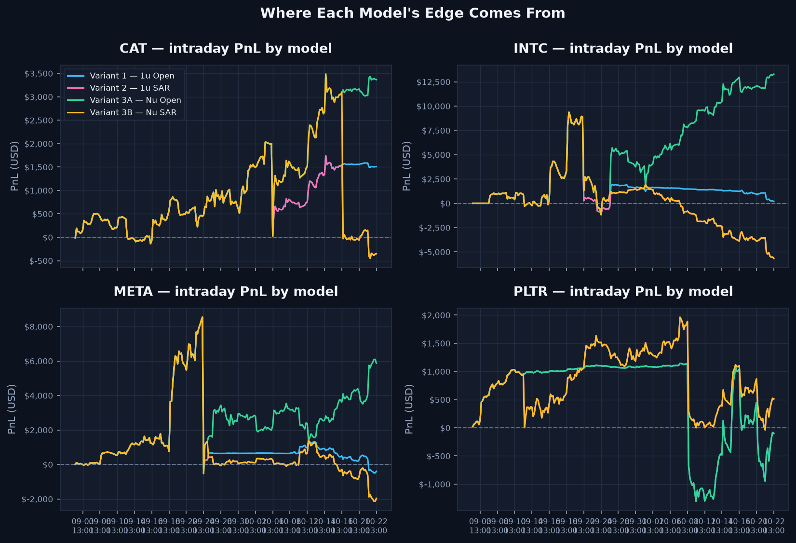

Per-ticker intraday contribution at the Oct 22 close:

| Ticker | V1 | V2 | V3A | V3B | Intraday peak bar (V3A) |
|---|---:|---:|---:|---:|---|
| `CAT` | $1,507.94 | -$349.93 | $3,365.81 | -$349.93 | `10-15 07:30 MST` |
| `INTC` | $188.67 | -$5,658.85 | $13,285.99 | -$5,658.85 | `10-22 13:00 MST` |
| `META` | -$401.02 | -$1,968.48 | $5,868.83 | -$1,968.48 | `09-24 12:30 MST` |
| `PLTR` | -$99.94 | $510.09 | -$99.94 | $510.09 | `10-08 07:30 MST` |

Full per-bar series: [`model_performance_intraday.csv`](data/model_performance_intraday.csv) (245 rows).

## 1-Minute Close-Up — INTC Hazard-Flip Window

A focused **60-bar, one-minute** view around the Sep 24 `10:00 MST` INTC short. This is a zoom into one high-signal hour, not a replacement for the 35-session hourly sub-book. The lower panel carries INTC-only cumulative realized + open PnL for each model; V1/V2 and V3A/V3B overlap here because their SAR paths have not yet diverged on this date.

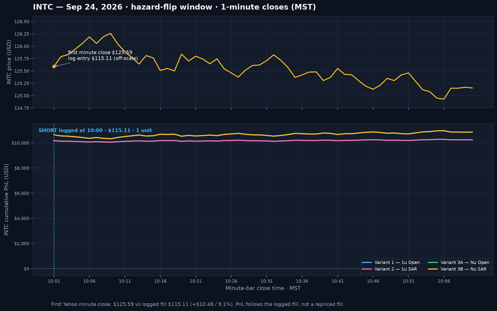

**Data-quality flag:** Yahoo's first close after the logged event is **$125.59** at `10:01 MST`, while the trade log records **$115.11** (a **$10.48 / 9.1%** difference). The PnL panel preserves the book's logged entry price; it does not silently reprice or correct the trade. Minute series: [`model_performance_minute_intc.csv`](data/model_performance_minute_intc.csv) (60 rows).

## Method & Caveats

- **Price source:** Yahoo Finance `v8/finance/chart` `interval=1d` for all `32` symbols (`Brent = BZ=F`, `WTI = CL=F`, `BTC = BTC-USD`, `ETH = ETH-USD`); pulled 2026-10-23.
- **Session calendar:** the `35` U.S. equity regular sessions from `2026-09-03` to `2026-10-22`. Futures and crypto are mapped onto the same session index by trade date.
- **`XRH0`** (db Physical Rhodium ETC, LSE) is too illiquid for a usable daily history, so it is held flat at its `$790.00` log entry — matching the [`Trades Zip PnL.md`](Trades%20Zip%20PnL.md) convention.
- **Terminal marks** on `2026-10-22` are pinned to the verified settlement set used by [`Trades Zip PnL.md`](Trades%20Zip%20PnL.md), so the final row reconciles to **$0.00** against that ledger.
- **ROI** is cumulative PnL divided by notional deployed *to date* (units opened on or before that session × `$10,000`), so early sessions show larger percentages on less capital.
- Entry fills use the log's own market prices, not session closes; exits are realised on their log date.
- Excludes commissions, borrow fees, and overnight financing.

---

Master ledger: **[`Trades Zip PnL.md`](Trades%20Zip%20PnL.md)** · Chart-signal report: **[`Triangle Signals.md`](Triangle%20Signals.md)** · Visual book: **[`Unrealized PnL.md`](Unrealized%20PnL.md)** · Pre-2026: **[`2024 Trades PnL.md`](2024%20Trades%20PnL.md)**
