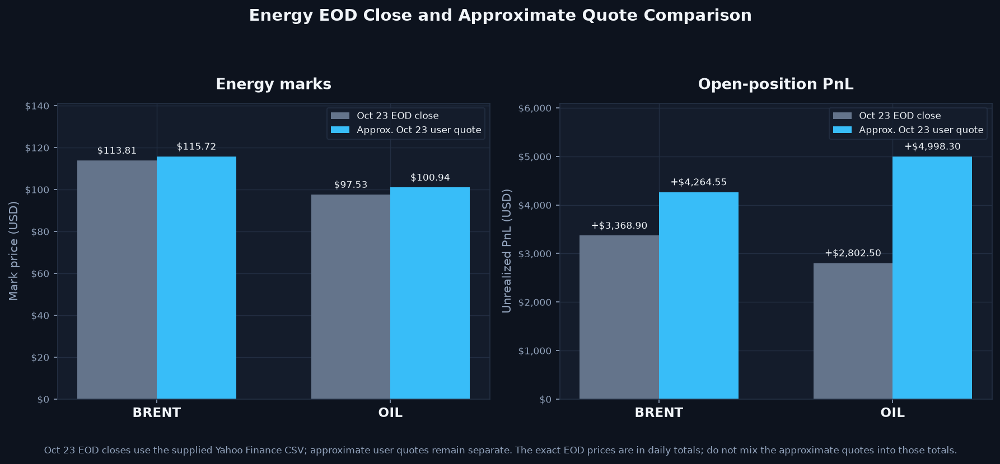

# Model Performance Comparison — *Fall (Arizona) [2026]*

Day-by-day (and, where market data supports it, intraday) comparison of the four portfolio models carried on the same standardized book: **[`trades/`](trades/)** / **[`trades.zip`](trades.zip)** — `33` price-covered symbols, `88` in-window price-covered events out of `95` total 2026 log events (`7` outside direct-price scope; `0` after cutoff), `1 unit = $10,000.00` initial notional, all timestamps in Arizona year-round **`MST` / `UTC-07:00`**, marked against the **Friday, October 23, 2026** close. Intraday plots remain on their supplied Oct. 22 hourly scope.

> **Interactive version:** open **[`Model Performance Explorer.html`](Model%20Performance%20Explorer.html)** for a self-contained explorer with toggleable series, a hover crosshair, and per-ticker breakdowns. Machine-readable exports live in [`data/`](data/): [`model_performance_daily.csv`](data/model_performance_daily.csv), [`model_performance_tickers.csv`](data/model_performance_tickers.csv), [`model_performance_summary.json`](data/model_performance_summary.json).
> **Whole-portfolio DXY view:** **[`DXY-Equivalent Portfolio Snapshot.md`](DXY-Equivalent%20Portfolio%20Snapshot.md)** includes the daily DXY-numeraire comparison, graph, Oct. 23 results, and supporting CSV exports.
> **Small Caps pilot:** **[`Small Caps [Buyout & Reorganization Offering Test Pilot].md`](Small%20Caps%20%5BBuyout%20%26%20Reorganization%20Offering%20Test%20Pilot%5D.md)** tracks the five LCID entries; all five are included in the Oct. 23 four-model comparison.

## The Four Models

| Model | Rule | Units deployed | Realized | Unrealized | Base PnL | US10Y adjustment | **Adjusted PnL** | **Adjusted ROI** |
|---|---|---:|---:|---:|---:|---:|---:|---:|
| **Variant 1 — 1u Open** | every line is 1 unit; positions stay open | 84u ($845,000) | $25,561.44 | $27,912.63 | $53,474.06 | $160.90 | **$53,634.97** | **6.35%** |
| **Variant 2 — 1u SAR** | every line is 1 unit; LONG/REBUY stops-and-reverses open shorts | 84u ($845,000) | $31,385.57 | $19,245.30 | $50,630.87 | $160.90 | **$50,791.77** | **6.01%** |
| **Variant 3A — Nu Open** | compounded shorts sized to the preceding full exit; positions stay open | 94u ($935,000) | $25,561.44 | $49,196.12 | $74,757.55 | $184.13 | **$74,941.69** | **8.02%** |
| **Variant 3B — Nu SAR** | compounded shorts *and* stop-and-reverse | 94u ($935,000) | $42,552.27 | $19,245.30 | $61,797.57 | $184.13 | **$61,981.70** | **6.63%** |

## US10Y Baseline Adjustment

This user-requested, yield-based inflation-style carry is a model adjustment, not a CPI inflation measure or a Treasury total-return calculation. It treats the user-provided daily US10Y closes as annualized carry relative to the `4.865%` baseline from `2026-09-10`. For each interval, the adjustment is the model's cumulative deployed notional (the same denominator used for ROI; it does not fall after a position closes) × ((yield close − 4.865) / 100) × actual calendar days / 365. Values above baseline add positive adjustment; below baseline subtract. Per your confirmation, the Oct 9 close (5.24%) is carried across the Oct 12 Treasury holiday; the export records the original source date. The Oct 23 close (4.986%) is marked at the latest session; the Oct 22-to-Oct 23 carry interval uses the Oct 22 close (4.96%) under the existing start-of-interval convention.

Session-level rates, forward-fill dates, actual/365 accruals, and adjusted totals: [`model_performance_us10y_adjustment.csv`](data/model_performance_us10y_adjustment.csv).

## Energy EOD Marks and Separate Approximate Quotes

> The Oct 23 EOD closes ($113.81 BRENT / $97.53 OIL) from the supplied Yahoo Finance CSV are included in the daily model totals above. This comparison keeps the separate approximate user quotes ($115.72 / $100.94; provider/time unspecified) out of those totals. Historical series use BZ=F and CL=F futures proxies, not guaranteed cash/CFD matches.

Detailed marks and calculations: [`data/energy_live_mark_overlay.csv`](data/energy_live_mark_overlay.csv).

All four models agree on `29` of the `33` tickers. They diverge only on **`CAT`, `INTC`, `META` and `PLTR`** — the four symbols where a short is followed by a long (or a full exit is compounded into a short). Everything below is driven by those four.

## Headline Chart

**Reading it:** the models begin close together, then spread as the reversal-sensitive positions develop. At the Oct. 23 close the base and US10Y-adjusted rankings are **V3A > V3B > V1 > V2** and **V3A > V3B > V1 > V2**, respectively.

## Base Return on Capital

This chart shows trading PnL before the US10Y carry; the adjusted ROI is shown in the model table above and is selectable in the interactive explorer.

Raw dollars flatter V3A/V3B because they deploy more capital — `94` units (`$935,000.00`) against V1/V2's `84` units (`$845,000.00`). ROI normalises for that, and the terminal ranking is unchanged: compounding shorts into full exits beats flat sizing on both capital bases, and *not* stop-and-reversing beats stop-and-reversing on both.

## Day-by-Day Moves

| Session | V1 | V2 | V3A | V3B | Note |
|---|---:|---:|---:|---:|---|
| `2026-09-03` | +3,439.92 | +3,439.92 | +3,439.92 | +3,439.92 | Season open |
| `2026-09-04` | -318.25 | -318.25 | -318.25 | -318.25 |  |
| `2026-09-08` | +440.82 | +440.82 | +440.82 | +440.82 |  |
| `2026-09-09` | +1,097.81 | +1,097.81 | +1,097.81 | +1,097.81 |  |
| `2026-09-10` | -399.19 | -399.19 | -399.19 | -399.19 |  |
| `2026-09-11` | +1,406.43 | +1,406.43 | +1,406.43 | +1,406.43 |  |
| `2026-09-14` | -393.25 | -64.44 | -393.25 | -64.44 |  |
| `2026-09-15` | -792.08 | -832.64 | -792.08 | -832.64 |  |
| `2026-09-16` | +466.73 | +563.00 | +466.73 | +563.00 |  |
| `2026-09-17` | +5,158.63 | +5,261.38 | +5,158.63 | +5,261.38 |  |
| `2026-09-18` | -212.25 | -136.54 | -212.25 | -136.54 |  |
| `2026-09-21` | +14,473.56 | +14,768.30 | +14,473.56 | +14,768.30 |  |
| `2026-09-22` | +2,805.00 | +2,907.75 | +3,827.74 | +3,930.49 | widest split (V3B best, V1 worst) |
| `2026-09-23` | -1,059.98 | -692.24 | -663.48 | -295.73 | widest split (V3B best, V1 worst) |
| `2026-09-24` | +1,229.60 | +1,272.86 | -700.39 | -657.13 | widest split (V2 best, V3A worst) |
| `2026-09-25` | +1,073.31 | +1,322.04 | +3,802.74 | +5,678.07 | widest split (V3B best, V1 worst) |
| `2026-09-28` | +2,055.78 | +3,344.59 | +6,122.68 | +9,103.39 | widest split (V3B best, V1 worst) |
| `2026-09-29` | -2,915.77 | -2,658.79 | -4,088.78 | -2,658.79 | widest split (V2 best, V3A worst) |
| `2026-09-30` | +116.01 | +655.30 | -529.64 | +655.30 | widest split (V2 best, V3A worst) |
| `2026-10-01` | +2,200.22 | +2,333.59 | +2,233.61 | +2,333.59 |  |
| `2026-10-02` | -582.11 | -734.85 | -483.04 | -734.85 |  |
| `2026-10-05` | -550.56 | -855.61 | -280.86 | -855.61 | widest split (V3A best, V2 worst) |
| `2026-10-06` | +1,365.84 | +860.12 | +2,698.60 | +874.69 | widest split (V3A best, V2 worst) |
| `2026-10-07` | -1,781.81 | -1,796.64 | -489.82 | -1,222.92 | widest split (V3A best, V2 worst) |
| `2026-10-08` | +4,948.39 | +4,195.06 | +7,075.06 | +4,399.17 | widest split (V3A best, V2 worst) |
| `2026-10-09` | -57.60 | +74.95 | +757.15 | +25.34 | widest split (V3A best, V1 worst) |
| `2026-10-12` | +2,239.07 | +1,997.46 | +2,043.29 | +2,010.18 |  |
| `2026-10-13` | +2,647.45 | +3,125.25 | +1,479.74 | +3,432.75 | widest split (V3B best, V3A worst) |
| `2026-10-14` | +1,708.59 | +191.38 | +4,757.26 | +466.62 | widest split (V3A best, V2 worst) |
| `2026-10-15` | +3,085.92 | +2,594.60 | +4,148.22 | +2,748.87 | widest split (V3A best, V2 worst) |
| `2026-10-16` | +5,454.72 | +3,402.40 | +8,672.09 | +3,458.84 | widest split (V3A best, V2 worst) |
| `2026-10-19` | -86.60 | +619.04 | -512.92 | +632.68 | widest split (V3B best, V3A worst) |
| `2026-10-20` | +876.21 | +584.31 | +1,571.27 | +584.31 | widest split (V3A best, V2 worst) |
| `2026-10-21` | -6,078.83 | -5,159.75 | -6,821.60 | -5,159.75 | widest split (V2 best, V3A worst) |
| `2026-10-22` | +9,574.57 | +6,988.18 | +14,873.55 | +6,988.18 | widest split (V3A best, V2 worst) |
| `2026-10-23` | +837.78 | +833.27 | +896.23 | +833.27 | Terminal mark |

## Where the Models Diverge

- **Stop-and-reverse (V1 − V2) ends at $2,843.20; (V3A − V3B) ends at $12,959.98.**
- **Compounding (V3A − V1) ends at $21,283.49** — the single largest structural effect in the book.

## Risk — Drawdown from Running Peak

| Model | Peak | Peak day | Trough | Trough day | Max drawdown | Max DD day | Best day | Worst day |
|---|---:|---|---:|---:|---|---:|---|---:|
| **Variant 1 — 1u Open** | $53,474.06 | `2026-10-23` | $3,121.67 | `2026-09-04` | -$6,078.83 | `2026-10-21` | $14,473.56 (`2026-09-21`) | -$6,078.83 (`2026-10-21`) |
| **Variant 2 — 1u SAR** | $50,630.87 | `2026-10-23` | $3,121.67 | `2026-09-04` | -$5,159.75 | `2026-10-21` | $14,768.30 (`2026-09-21`) | -$5,159.75 (`2026-10-21`) |
| **Variant 3A — Nu Open** | $74,757.55 | `2026-10-23` | $3,121.67 | `2026-09-04` | -$6,821.60 | `2026-10-21` | $14,873.55 (`2026-10-22`) | -$6,821.60 (`2026-10-21`) |
| **Variant 3B — Nu SAR** | $61,797.57 | `2026-10-23` | $3,121.67 | `2026-09-04` | -$5,159.75 | `2026-10-21` | $14,768.30 (`2026-09-21`) | -$5,159.75 (`2026-10-21`) |

## Terminal Composition

| Model | Realized (closed) | Unrealized (open) | Closed lots | Open lots |
|---|---:|---:|---:|---:|
| **Variant 1 — 1u Open** | $25,561.44 | $27,912.63 | 15 | 68 |
| **Variant 2 — 1u SAR** | $31,385.57 | $19,245.30 | 20 | 63 |
| **Variant 3A — Nu Open** | $25,561.44 | $49,196.12 | 15 | 68 |
| **Variant 3B — Nu SAR** | $42,552.27 | $19,245.30 | 20 | 63 |

## Contribution by Ticker

### The four divergence tickers

| Ticker | V1 | V2 | V3A | V3B |
|---|---:|---:|---:|---:|
| `CAT` | $3,456.26 | $2,963.84 | $5,511.31 | $4,526.46 |
| `INTC` | $11,319.85 | $8,383.08 | $23,954.58 | $15,435.24 |
| `META` | $9,937.17 | $8,926.73 | $16,530.89 | $11,478.65 |
| `PLTR` | $2,314.89 | $3,911.35 | $2,314.89 | $3,911.35 |

### Top contributors (V3A)

| Ticker | Units | Realized | Unrealized | **Total** |
|---|---:|---:|---:|---:|
| `INTC` | 14u | $10,955.99 | $12,998.59 | **$23,954.58** |
| `META` | 13u | $10,430.36 | $6,100.53 | **$16,530.89** |
| `LMT` | 4u | $0.00 | $6,990.06 | **$6,990.06** |
| `CAT` | 5u | $1,984.84 | $3,526.47 | **$5,511.31** |
| `LCID` | 5u | $0.00 | $5,289.53 | **$5,289.53** |
| `CVX` | 3u | $0.00 | $3,406.36 | **$3,406.36** |
| `BRENT` | 5u | $0.00 | $3,368.90 | **$3,368.90** |
| `BTC` | 2u | $0.00 | $2,910.19 | **$2,910.19** |
| `OIL` | 6u | $0.00 | $2,802.50 | **$2,802.50** |
| `SPCX` | 3u | $0.00 | $2,416.69 | **$2,416.69** |

### Bottom contributors (V3A)

| Ticker | Units | Realized | Unrealized | **Total** |
|---|---:|---:|---:|---:|
| `GEV` | 1u | $0.00 | -$1,903.20 | **-$1,903.20** |
| `RIVN` | 1u | $0.00 | -$1,727.27 | **-$1,727.27** |
| `UPS` | 2u | $0.00 | -$1,422.48 | **-$1,422.48** |
| `DIS` | 2u | -$310.50 | -$795.36 | **-$1,105.85** |
| `NVDA` | 1u | $0.00 | -$811.45 | **-$811.45** |
| `AMZN` | 1u | $0.00 | -$409.16 | **-$409.16** |
| `NET` | 1u | $0.00 | -$206.26 | **-$206.26** |
| `NFLX` | 1u | $0.00 | -$180.44 | **-$180.44** |
| `VLO` | 1u | $0.00 | -$113.65 | **-$113.65** |
| `TSLA` | 1u | $0.00 | -$113.03 | **-$113.03** |

## Intraday — Hour by Hour

Daily closes hide *when* inside a session the models pull apart. Zooming to **hourly bars** (7 per session: `06:30`→`13:00 MST`) resolves that.

> **Scope:** the intraday view covers **`CAT`, `INTC`, `META` and `PLTR`** — the divergence sub-book. The other `29` tickers produce byte-identical PnL under all four models, so they cancel exactly out of every comparison below. Every number here is therefore *exact*, not interpolated.

### Terminal, divergence sub-book only

| Model | Realized | Unrealized | **Sub-book total** |
|---|---:|---:|---:|
| **Variant 1 — 1u Open** | $25,871.93 | $1,195.66 | **$27,067.59** |
| **Variant 2 — 1u SAR** | $31,696.07 | -$7,467.17 | **$24,228.90** |
| **Variant 3A — Nu Open** | $25,871.93 | $22,420.70 | **$48,292.63** |
| **Variant 3B — Nu SAR** | $42,862.77 | -$7,467.17 | **$35,395.60** |

The sub-book totals differ from the full-portfolio totals above by exactly the 29 invariant tickers, which contribute the same amount to every model.

### The regime flips

| Spread | First > 0 | Stays > 0 from | Peak | Trough | Terminal |
|---|---|---|---:|---:|---:|
| **V1-V2** | `10-15 07:30 MST` | `10-16 07:30 MST` | $2,861.47 @ `10-22 12:30 MST` | -$4,916.98 @ `10-02 07:30 MST` | **$2,838.69** |
| **V3A-V3B** | `10-14 09:30 MST` | `10-14 13:00 MST` | $13,114.19 @ `10-22 11:30 MST` | -$11,985.25 @ `10-02 07:30 MST` | **$12,897.03** |
| **V3A-V1** | `09-22 13:00 MST` | `09-25 07:30 MST` | $21,433.86 @ `10-22 11:30 MST` | -$510.75 @ `09-24 13:00 MST` | **$21,225.04** |
| **V3B-V2** | `09-22 13:00 MST` | `09-25 07:30 MST` | $11,345.49 @ `10-15 07:30 MST` | -$510.75 @ `09-24 13:00 MST` | **$11,166.70** |

**What this says — stop-and-reverse is a help early and a drag late.** Both spreads open the season deeply *negative*, meaning the **SAR books lead** out of the gate: at `10-02 07:30 MST` `V2` is ahead of `V1` by $4,916.98 and `V3B` is ahead of `V3A` by $11,985.25 — the widest SAR lead of the whole season, on the same bar. Flipping a position instead of stacking a new one protects capital while prices run *against* the earlier direction.

That lead then erodes as the trend matures, and the **open books take over for good in the `Oct 14`–`Oct 16` window**: `V3A − V3B` first prints positive at `10-14 09:30 MST` and never looks back from `10-14 13:00 MST`; `V1 − V2` flips a day later and holds from `10-16 07:30 MST`. Once the moves are directional, reversing out of the original entry throws away the winner — which is why the two spreads end the season on opposite sides of zero, and `4.5×` apart in magnitude.

Compounding shorts into full exits, by contrast, is unambiguous: `V3A − V1` turns positive on `09-22 13:00 MST` — the moment the `INTC` `5-unit` full exit at `$127.11` is compounded — and never crosses back.

### Which ticker drives each edge

Intraday per-ticker contribution at the Oct 22 close (the hourly archive has no Oct 23 bars):

| Ticker | V1 | V2 | V3A | V3B | Intraday peak bar (V3A) |
|---|---:|---:|---:|---:|---|
| `CAT` | $1,507.94 | -$349.93 | $3,365.81 | -$349.93 | `10-15 07:30 MST` |
| `INTC` | $188.67 | -$5,658.85 | $13,285.99 | -$5,658.85 | `10-22 13:00 MST` |
| `META` | -$401.02 | -$1,968.48 | $5,868.83 | -$1,968.48 | `09-24 12:30 MST` |
| `PLTR` | -$99.94 | $510.09 | -$99.94 | $510.09 | `10-09 13:00 MST` |

Full per-bar series: [`model_performance_intraday.csv`](data/model_performance_intraday.csv) (245 rows).

## 1-Minute Close-Up — INTC Hazard-Flip Window

A focused **60-bar, one-minute** view around the Sep 24 `10:00 MST` INTC short. This is a zoom into one high-signal hour, not a replacement for the 35-session hourly sub-book. The lower panel carries INTC-only cumulative realized + open PnL for each model; V1/V2 and V3A/V3B overlap here because their SAR paths have not yet diverged on this date.

**Data-quality flag:** Yahoo's first close after the logged event is **$125.59** at `10:01 MST`, while the trade log records **$115.11** (a **$10.48 / 9.1%** difference). The PnL panel preserves the book's logged entry price; it does not silently reprice or correct the trade. Minute series: [`model_performance_minute_intc.csv`](data/model_performance_minute_intc.csv) (60 rows).

## Method & Caveats

- **Model coverage:** the four variants directly price the `33` symbols with configured daily market series. `88` price-covered events dated on or before the Oct. 23 mark are replayed; `0` price-covered events after the mark are excluded from this current daily replay. `7` DXY, EURUSD, JPYUSD, US10Y and US30Y log events are not replayed as standalone price positions. The two US10Y events establish the yield-adjustment context; its separate daily rate series applies the baseline carry to the portfolio. DXY/FX/US30Y positions remain outside the four direct-price variants and require their own quote/valuation treatment.
- **Price source:** Yahoo Finance `v8/finance/chart` `interval=1d` for `32` symbols (`BRENT = BZ=F` Brent futures proxy, `OIL = CL=F` WTI futures proxy, `BTC = BTC-USD`, `ETH = ETH-USD`); pulled 2026-10-23. LCID uses the separate user-provided daily marks in [`data/lcid_small_caps_pilot_daily_marks.csv`](data/lcid_small_caps_pilot_daily_marks.csv). `BZ=F`/`CL=F` are not exact matches for the trade metadata's Brent Cash / ICE Brent and `TVC:USOIL` WTI CFD instruments.
- **Oct. 23 EOD source:** the supplied close set in [`data/eod_closes_20261023.csv`](data/eod_closes_20261023.csv) (Source column: Yahoo Finance) covers all 33 configured symbols. LCID continues to use its separate pilot mark series, whose Oct. 23 value ($3.55) matches that EOD file. The historical Oct. 22 equity recheck remains separately auditable in [`data/oct22_equity_eod_recheck.csv`](data/oct22_equity_eod_recheck.csv).
- **Approximate energy quotes (separate overlay):** their open-lot calculations versus the exact EOD marks are in [`data/energy_live_mark_overlay.csv`](data/energy_live_mark_overlay.csv). They remain excluded from model totals.
- **Session calendar:** the `36` U.S. equity regular sessions from `2026-09-03` to `2026-10-23`. Futures and crypto are mapped onto the same session index by trade date.
- **`XRH0`** (db Physical Rhodium ETC, LSE) is too illiquid for a usable daily history, so it is held flat at its `$790.00` log entry — matching the [`Trades Zip PnL.md`](Trades%20Zip%20PnL.md) convention.
- **Oct. 22 historical marks** remain pinned to the verified settlement set from [`Trades Zip PnL.md`](Trades%20Zip%20PnL.md); the Oct. 23 endpoint uses the user-supplied EOD file above. The Oct. 23 ORCL and LCID entries are now included at that date's close. The master PnL report remains unrecalculated and unreconciled; do not interpret this model replay as a refresh of its totals.
- **ROI** is cumulative PnL divided by notional deployed *to date* (units opened on or before that session × `$10,000`), so early sessions show larger percentages on less capital.
- Entry fills use the log's own market prices, not session closes; exits are realised on their log date.
- Excludes commissions, borrow fees, and overnight financing.

---

Master ledger: **[`Trades Zip PnL.md`](Trades%20Zip%20PnL.md)** · Chart-signal report: **[`Triangle Signals.md`](Triangle%20Signals.md)** · Visual book: **[`Unrealized PnL.md`](Unrealized%20PnL.md)** · Pre-2026: **[`2024 Trades PnL.md`](reports/2024/2024%20Trades%20PnL.md)**
