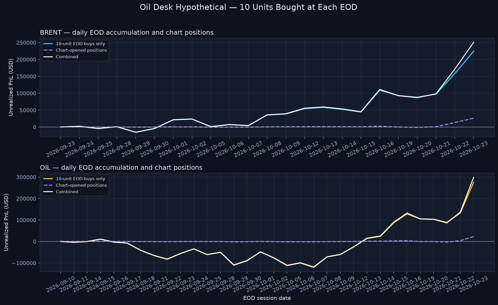

# Oil Desk EOD Accumulation Hypothetical

> **Historical sidecar—superseded for current comparisons (2026-10-24).** This legacy v1 schedule uses the prior energy marks and is not the current TradingView-only calculation. The active TradingView energy schedule and DXY sizing/audit table are in [`TradingView Energy and Currency Desk Sidecars.md`](TradingView%20Energy%20and%20Currency%20Desk%20Sidecars.md). The 1U/DAY/DXY sleeve is already integrated into core variants; 0.05U remains an alternative, while THE ONE MODEL separately adds 10U/DAY DXY to each of its 32 portfolios. Current strategy composites consume the 10U energy rows. Do not use this page's prior numbers as current results.

This archived daily-buy sidecar is separate from the core. Its chart-position series is an attribution of logged chart/core lots, including the 50U Manual-Automatic Weekend Oil entries; those same tagged lots are already included in each core variant and must not be added to core-based composites a second time. The chart-position column shows open-lot unrealized PnL only; the realized trim PnL is recorded in the core replay.

For the daily position and PnL methodology across all variants and sidecars, see [`Model Calculation Guide.md`](Model%20Calculation%20Guide.md).

## Assumptions

- Buy **10 units (10U; $100,000 notional)** in each instrument at every supplied EOD session.
- One new long lot is opened at each session's EOD close and remains open through Oct. 23; no exits, fees, financing, or scaling from PnL.
- The daily buy at a given close starts accruing PnL after that close; therefore it has zero mark-to-market PnL at its purchase EOD.
- Chart-opened positions are shown separately and then added to the daily-buy hypothetical for a combined energy subtotal.
- Both the core replay and this sidecar use the same exact daily energy marks from `data/energy_provider_eod_marks_v1.csv`; the sidecar buys each tranche at that instrument's supplied EOD close.
- Yahoo `BZ=F` / `CL=F` values are pre-entry context proxies only; they are not used to mark active energy positions or sidecar purchases.

## Exact EOD mark coverage

| Ticker | Instrument / source | Active-period coverage | Sessions | Oct. 23 EOD mark |
|---|---|---|---:|---:|
| `BRENT` | User-provided BlackBull Markets Brent Cash EOD (`BlackBull Brent Cash`) | 2026-09-23–2026-10-23 | 23 | $117.345 |
| `OIL` | User-provided TradingView TVC:USOIL EOD (`TVC:USOIL`) | 2026-09-10–2026-10-23 | 32 | $103.45 |

## Terminal summary — Oct. 23, 2026

| Instrument | EOD sessions | Daily-buy units | Daily-buy notional | Daily-buy PnL | Chart-open units | Chart-open unrealized PnL | Combined energy PnL |
|---|---:|---:|---:|---:|---:|---:|---:|
| BRENT | 23 | 230 | $2,300,000.00 | $+224,358.86 | 55 | $+26,032.81 | $+250,391.67 |
| OIL | 32 | 320 | $3,200,000.00 | $+275,347.06 | 56 | $+23,003.98 | $+298,351.04 |
| **All energy** | 55 | 550 | $5,500,000.00 | $+499,705.92 | 111 | $+49,036.79 | $+548,742.71 |

Session-level lots and PnL: [`oil_desk_eod_accumulation_v1.csv`](data/oil_desk_eod_accumulation_v1.csv).

Energy source rows: [`energy_provider_eod_marks_v1.csv`](data/energy_provider_eod_marks_v1.csv). Active source map: [`active_price_source_registry_v3.csv`](data/active_price_source_registry_v3.csv).

This historical 10U/day-buy schedule is not part of current core-based composites or whole-portfolio DXY/yield multipliers. Its combined energy column includes the chart-lot attribution described above, which is already in core; do not add that contribution again. Applying whole-account factors to the separate daily-buy schedule would require a distinct capital convention.
