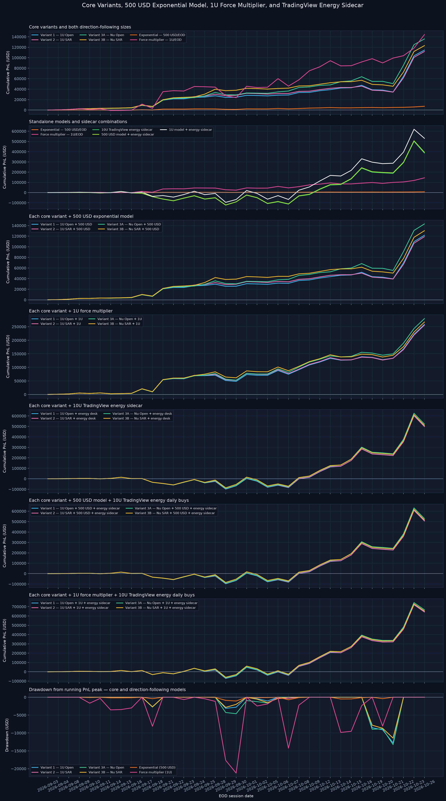
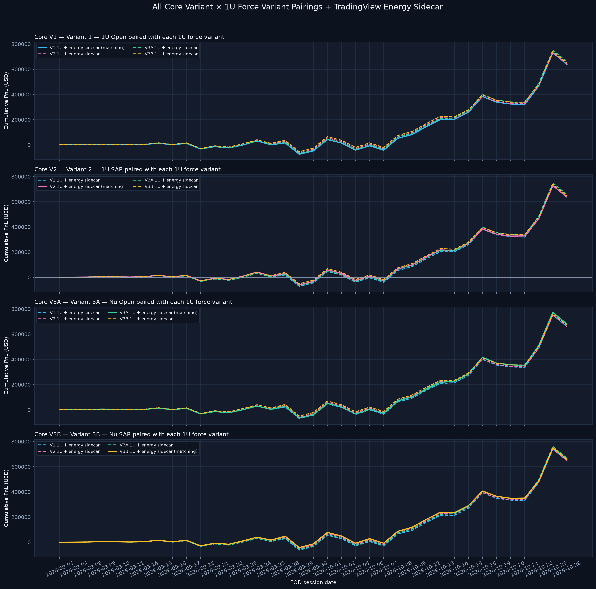
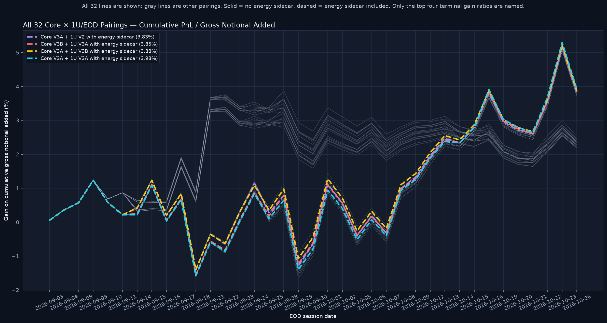

# Strategy and Sidecar Comparison

> **TradingView-only refresh — 2026-10-26.** Core comparisons use 31 supplied direct-price symbols plus the chart-directed 1U/DAY/DXY index-return sleeve integrated into each core variant; BTC/ETH are excluded pending recalibration. TradingView sidecar schedules through 2026-10-26 use the same benchmark, with the generic energy add-on held at 10U/DAY. XRH0 includes five flagged carry-forward marks; see the benchmark coverage and session-mark files.
> **Updated Part B source:** the revised user-provided archive corrects LLY's Oct. 20 close to `$1,283.66`, superseding the prior `$12,833.66` row; all strategy/core figures below use the revised mark.

Calculation detail for the core variants and daily lot rules: [`Model Calculation Guide.md`](Model%20Calculation%20Guide.md).

## Model rules and combination math

- **Core variants:** existing V1, V2, V3A, and V3B model replays from the main comparison. The core logs also contain separate hypothetical 10U SHORT force-multiplier lots in BRENT at $117 and OIL at $102, modeled at the Oct. 23 target-level EOD trigger (not a verified intraday execution). Their explicit modeled exits are $114.627 BRENT and $100.74 OIL at 2026-10-25 20:35 MST, after the four earlier Oct. 25 replenishments and simultaneous with separate 35U BRENT/34U OIL LONG Weekend Oil buys; the buys count toward weekly supply, but the short closures do not. They raise post-close all-core oil long exposure from 65U BRENT + 66U OIL to 100U each (200U combined). The $115.792 BRENT/$101.74 OIL lots use the user-recalled 17:20–17:25 MST window, modeled at 17:22; the $114.80 BRENT/$101.00 OIL lot times are approximate around 20:00 MST per the user's recollection. These lot-specific exits override SAR only for the two tagged shorts; prices and timings are hypothetical model inputs, not verified executions. The Oct. 25 events and short exits are included in the current core replay through Oct. 26 and remain separate from the preserved Oct. 23 historical baseline. These short positions are part of core, not the energy sidecar.
- **Exponential ($500/EOD):** after a ticker first has a logged direction, add a new fixed **$500 notional** lot in its latest LONG/SHORT/REBUY direction each EOD. $500 does not compound.
- **Shared-direction force multiplier (1U/EOD):** one 1U tranche per symbol with a carried direction each priced EOD; close all prior lots at the EOD mark on any LONG/SHORT flip. This remains a separate alternative to the $500 model.
- **Variant-specific 1U/EOD force family:** four separate daily-addition replays apply V1, V2, V3A, or V3B position handling to the 1U schedule. Explicit EXIT/TAKE PROFIT records close open long lots at their logged prices in all four; the carried direction remains active, so the scheduled EOD addition still occurs. V1/V3A leave opposite-side lots open on direction changes. V2/V3B cover shorts on LONG/REBUY at the logged signal price; as in the core implementation, SHORT does not close open longs. A qualifying V3A/V3B compounded-short entry uses the preceding full-exit unit count for that event-day tranche only; subsequent carried days return to 1U additions.
- **Signal timing:** direction-bearing LONG/SHORT/REBUY events map to the first priced session on or after their log date; the last directional event for a ticker on that session selects the EOD addition direction. EXIT / TAKE PROFIT rows do not clear carried direction. No separate authorization feed exists.
- **Additive comparisons:** each core base already contains the 1U/DAY/DXY index-return sleeve. The comparison adds shared $500/1U alternatives and the 10U TradingView energy schedule; variant-specific force models are shown alone, with energy, and in all 16 core-variant × 1U-variant pairings plus energy. Matching and cross-variant combinations are included. Do not add the DXY 1U sleeve a second time, net positions/capital, duplicate chart-opened energy positions, or stack alternative force models or variant rules.
- Universe: all 31 directly price-covered TradingView core tickers plus DXY as an integrated index-return sleeve; BTC/ETH are pending recalibration, and EURUSD, JPYUSD, US10Y, and US30Y are outside this portfolio comparison.

## Standalone model and sidecar terminal comparison — Oct. 26, 2026

| Component/scenario | Terminal PnL | Cumulative notional added | Open notional |
|---|---:|---:|---:|
| Exponential — fixed $500/EOD | $+7,206.51 | $343,500.00 | $267,500.00 |
| Shared-direction force — 1U per EOD | $+144,130.20 | $6,870,000.00 | $5,350,000.00 |
| 10U TradingView energy daily-buy sidecar | $+386,290.08 | $5,700,000.00 | $5,700,000.00 |
| $500 model + 10U energy sidecar | $+393,496.59 | $6,043,500.00 | $5,967,500.00 |
| 1U model + 10U energy sidecar | $+530,420.28 | $12,570,000.00 | $11,050,000.00 |

The $500 model ends at **$+7,206.51** (realized $+6,865.36; unrealized $+341.15). The shared-direction 1U force model ends at **$+144,130.20** (realized $+137,307.22; unrealized $+6,822.98). With identical direction state and no tranche compounding, its PnL and exposure are 20× the $500 model before display rounding.

## Variant-specific 1U/EOD force models and energy combinations — terminal

The four separate 1U/EOD models apply V1, V2, V3A, or V3B exit/SAR/short-compounding behavior. The energy sidecar contributes only its daily-buy PnL and gross notional. The graph below covers all 16 core-variant × 1U-variant pairings; each panel fixes the core variant and plots all four 1U models. Matching pairings are labeled, while the cross-variant pairings expose alternative position-management combinations.

The generated CSV retains legacy `oil` suffixes for compatibility; these now refer to the 10U TradingView energy schedule. All composite PnL/notional figures are additive USD totals. Positions and capital are not netted, and energy chart-opened core positions are not duplicated in the sidecar.

| 1U/EOD variant rule | Standalone force PnL | Cumulative notional added | Open notional |
|---|---:|---:|---:|
| Variant 1 — 1U Open | $+138,138.01 | $6,870,000.00 | $5,360,000.00 |
| Variant 2 — 1U SAR | $+139,076.81 | $6,870,000.00 | $5,140,000.00 |
| Variant 3A — Nu Open | $+158,468.56 | $6,960,000.00 | $5,450,000.00 |
| Variant 3B — Nu SAR | $+149,758.20 | $6,960,000.00 | $5,140,000.00 |

| 1U/EOD variant rule | Force model + energy PnL | Combined cumulative notional | Combined open notional |
|---|---:|---:|---:|
| Variant 1 — 1U Open + energy | $+524,428.09 | $12,570,000.00 | $11,060,000.00 |
| Variant 2 — 1U SAR + energy | $+525,366.89 | $12,570,000.00 | $10,840,000.00 |
| Variant 3A — Nu Open + energy | $+544,758.64 | $12,660,000.00 | $11,150,000.00 |
| Variant 3B — Nu SAR + energy | $+536,048.28 | $12,660,000.00 | $10,840,000.00 |

## All core + 1U force variant pairings + 10U energy schedule — terminal

### Core V1 — Variant 1 — 1U Open

Core PnL: **$+114,524.25**; energy sidecar PnL: **$+386,290.08**.

| 1U/EOD force variant | Pairing | Force PnL | Composite PnL | Gross cumulative notional | Gross open notional |
|---|---|---:|---:|---:|---:|
| Variant 1 — 1U Open | Matching | $+138,138.01 | $+638,952.34 | $17,155,000.00 | $14,015,000.00 |
| Variant 2 — 1U SAR | Cross-variant | $+139,076.81 | $+639,891.14 | $17,155,000.00 | $13,795,000.00 |
| Variant 3A — Nu Open | Cross-variant | $+158,468.56 | $+659,282.89 | $17,245,000.00 | $14,105,000.00 |
| Variant 3B — Nu SAR | Cross-variant | $+149,758.20 | $+650,572.53 | $17,245,000.00 | $13,795,000.00 |

### Core V2 — Variant 2 — 1U SAR

Core PnL: **$+111,926.39**; energy sidecar PnL: **$+386,290.08**.

| 1U/EOD force variant | Pairing | Force PnL | Composite PnL | Gross cumulative notional | Gross open notional |
|---|---|---:|---:|---:|---:|
| Variant 1 — 1U Open | Cross-variant | $+138,138.01 | $+636,354.48 | $17,155,000.00 | $14,015,000.00 |
| Variant 2 — 1U SAR | Matching | $+139,076.81 | $+637,293.28 | $17,155,000.00 | $13,795,000.00 |
| Variant 3A — Nu Open | Cross-variant | $+158,468.56 | $+656,685.03 | $17,245,000.00 | $14,105,000.00 |
| Variant 3B — Nu SAR | Cross-variant | $+149,758.20 | $+647,974.67 | $17,245,000.00 | $13,795,000.00 |

### Core V3A — Variant 3A — Nu Open

Core PnL: **$+135,836.06**; energy sidecar PnL: **$+386,290.08**.

| 1U/EOD force variant | Pairing | Force PnL | Composite PnL | Gross cumulative notional | Gross open notional |
|---|---|---:|---:|---:|---:|
| Variant 1 — 1U Open | Cross-variant | $+138,138.01 | $+660,264.15 | $17,245,000.00 | $14,015,000.00 |
| Variant 2 — 1U SAR | Cross-variant | $+139,076.81 | $+661,202.95 | $17,245,000.00 | $13,795,000.00 |
| Variant 3A — Nu Open | Matching | $+158,468.56 | $+680,594.70 | $17,335,000.00 | $14,105,000.00 |
| Variant 3B — Nu SAR | Cross-variant | $+149,758.20 | $+671,884.34 | $17,335,000.00 | $13,795,000.00 |

### Core V3B — Variant 3B — Nu SAR

Core PnL: **$+123,093.10**; energy sidecar PnL: **$+386,290.08**.

| 1U/EOD force variant | Pairing | Force PnL | Composite PnL | Gross cumulative notional | Gross open notional |
|---|---|---:|---:|---:|---:|
| Variant 1 — 1U Open | Cross-variant | $+138,138.01 | $+647,521.19 | $17,245,000.00 | $14,015,000.00 |
| Variant 2 — 1U SAR | Cross-variant | $+139,076.81 | $+648,459.99 | $17,245,000.00 | $13,795,000.00 |
| Variant 3A — Nu Open | Cross-variant | $+158,468.56 | $+667,851.74 | $17,335,000.00 | $14,105,000.00 |
| Variant 3B — Nu SAR | Matching | $+149,758.20 | $+659,141.38 | $17,335,000.00 | $13,795,000.00 |

## Percent gain across all 32 combinations

Percent gain is cumulative composite PnL divided by cumulative gross notional added, expressed as a percentage. It is a deployed-notional ratio, not an account return or capital-normalized ROI. The chart plots all 16 core × 1U variant pairings both without energy and with the 10U TradingView energy daily-buy sidecar (32 lines total). Solid lines omit energy; dashed lines include the energy sidecar. The top four terminal gain ratios are named in the legend; the other 28 pairings remain visible in gray.

| Rank | Pairing | 10U energy sidecar | Terminal gain on cumulative notional added |
|---:|---|---|---:|
| 1 | Core V3A + 1U V3A | Included | 3.93% |
| 2 | Core V3A + 1U V3B | Included | 3.88% |
| 3 | Core V3B + 1U V3A | Included | 3.85% |
| 4 | Core V3A + 1U V2 | Included | 3.83% |

## Core variants with add-ons — terminal PnL

| Core variant | Core only | + $500 model | + 1U force multiplier | + energy desk | + $500 and energy | + force multiplier and energy |
|---|---:|---:|---:|---:|---:|---:|
| Variant 1 — 1U Open | $+114,524.25 | $+121,730.76 | $+258,654.45 | $+500,814.33 | $+508,020.84 | $+644,944.53 |
| Variant 2 — 1U SAR | $+111,926.39 | $+119,132.90 | $+256,056.59 | $+498,216.47 | $+505,422.98 | $+642,346.67 |
| Variant 3A — Nu Open | $+135,836.06 | $+143,042.57 | $+279,966.26 | $+522,126.14 | $+529,332.65 | $+666,256.34 |
| Variant 3B — Nu SAR | $+123,093.10 | $+130,299.61 | $+267,223.30 | $+509,383.18 | $+516,589.69 | $+653,513.38 |

The standalone 10U TradingView energy schedule ends at **$+386,290.08** on **$5,700,000.00** cumulative daily-buy notional. Use the notional columns when comparing scale; these additive composites do not apply a common capital base.

## Data and output files

- Daily all-strategy PnL and exposure comparison: [`strategy_sidecar_comparison_daily_v1.csv`](data/strategy_sidecar_comparison_daily_v1.csv).
- Exponential $500 per-symbol EOD audit: [`exponential_eod_positions_v1.csv`](data/exponential_eod_positions_v1.csv).
- Shared-direction force model audit: [`force_multiplier_eod_positions_v1.csv`](data/force_multiplier_eod_positions_v1.csv).
- Variant-specific 1U EOD position audit: [`force_multiplier_variant_eod_positions_v1.csv`](data/force_multiplier_variant_eod_positions_v1.csv).
- Percent-gain chart for all 32 core/1U pairings with and without energy: [`22-force-variant-oil-percent-gain.png`](Charts/performance/22-force-variant-oil-percent-gain.png).
- Price source map: [`tradingview_benchmark_session_marks_20261026.csv`](data/tradingview_benchmark_session_marks_20261026.csv); sidecar schedule: [`tradingview_energy_sidecar_daily_20261026.csv`](data/tradingview_energy_sidecar_daily_20261026.csv).
- Core models: [`Model Performance Comparison.md`](Model%20Performance%20Comparison.md). Energy schedule and DXY sizing/audit alternatives: [`TradingView Energy and Currency Desk Sidecars.md`](TradingView%20Energy%20and%20Currency%20Desk%20Sidecars.md).

**Scope note:** new direction-following models and composites are unadjusted USD PnL comparisons; they are not included in the existing whole-portfolio DXY/yield account scenarios. This historical paper-trade replay is not a live system, risk forecast, or investment recommendation.
