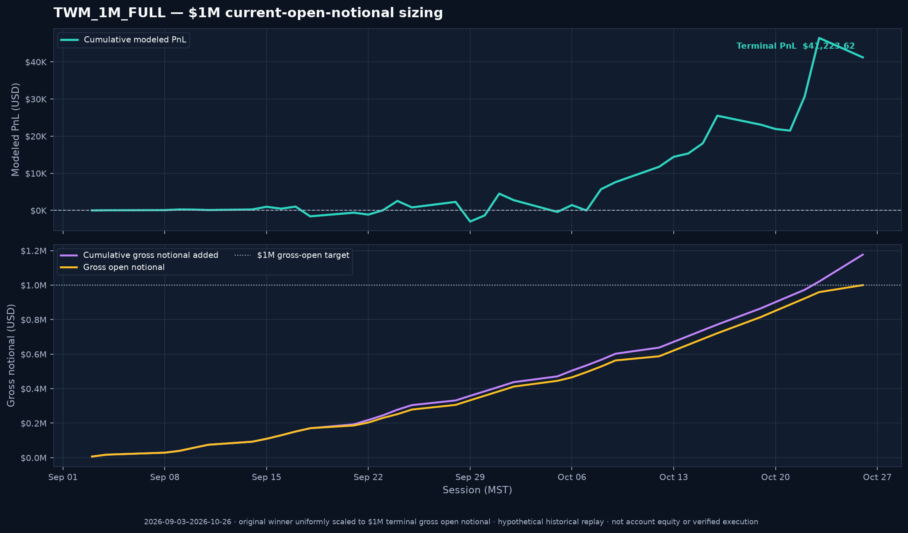
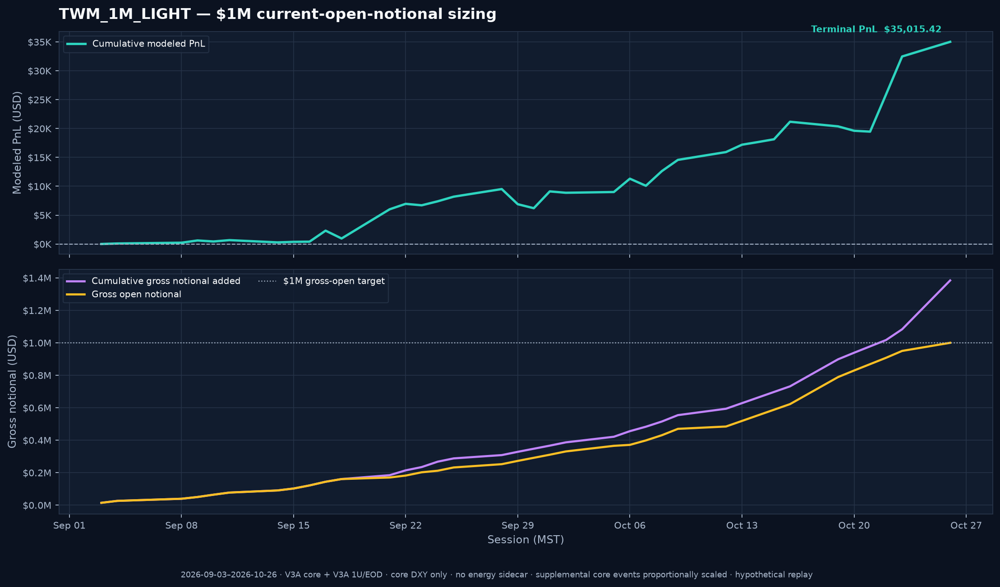
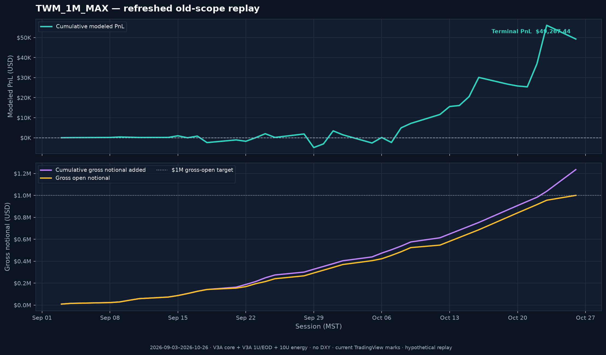

# THE ONE MODEL vs THE WINNING MODEL

> **Historical hypothetical comparison · TradingView-only benchmark through 2026-10-26 · 37 sessions.** This compares the 32-portfolio THE ONE MODEL aggregate with one constituent selected as THE WINNING MODEL: the portfolio with the highest terminal modeled PnL over this same period. Selection is ex post and subject to look-ahead/selection bias.

## Comparison basis

“THE WINNING MODEL” here means **V3A Core + V3A variant-specific 1U/EOD, with the 11U/DAY energy sidecar per active ticker**—portfolio `core_v3a__1u_v3a__with_oil`. It includes core’s integrated 1U/DAY DXY sleeve plus the 10U/DAY DXY add-on (11U/DAY total), just as each of the 32 THE ONE MODEL portfolios does.

The equal-gross comparison scales every daily PnL, notional addition, and open-notional value of this one winning portfolio by **27.201116×**, so its period-end cumulative gross additions match THE ONE MODEL at **$584,960,000.00**. This scales the winner’s unit sizes too: its combined DXY schedule becomes **299.2123U/DAY**, versus the original 11U/DAY. It is a proportional arithmetic scaling of all components, not an assertion that the larger orders could be executed at unchanged prices, spreads, capacity, financing, or risk. The original, unscaled 1× winner is shown alongside it for context; that original portfolio does not have the same total gross additions as the 32-portfolio aggregate.

## TWM_1M_FULL — $1M current-open-notional sizing

**TWM_1M_FULL** is the full TWM winner configuration—V3A core, the V3A-specific 1U/EOD force variant, the included 11U/DAY-per-active-ticker energy sidecar, and the combined 11U/DAY DXY schedule—uniformly scaled to **$1,000,000 of gross open notional**. It scales the original 1× winner by **0.054719562244×** (about 5.4720% of its original size). By construction, terminal gross open notional on 2026-10-26 is **$1,000,000.00**. The largest open notional in this historical replay also occurs on 2026-10-26 and is **$1,000,000.00**.

At that scale, the same historical replay produces **$41,223.62** of terminal modeled PnL on **$1,176,744.19** of cumulative gross additions; the scaled combined DXY schedule is **0.601915U/DAY**. Under your all-cash/debit convention, each $1M gross-open version is treated as a fully paid $1M position base, not $1M of PnL. Cumulative additions can exceed that base because cash from closed positions can be reused. DXY terminology and the TradingView-based DXY sleeve are retained; this sizing view does not relabel DXY as cash or a cash equivalent. This remains a hypothetical historical replay, not verified brokerage execution or proof of future performance.

## TWM_1M_LIGHT — $1M current-open-notional sizing

**TWM_1M_LIGHT** uses the V3A core plus the V3A-specific 1U/EOD force schedule. It retains the chart-directed core DXY sleeve, but excludes the separate 10U/DAY DXY add-on and the energy daily-buy sidecar. Original chart-post events and the ATS/manual/user-reported core additions present in the source replay are included and properly scaled together by **0.118976799524×** to target **$1,000,000 of terminal gross open notional**. The scaling also prorates those supplemental model events; it does not represent actual brokerage quantities or fills.

On 2026-10-26, TWM_1M_LIGHT has **$1,000,000.00** gross open notional and **$35,015.42** terminal modeled PnL, on **$1,384,295.06** cumulative gross additions. Its maximum open notional in the replay is **$1,000,000.00** on 2026-10-26. Under the all-cash/debit convention, the $1M maximum gross-open notional is treated as $1M of fully funded positions; cumulative additions are total activity over time, not an additional cash deposit.

## Current-data rerun of the earlier V3A + 1U + 10U energy construction

**TWM_1M_MAX** reruns the earlier scope with the refreshed 37-session data through 2026-10-26: V3A core + V3A-specific 1U/EOD + a 10U/DAY TradingView energy sidecar, with DXY excluded to match the earlier comparison universe. The 1U/DAY chart-directed DXY core sleeve is removed from the input composite, and the separate 10U/DAY DXY add-on is not included. Current logged ATS/manual/user-reported core events remain in the replay and are scaled with the rest of the model.

This current-data replay totals **$677,180.90** modeled PnL on **$16,975,000.00** of additions, or **3.9893%**. Scaled to **$1,000,000 terminal gross open notional** by **0.072753728629×**, it yields **$49,267.44** modeled PnL on **$1,234,994.54** of cumulative position additions. Under your all-cash/debit convention, treat the **$1,000,000** maximum open notional as the fully funded capital base; the cumulative **$1,234,994.54** of additions is turnover over time, not an extra $1.235M deposited. The modeled PnL is **4.9267% of that $1M cash base** over this replay. The 3.9893% figure above is instead PnL divided by cumulative additions. The current-data replay therefore does **not** reproduce 8.88%.

For comparison, the archived Oct. 23 snapshot (36 sessions; commit `abdd1d8`) had **$1,225,786.98** PnL on **$13,805,000.00** gross additions (**8.879297%**) and **$12,885,000.00** open notional. That is a historical result from the then-current marks and inputs, not a current-data forecast or account return.

## Terminal comparison

| Historical result through 2026-10-26 | THE ONE MODEL: 32 independent portfolios | Winner: original 1× | Winner: equal-gross scaled | TWM_1M_FULL | TWM_1M_LIGHT | TWM_1M_MAX |
|---|---:|---:|---:|---:|---:|---:|
| Terminal modeled PnL | $16,457,691.52 | $753,361.68 | **$20,492,278.46** | $41,223.62 | $35,015.42 | $49,267.44 |
| Cumulative gross notional added | $584,960,000.00 | $21,505,000.00 | **$584,960,000.00** | $1,176,744.19 | $1,384,295.06 | $1,234,994.54 |
| Gross open notional at period end | $478,800,000.00 | $18,275,000.00 | $497,100,395.26 | **$1,000,000.00** | **$1,000,000.00** | **$1,000,000.00** |
| PnL ÷ cumulative gross additions | 2.8135% | 3.5032% | **3.5032%** | 3.5032% | 2.5295% | 3.9893% |
| Modeled PnL ÷ $1M fully funded cash base | — | — | — | 4.1224% | 3.5015% | 4.9267% |
| Peak-to-trough modeled PnL drawdown | $1,786,528.08 | $101,438.78 | $2,759,248.03 | $5,550.68 | $3,314.13 | $6,907.24 |

At the equal-gross terminal additions, the scaled winning curve exceeds THE ONE MODEL's terminal modeled PnL by **$4,034,586.94** and its deployed-notional ratio by **0.6897 percentage points** in this historical sample. The comparison does not establish future outperformance. The winning portfolio was chosen using the same period being compared; this creates survivorship/selection bias, and its advantage is not an independent or out-of-sample result.

## Files and interpretation

- Clean-sheet definitions and rules: [TWM chart-to-model series specification](TWM%20Chart-to-Model%20Series%20%E2%80%94%20Clean-Sheet%20Specification.md) and [THE ONE MODEL winner/contender specification](THE%20ONE%20MODEL%20%E2%80%94%20Winning%20Model%20and%20Contender%20Specification.md).
- Daily comparison series, including the original, equal-gross, TWM_1M_FULL, TWM_1M_LIGHT, and TWM_1M_MAX paths: [`the_one_model_vs_winning_model_v1.csv`](data/the_one_model_vs_winning_model_v1.csv).
- Machine-readable metrics and construction notes for all $1M versions: [`the_one_model_vs_winning_model_v1_summary.json`](data/the_one_model_vs_winning_model_v1_summary.json).
- Each $1M version uniformly scales its selected source path to $1M terminal gross open notional. PnL-to-additions ratios are invariant to uniform scaling (aside from cent rounding). TWM_1M_LIGHT excludes the extra 10U/DAY DXY add-on and energy sidecar but retains core chart DXY. TWM_1M_MAX reruns the old no-DXY, 10U-energy construction using refreshed current data; it does not reproduce the archived 8.88% ratio.
- The 32-way aggregate assumes independent funding/exposure for every constituent. The one-winner comparison is a single concentrated portfolio. No positions, capital, correlated risk, or margin are netted between the two approaches.
- These are hypothetical paper-model outputs, not verified brokerage executions. Under the user-specified all-cash/debit convention, each $1M open-notional scenario is treated as a fully funded $1M capital base, and the table shows modeled PnL relative to that base. PnL divided by cumulative gross additions remains a turnover/deployed-notional ratio, not an account return. Trading costs, slippage, taxes, and operational constraints are not fully modeled.
