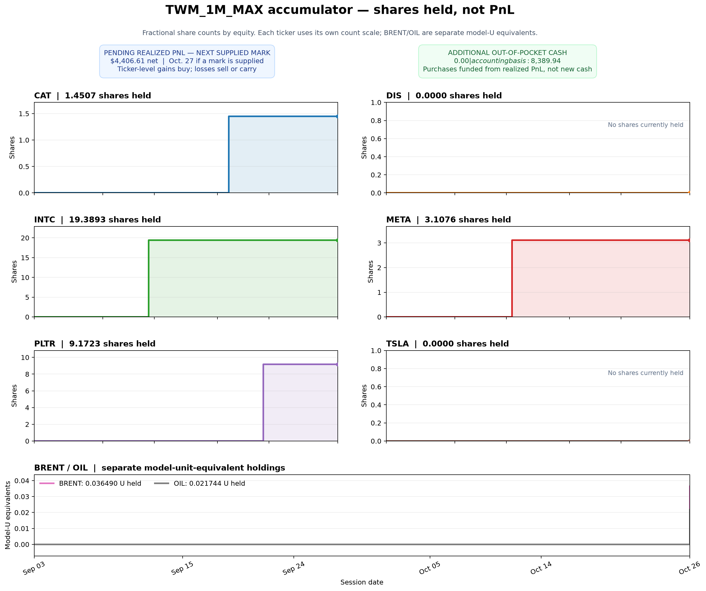

# TWM_1M_MAX Realized-PnL Share Accumulator

This is a separate companion overlay. It does not replace or modify TWM_1M_MAX's dollar PnL, trade sizing, or basis-credit treatment.

## Rules

- Only realized PnL from the V3A core and its V3A 1U/EOD force schedule enters the accumulator. Unrealized gains are never reinvested.
- Same-ticker realized PnL for a session is netted. Positive net PnL buys fractional shares at the first supplied TradingView EOD mark strictly after that session.
- BRENT and OIL are tracked as separate model-U equivalents (1U = $10,000 of initial notional); they are not represented as shares.
- A later realized loss sells only that ticker's accumulated lots at its next supplied EOD mark. Sale proceeds cover the loss first; any shortfall remains a loss debit and offsets future same-ticker realized profits before purchases resume.
- DXY is not turned into a separate share/unit tracker or added as another sleeve; only eligible direct-ticker and energy realized events are used, avoiding DXY double-counting.
- Marks are sourced from the existing TradingView benchmark session file and 10U energy sidecar input. No legacy-price substitution is used.
- This accumulator is a cash-flow overlay: its share/unit cost basis is funded from realized PnL already included in the baseline. Therefore only the accumulator's own realized/unrealized investment PnL is incremental; its market value or cost basis must not be added to baseline PnL.

## Terminal results

- Period: **2026-09-03–2026-10-26** (37 sessions).
- Baseline TWM_1M_MAX PnL remains **$49,267.44** on the existing $1,000,000 funded-cash base.
- Scaled realized PnL events eligible for this overlay: **$12,654.80** across 181 close events.
- Accumulator holdings at the last supplied marks: market value **$7,123.91**, cost basis **$8,389.94**.
- Accumulator incremental PnL: **$-1,266.02** (realized **$0.00**, unrealized **$-1,266.02**).
- Baseline plus incremental accumulator PnL for perspective: **$48,001.42**. This does not add the accumulator's cost basis or market value a second time.
- Unfunded realized-loss carry: **$141.75**; **$4,406.61** of net realized PnL from the final session is pending processing at the next supplied EOD mark (Oct. 27 if a TradingView mark is supplied).
- Additional out-of-pocket cash for the accumulated shares: **$0.00**. The **$8,389.94** accounting cost basis is funded from realized PnL already earned; it is not new cash or zero accounting basis.

### Ticker-level holdings

| Ticker | Tracker | Held shares / model-U equivalents | Cost basis | Market value | Incremental PnL | Loss carry |
|---|---|---:|---:|---:|---:|---:|
| BRENT | model-U | 0.03649049 | $364.90 | $364.90 | $0.00 | $0.00 |
| CAT | shares | 1.45071998 | $1,180.64 | $1,004.09 | $-176.55 | $0.00 |
| DIS | shares | 0.00000000 | $0.00 | $0.00 | $0.00 | $141.75 |
| INTC | shares | 19.38929813 | $2,377.13 | $1,754.15 | $-622.98 | $0.00 |
| META | shares | 3.10756626 | $2,335.83 | $1,959.51 | $-376.33 | $0.00 |
| OIL | model-U | 0.02174384 | $217.44 | $217.44 | $0.00 | $0.00 |
| PLTR | shares | 9.17233972 | $1,913.99 | $1,823.83 | $-90.16 | $0.00 |
| TSLA | shares | 0.00000000 | $0.00 | $0.00 | $0.00 | $0.00 |

## Share counts through time

The panels show units held—not dollars or PnL. Equity panels use independent share-count axes because share quantities are not directly comparable across tickers; BRENT/OIL are in a separate model-U panel.

## Audit files

- Share-count chart: `Charts/superstructure/twm-1m-max-share-counts.png`
- Daily ticker ledger: `data/twm_1m_max_share_accumulator_daily_v1.csv`
- Terminal ticker summary: `data/twm_1m_max_share_accumulator_ticker_summary_v1.csv`
- Machine-readable summary: `data/twm_1m_max_share_accumulator_v1_summary.json`
- PnL comparison chart: `Charts/superstructure/twm-1m-max-share-accumulator.png`

The daily ledger distinguishes realized PnL, next-mark purchases/sales, held shares or U-equivalents, market value, cost basis, loss carry, and incremental overlay PnL.
