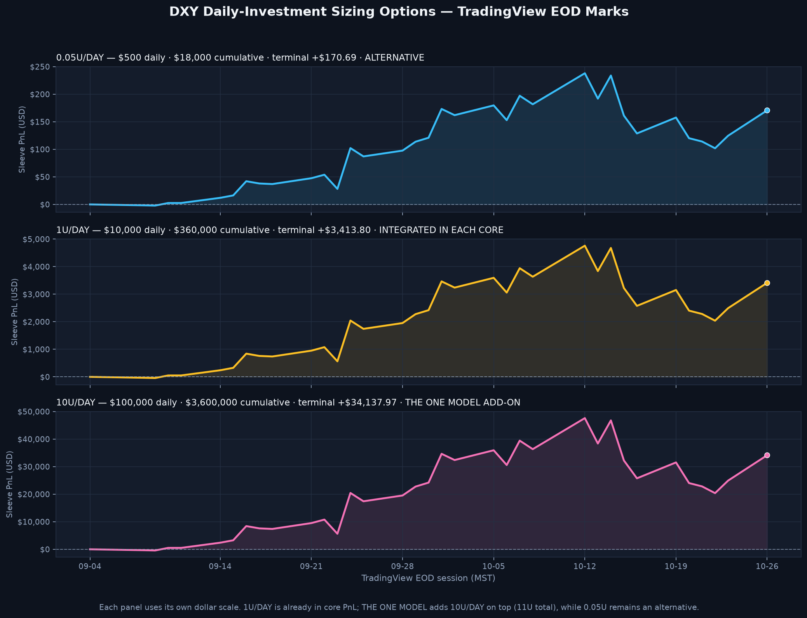

# TradingView Energy and Currency Desk Sidecars

> **TradingView sidecar schedules — 2026-10-24 benchmark.** Prices use only the user-provided Part A/Part B TradingView lists. 1U = $10,000 notional; displayed standard daily allocations are 0.05U ($500), 1U ($10,000), and 10U ($100,000). The 1U/DAY/DXY schedule is integrated into every core variant. THE ONE MODEL adds 10U/DAY DXY to all 32 portfolios (11U/DAY combined), and uses a derived 11U/DAY energy tranche per active BRENT and OIL ticker in its 16 energy-inclusive portfolios. 0.05U DXY remains an alternative. These are hypothetical dollar-notional/index-return exposures, not broker fills or account returns.

## Energy desk: separate Brent and WTI daily-buy schedules

Each size option adds a fixed-notional long lot at that session's EOD mark beginning with the first logged chart position for the instrument. The purchase-day mark-to-market is zero. Energy-sidecar PnL below includes only the new daily-buy lots; the pre-existing chart position PnL is displayed separately for context and is not counted again in model composites.

For THE ONE MODEL only, the 11U/DAY schedule per active ticker is derived from the audited 10U TradingView energy rows so each active energy tranche matches the model's combined 11U/DAY DXY exposure. The 10U schedule remains the size used in the separate strategy-comparison composites. Derived THE ONE MODEL schedule: [`the_one_model_energy_11u_sidecar_daily_v1.csv`](data/the_one_model_energy_11u_sidecar_daily_v1.csv).

| Daily size | Ticker | Daily notional | Sessions | Cumulative notional added | Daily-buy terminal PnL | Chart-position PnL (separate) |
|---|---|---:|---:|---:|---:|---:|
| 0.05U | BRENT | $500.00 | 23 | $11,500.00 | $+1,127.31 | $+5,026.57 |
| 0.05U | OIL | $500.00 | 32 | $16,000.00 | $+1,376.74 | $+6,614.56 |
| 1U | BRENT | $10,000.00 | 23 | $230,000.00 | $+22,546.12 | $+5,026.57 |
| 1U | OIL | $10,000.00 | 32 | $320,000.00 | $+27,534.71 | $+6,614.56 |
| 10U | BRENT | $100,000.00 | 23 | $2,300,000.00 | $+225,461.20 | $+5,026.57 |
| 10U | OIL | $100,000.00 | 32 | $3,200,000.00 | $+275,347.06 | $+6,614.56 |

## DXY currency desk: daily long-investment alternatives

The DXY log has one LONG badge on Sep. 4 at 99.087 (the original post's caption says the dollar weakens, which conflicts with its LONG badge). The logged badge is treated as the activation signal; daily 1U lots follow the latest charted LONG/REBUY/SHORT direction. The 1U/DAY schedule shown here is the same sleeve integrated into each core variant, not an additional allocation to stack on top. Because DXY is an index rather than a directly investable security, this is a hypothetical notional/index-return proxy; no futures/ETF contract, multiplier, collateral, or tracking error is modeled. The logged one-time 1U chart-position result is shown separately and is not part of the daily sleeve.

| Daily size | Daily notional | Sessions | Cumulative notional added | Daily-investment terminal PnL | Logged 1U chart-position PnL (separate) |
|---|---:|---:|---:|---:|---:|
| 0.05U | $500.00 | 35 | $17,500.00 | $+124.62 | $+268.85 |
| 1U | $10,000.00 | 35 | $350,000.00 | $+2,492.30 | $+268.85 |
| 10U | $100,000.00 | 35 | $3,500,000.00 | $+24,923.03 | $+268.85 |

*Three-panel view of the 0.05U, 1U, and 10U DXY daily-lot PnL paths. Each panel uses its own dollar scale; the size labels show daily and cumulative notional. The 1U/DAY schedule is included in every core model. THE ONE MODEL adds the 10U/DAY schedule on top, for 11U/DAY total; 0.05U remains an alternative.*

The 0.05U, 1U, and 10U rows show sizing scenarios. The 1U/DAY/DXY PnL and notional are already included in each core model; do not add the 1U schedule a second time. THE ONE MODEL selects the 10U/DAY schedule as a separate add-on in each of its 32 portfolios, making 11U/DAY combined DXY exposure; 0.05U remains an unselected alternative. Other strategy-comparison composites retain their existing scope. Do not treat the one-time chart-position context as included in the daily-investment results.

The crypto positions have been removed from the core comparison pending source calibration. See [`Crypto Sidecar — Pending TradingView Recalibration.md`](Crypto%20Sidecar%20%E2%80%94%20Pending%20TradingView%20Recalibration.md); no BTC/ETH marks or PnL are used here.

Machine-readable daily schedules: [`tradingview_energy_sidecar_daily_20261024.csv`](data/tradingview_energy_sidecar_daily_20261024.csv), [`dxy_currency_desk_sidecar_daily_20261024.csv`](data/dxy_currency_desk_sidecar_daily_20261024.csv). Price source/mark flags: [`tradingview_benchmark_session_marks_20261024.csv`](data/tradingview_benchmark_session_marks_20261024.csv).
