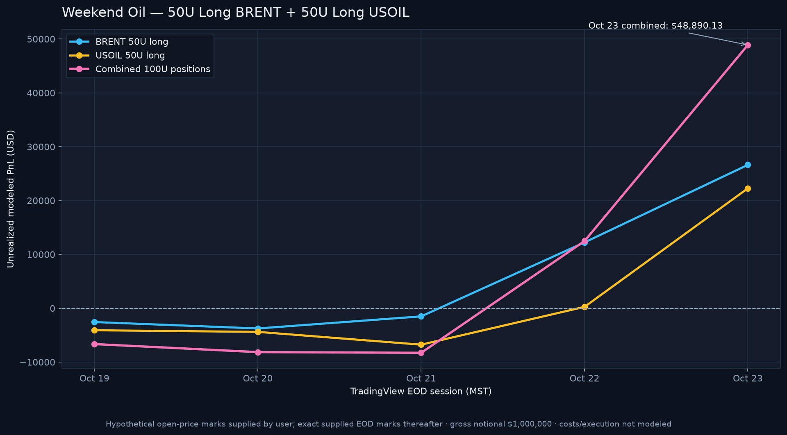

# Weekend Oil 50U Position Hypothetical

> **Hypothetical educational mark-to-market only.** These are not broker executions, a verified account return, or a recommendation. Both assumed positions remain open through the latest supplied EOD marks, with no costs, financing, slippage, or liquidation modeled.

## Position assumptions

The user requested one **50U LONG** position in BRENT and one **50U LONG** position in USOIL, opened at the **2026-10-19 market open**. Under the repository convention of 1U = $10,000 notional, each position starts at $500,000 gross notional; combined gross notional is $1,000,000.

| Instrument | Internal ticker | Side / size | Assumed 2026-10-19 open | Entry-mark source | Daily EOD mark source | Oct. 23 EOD mark | Oct. 23 unrealized PnL | PnL ÷ gross notional |
|---|---|---:|---:|---|---|---:|---:|---:|
| BRENT | `BRENT` | 50U LONG | $111.412 | User-provided TradingView open | User-provided BlackBull Markets Brent Cash EOD | $117.345 | $+26,626.40 | 5.3253% |
| USOIL (repository ticker OIL) | `OIL` | 50U LONG | $99.04 | User-provided TradingView open | User-provided TradingView TVC:USOIL EOD | $103.45 | $+22,263.73 | 4.4527% |
| **Combined** | — | **100U LONG** | — | — | — | — | **$+48,890.13** | **4.8890%** |

## Session marks and PnL

PnL is marked using `gross notional × (EOD close ÷ assumed open − 1)`. Both positions are long and remain open. The Oct. 19 result is the first EOD mark after the assumed opening; it is not zero-PnL because the entry prices are the separately supplied market-open marks.

| EOD date | Instrument | EOD close | Gross notional | Unrealized PnL | PnL / gross notional | Mark source |
|---|---|---:|---:|---:|---:|---|
| 2026-10-19 | BRENT | $110.840 | $500,000.00 | $-2,567.05 | -0.5134% | User-provided BlackBull Markets Brent Cash EOD |
| 2026-10-20 | BRENT | $110.575 | $500,000.00 | $-3,756.33 | -0.7513% | User-provided BlackBull Markets Brent Cash EOD |
| 2026-10-21 | BRENT | $111.075 | $500,000.00 | $-1,512.40 | -0.3025% | User-provided BlackBull Markets Brent Cash EOD |
| 2026-10-22 | BRENT | $114.136 | $500,000.00 | $+12,224.89 | 2.4450% | User-provided BlackBull Markets Brent Cash EOD |
| 2026-10-23 | BRENT | $117.345 | $500,000.00 | $+26,626.40 | 5.3253% | User-provided BlackBull Markets Brent Cash EOD |
| 2026-10-19 | USOIL (repository ticker OIL) | $98.230 | $500,000.00 | $-4,089.26 | -0.8179% | User-provided TradingView TVC:USOIL EOD |
| 2026-10-20 | USOIL (repository ticker OIL) | $98.170 | $500,000.00 | $-4,392.16 | -0.8784% | User-provided TradingView TVC:USOIL EOD |
| 2026-10-21 | USOIL (repository ticker OIL) | $97.700 | $500,000.00 | $-6,764.94 | -1.3530% | User-provided TradingView TVC:USOIL EOD |
| 2026-10-22 | USOIL (repository ticker OIL) | $99.090 | $500,000.00 | $+252.42 | 0.0505% | User-provided TradingView TVC:USOIL EOD |
| 2026-10-23 | USOIL (repository ticker OIL) | $103.450 | $500,000.00 | $+22,263.73 | 4.4527% | User-provided TradingView TVC:USOIL EOD |

Session-level export: [`weekend_oil_50u_positions_v1.csv`](data/weekend_oil_50u_positions_v1.csv).

## Source and scope notes

- Weekend source archive: [`Weekend Oil (10-17 & 10-18).zip`](Weekend%20Oil%20%2810-17%20%26%2010-18%29.zip); [upstream GitHub file](https://github.com/A44674928/Financial_Model_Records/blob/main/Weekend%20Oil%20(10-17%20%26%2010-18).zip) at commit `b5d6a9a0d9abb84d108c82f312b5298ecf9f437a`; SHA-256 `7419893a19fa1416a5dd238d48cacf17e22187da9b392b54ae50f5093b377c6f`.
- The archive contains two annotated IG **Weekend Oil – US Crude (CLN25)** screenshots dated Oct. 17 and Oct. 18, not a complete OHLC history and not separate BRENT/USOIL Monday-open price files. The screenshots are retained as source context, not transcribed as daily marks.
- The two Oct. 19 open prices, BRENT $111.412 and USOIL $99.04, were provided by the user and identified as TradingView. BRENT is stored internally as `BRENT`; USOIL maps to the repository ticker `OIL`.
- Subsequent EOD values come from [`energy_provider_eod_marks_v1.csv`](data/energy_provider_eod_marks_v1.csv): BlackBull Markets Brent Cash for BRENT and TradingView TVC:USOIL for OIL. No new or external daily prices are inserted.
- This one-time 50U-per-instrument overlay is **not included** in the core replay, THE ONE MODEL's 32-portfolio aggregate, or standard 10U energy strategy-comparison composites. It is a separate hypothetical with $1,000,000 combined gross notional, not an account-capital return.
- PnL excludes commissions, spread, slippage, financing, CFD contract multipliers/tracking differences, taxes, margin, and execution constraints. The notional-percentage view is a simple gross-notional ratio, not an account return.
