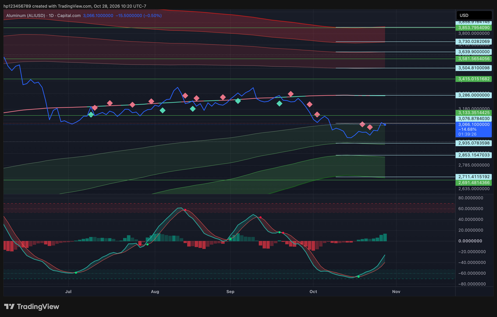

# ALIUSD User-Directed LONG Position

> **User-directed paper scenario, not a verified brokerage position.** The user explicitly specified a LONG position with **$20,000,000,000.00 notional at $3,000.00**. No broker order, fill, actual account balance, or execution is independently verified.

| Field | Recorded value |
|---|---|
| Instrument | Aluminum / U.S. Dollar (`ALIUSD`), TradingView chart labeled Capital.com |
| Direction | LONG — explicitly specified by the user |
| Modeled gross notional | $20,000,000,000.00 |
| User-specified entry price | $3,000.00 |
| Price-divided notional-equivalent quantity | 6,666,666.66666667 |
| Position/order date and time | Not supplied |
| Execution status | User-directed paper scenario; no verified fill |
| Funding convention | Gross notional only; no leverage or financing is modeled. Funding is not independently verified. |

The quantity is only the arithmetic quotient of notional divided by entry price. The Capital.com instrument's contract multiplier and quantity convention were not supplied, so this is **not a claim about shares, contracts, metric tons, or brokerage units**.

## Chart source and mark boundary

The archived TradingView screenshot identifies **Aluminum (ALIUSD), 1D, Capital.com** and carries a chart-creation timestamp of **2026-10-28 10:20 UTC−7**. That timestamp documents the source chart only; it is **not** treated as the position's entry/order time. The displayed chart price of **$3,066.10** is retained as screenshot context, not as a verified EOD close or a mark used to calculate PnL. No current valuation or realized/unrealized PnL is calculated here.

The image is preserved in [`Archive/ALIUSD_LONG_2026-10-28/`](../Archive/ALIUSD_LONG_2026-10-28/) with its source description and SHA-256. This ALIUSD scenario is kept separate from the historical 31-symbol model replay and existing oil/pool allocations; no funding source or combined account total is inferred.

Machine-readable record: [`data/aliusd_user_directed_position_v1.csv`](../data/aliusd_user_directed_position_v1.csv).
