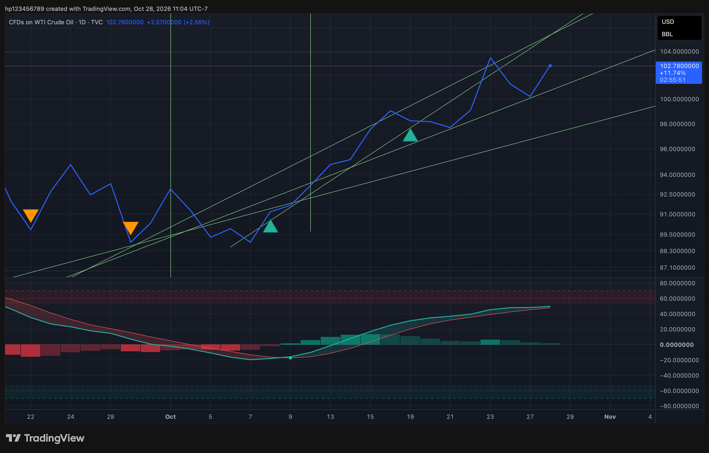
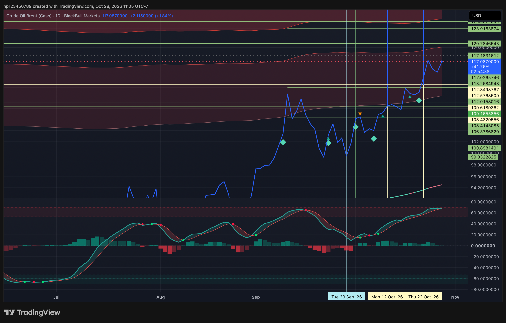
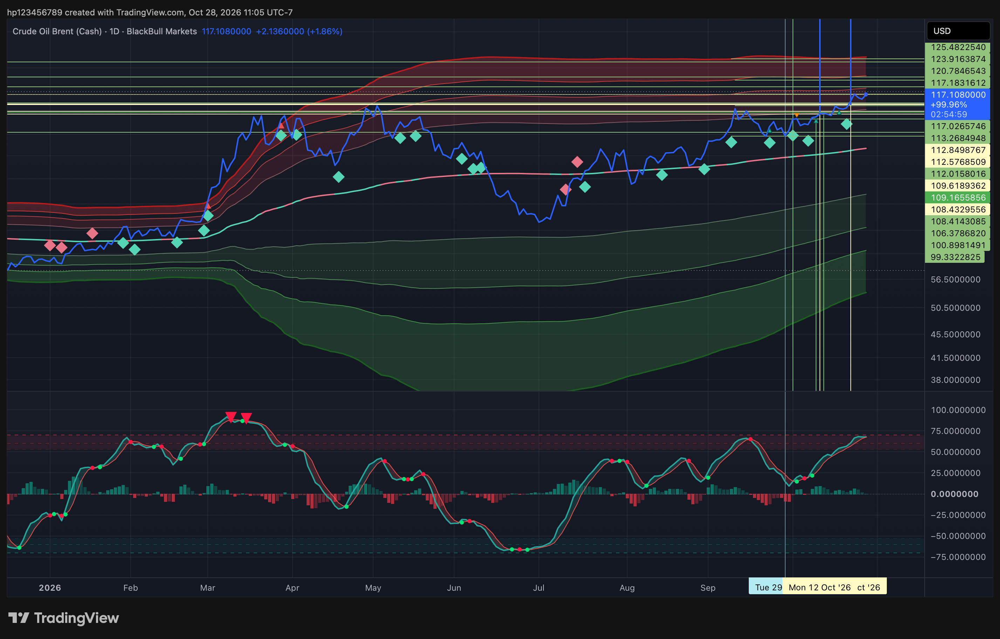

# Oil Chart Set — 2026-10-28

A catalog of the three user-supplied daily charts, grouped by instrument and view. This is an archive/index only—not a new trade log, signal interpretation, EOD-mark update, or fill verification. The visible quote labels are screenshot-time values, not supplied EOD closes. No position direction, entry, or trade is inferred from chart lines, markers, or annotations.

## USOIL / WTI — recent daily view

- **Chart label:** CFDs on WTI Crude Oil · 1D · TVC
- **Chart-created timestamp:** Oct. 28, 2026, 11:04 UTC−7
- **Displayed quote:** $102.780000 (change shown: +$2.570000, +2.56%)
- **Visible price unit:** USD/BBL
- **Source file:** [`USOIL_2026-10-28_11-04-08.png`](../Archive/Oil_Chart_Set_2026-10-28/USOIL/USOIL_2026-10-28_11-04-08.png)

## BRENT — recent daily view

- **Chart label:** Crude Oil Brent (Cash) · 1D · BlackBull Markets
- **Chart-created timestamp:** Oct. 28, 2026, 11:05 UTC−7; attachment filename timestamp 11:05:21
- **Displayed quote:** $117.087000 (change shown: +$2.115000, +1.84%)
- **Visible context:** recent-month view
- **Source file:** [`BRENT_2026-10-28_11-05-21.png`](../Archive/Oil_Chart_Set_2026-10-28/BRENT/BRENT_2026-10-28_11-05-21.png)

## BRENT — broader 2026 daily view

- **Chart label:** Crude Oil Brent (Cash) · 1D · BlackBull Markets
- **Chart-created timestamp:** Oct. 28, 2026, 11:05 UTC−7; attachment filename timestamp 11:05:00
- **Displayed quote:** $117.108000 (change shown: +$2.136000, +1.86%)
- **Visible context:** broader 2026 history
- **Source file:** [`BRENT_2026-10-28_11-05-00.png`](../Archive/Oil_Chart_Set_2026-10-28/BRENT/BRENT_2026-10-28_11-05-00.png)

## Organization and boundaries

All three originals are kept in [`Archive/Oil_Chart_Set_2026-10-28/`](../Archive/Oil_Chart_Set_2026-10-28/), separated by instrument. Their SHA-256 hashes and source-file mapping are in that folder's README. The two BRENT screenshots are distinct captures with slightly different displayed quotes; they are preserved separately, not averaged or substituted for an EOD mark.

This archive does not change existing BRENT/OIL position sizes, entry prices, model results, or the locked-$200 condition. Any trade/position update requires an explicit user-stated direction and sizing rather than inference from these chart visuals.
