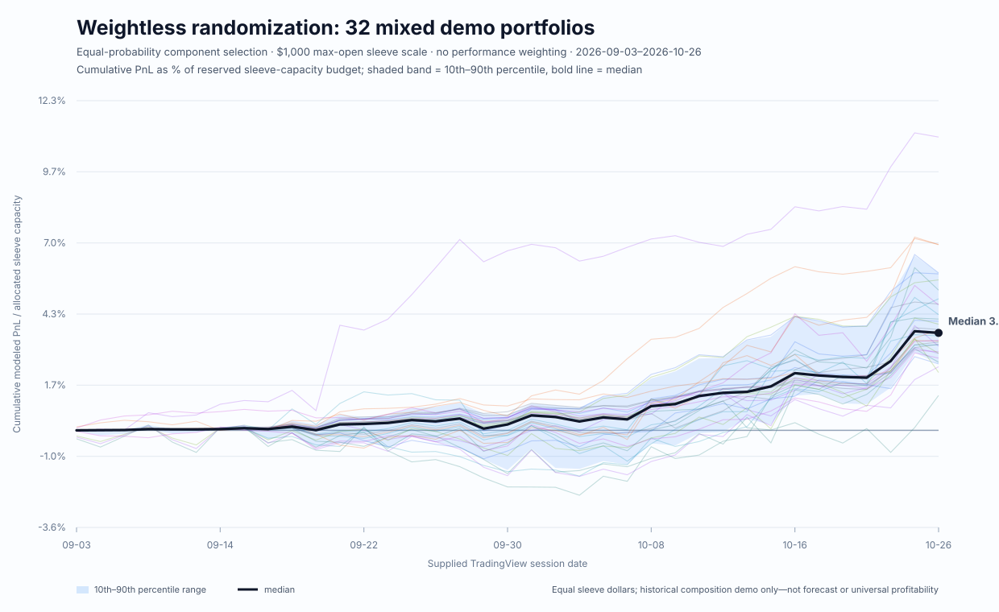

# Weightless Randomized Demo Portfolios — 2026-10-26

**Snapshot:** supplied TradingView replay, **2026-09-03–2026-10-26** (37 sessions). This is a reproducible composition/aggregation demonstration—not a forecast, portfolio recommendation, or claim of future profitability.

## What “weightless randomization” means here

- **Uniform composition draws:** seed `20261026` selects component types and available variants/tickers without ranking or weighting them by ROI, Sharpe, drawdown, or other historical performance. Each demo always has one DXY-free core book and one DXY-free whole-model component, plus a uniform random selection of one to four additional categories from force, ticker, energy, and standalone DXY. There are **32 reproducible demo compositions**.
- **Equal dollars per chosen component:** each selected component is scaled to **$1,000 maximum gross open notional**, so every selected sleeve has equal size. The reserved all-cash capacity is the sum of those sleeve targets (3–6 components = $3K–$6K). No return-based portfolio weights are applied.
- **DXY control:** core and whole-model source paths are stripped of DXY before they enter the catalog. A demo can have at most one explicitly selected standalone 1U or 10U/DAY DXY sleeve. DXY is an index-return proxy, not a share ticker.
- **Independent books, not netting:** each component retains its own historical event/mark path. Same-ticker components, if selected, are separate funded sleeves; their gross PnL/additions/exposure are summed and never position-netted. Energy sidecars remain separate BRENT/OIL U-equivalents.
- **No invented history:** components that begin after Sep. 3 remain at zero before their first supplied active session. TradingView-only marks are used; no legacy-price substitutions, image-inferred trades, or verified-fill claims are introduced.

## The superstructure demonstration

The superstructure performs the same steps for every exact mix: identify independent components; record their source variant, ticker, sidecar scope, and scale factor; align each path to the shared session calendar; sum daily PnL, additions, and gross open notional; then report drawdown and clearly named return denominators. The graph shows every demo's cumulative PnL relative to its reserved sleeve-capacity budget, with a 10th–90th percentile band and median.

Across this seeded sample, the ending return on allocated sleeve capacity ranges from **1.305% to 10.968%**, with a median of **3.643%**. Ending modeled PnL ranges from **$39.16 to $417.11**. Maximum concurrent gross-open exposure ranges from **$2,568.22 to $5,926.87**. The range is intentional: the system keeps the different mixes and their inputs separate while using the same aggregation contract.

This demonstrates composition-agnostic **accounting and reporting**, not that every mix is profitable or that exact composition does not affect results. In-sample selection, correlation, concentration, market capacity, trading costs, and future performance remain unresolved.

## Demo portfolio series

`PnL / capacity` is terminal modeled PnL divided by the reserved sum of the $1,000 per-sleeve limits. `PnL / additions` is a separate deployed-notional ratio. `PnL / max open` divides terminal PnL by the actual maximum concurrent gross-open notional and is the funded-peak-exposure view; it is not interchangeable with either additions or reserved-capacity return. `Maximum open` is the actual concurrent gross exposure after aligning the selected sleeves' daily paths; it can be below reserved capacity when sleeve peaks occur on different dates.

| Demo | Sleeves | Randomly selected composition | Reserved capacity | Terminal PnL | PnL / capacity | PnL / additions | PnL / max open | Maximum open | Max drawdown |
|---|---:|---|---:|---:|---:|---:|---:|---:|---:|
| WLESS-01 | 3 | CORE_V2_NO_DXY TOM_32_AGGREGATE_NO_DXY CORE_TICKER_V3A_HD | $3,000 | $124.83 | 4.161% | 3.177% | 4.161% | $3,000.00 | $76.42 |
| WLESS-02 | 3 | CORE_V3B_NO_DXY TWM_1M_MAX_NO_DXY_10U_ENERGY FORCE_V3A_1U_EOD | $3,000 | $122.34 | 4.078% | 2.997% | 4.180% | $2,926.87 | $11.02 |
| WLESS-03 | 5 | CORE_V3B_NO_DXY TOM_32_AGGREGATE_NO_DXY CORE_TICKER_V1_GEV ENERGY_BRENT_11U_DAY DXY_10U_STANDALONE | $5,000 | $119.03 | 2.381% | 1.996% | 2.381% | $5,000.00 | $42.74 |
| WLESS-04 | 6 | CORE_V3B_NO_DXY TOM_32_AGGREGATE_NO_DXY CORE_TICKER_V3B_CAT DXY_10U_STANDALONE FORCE_V3B_1U_EOD ENERGY_OIL_11U_DAY | $6,000 | $417.11 | 6.952% | 4.789% | 7.697% | $5,419.50 | $30.67 |
| WLESS-05 | 5 | CORE_V2_NO_DXY TOM_32_AGGREGATE_NO_DXY FORCE_V3A_1U_EOD CORE_TICKER_V3A_LULU ENERGY_OIL_11U_DAY | $5,000 | $246.07 | 4.921% | 4.025% | 4.995% | $4,926.87 | $129.66 |
| WLESS-06 | 5 | CORE_V1_NO_DXY TOM_MEMBER_NO_DXY_core_v2__1u_v3a__with_oil DXY_1U_STANDALONE CORE_TICKER_V1_WMT FORCE_V3B_1U_EOD | $5,000 | $281.17 | 5.623% | 4.615% | 5.716% | $4,919.50 | $18.84 |
| WLESS-07 | 4 | CORE_V3B_NO_DXY TOM_MEMBER_NO_DXY_core_v3b__1u_v1__with_oil FORCE_V3A_1U_EOD CORE_TICKER_V3A_ORCL | $4,000 | $117.54 | 2.938% | 2.317% | 2.993% | $3,926.87 | $11.11 |
| WLESS-08 | 3 | CORE_V1_NO_DXY TOM_32_AGGREGATE_NO_DXY CORE_TICKER_V2_PEP | $3,000 | $141.63 | 4.721% | 3.604% | 4.721% | $3,000.00 | $16.30 |
| WLESS-09 | 4 | CORE_V3A_NO_DXY TWM_1M_MAX_NO_DXY_10U_ENERGY FORCE_V3A_1U_EOD CORE_TICKER_V3A_XRH0 | $4,000 | $101.93 | 2.548% | 2.006% | 2.596% | $3,926.87 | $72.97 |
| WLESS-10 | 3 | CORE_V3A_NO_DXY TWM_1M_MAX_NO_DXY_10U_ENERGY ENERGY_BRENT_11U_DAY | $3,000 | $176.62 | 5.887% | 4.531% | 5.887% | $3,000.00 | $20.60 |
| WLESS-11 | 6 | CORE_V3A_NO_DXY TOM_MEMBER_NO_DXY_core_v3a__1u_v1__with_oil FORCE_V1_1U_EOD CORE_TICKER_V1_AMZN DXY_1U_STANDALONE ENERGY_BRENT_11U_DAY | $6,000 | $172.65 | 2.878% | 2.440% | 2.914% | $5,925.73 | $50.08 |
| WLESS-12 | 5 | CORE_V3B_NO_DXY TOM_32_AGGREGATE_NO_DXY CORE_TICKER_V1_VLO DXY_1U_STANDALONE ENERGY_OIL_11U_DAY | $5,000 | $166.76 | 3.335% | 2.796% | 3.335% | $5,000.00 | $41.40 |
| WLESS-13 | 5 | CORE_V3B_NO_DXY TOM_MEMBER_NO_DXY_core_v3a__1u_v3b__with_oil ENERGY_OIL_11U_DAY DXY_10U_STANDALONE CORE_TICKER_V2_V | $5,000 | $216.18 | 4.324% | 3.654% | 4.324% | $5,000.00 | $32.47 |
| WLESS-14 | 6 | CORE_V2_NO_DXY TOM_32_AGGREGATE_NO_DXY DXY_1U_STANDALONE ENERGY_BRENT_11U_DAY CORE_TICKER_V2_XRH0 FORCE_V3A_1U_EOD | $6,000 | $172.59 | 2.876% | 2.426% | 2.912% | $5,926.87 | $64.37 |
| WLESS-15 | 5 | CORE_V3A_NO_DXY TWM_1M_MAX_NO_DXY_10U_ENERGY CORE_TICKER_V1_PLTR DXY_10U_STANDALONE ENERGY_OIL_11U_DAY | $5,000 | $234.28 | 4.686% | 3.760% | 5.122% | $4,573.84 | $88.82 |
| WLESS-16 | 6 | CORE_V3B_NO_DXY TWM_1M_MAX_NO_DXY_10U_ENERGY DXY_1U_STANDALONE CORE_TICKER_V3A_TMO FORCE_V3A_1U_EOD ENERGY_OIL_11U_DAY | $6,000 | $226.40 | 3.773% | 3.197% | 3.820% | $5,926.87 | $27.86 |
| WLESS-17 | 3 | CORE_V3B_NO_DXY TWM_1M_MAX_NO_DXY_10U_ENERGY CORE_TICKER_V3A_GEV | $3,000 | $39.16 | 1.305% | 1.005% | 1.305% | $3,000.00 | $57.68 |
| WLESS-18 | 6 | CORE_V3A_NO_DXY TOM_MEMBER_NO_DXY_core_v3b__1u_v2__no_oil CORE_TICKER_V1_WMT DXY_1U_STANDALONE ENERGY_BRENT_11U_DAY FORCE_V3A_1U_EOD | $6,000 | $350.99 | 5.850% | 4.813% | 5.922% | $5,926.87 | $23.78 |
| WLESS-19 | 5 | CORE_V3A_NO_DXY TOM_32_AGGREGATE_NO_DXY CORE_TICKER_V3A_XRH0 ENERGY_OIL_11U_DAY FORCE_V3B_1U_EOD | $5,000 | $157.39 | 3.148% | 2.535% | 3.199% | $4,919.50 | $94.88 |
| WLESS-20 | 3 | CORE_V3A_NO_DXY TOM_MEMBER_NO_DXY_core_v3b__1u_v3b__no_oil FORCE_V3B_1U_EOD | $3,000 | $112.65 | 3.755% | 2.581% | 3.859% | $2,919.50 | $8.46 |
| WLESS-21 | 4 | CORE_V1_NO_DXY TWM_1M_MAX_NO_DXY_10U_ENERGY CORE_TICKER_V1_HD DXY_1U_STANDALONE | $4,000 | $141.25 | 3.531% | 2.905% | 3.531% | $4,000.00 | $71.50 |
| WLESS-22 | 6 | CORE_V3A_NO_DXY TWM_1M_MAX_NO_DXY_10U_ENERGY CORE_TICKER_V1_OIL DXY_1U_STANDALONE FORCE_V1_1U_EOD ENERGY_BRENT_11U_DAY | $6,000 | $238.21 | 3.970% | 3.060% | 4.020% | $5,925.73 | $22.92 |
| WLESS-23 | 4 | CORE_V3A_NO_DXY TWM_1M_MAX_NO_DXY_10U_ENERGY FORCE_V2_1U_EOD DXY_1U_STANDALONE | $4,000 | $134.66 | 3.366% | 2.627% | 3.436% | $3,919.50 | $10.61 |
| WLESS-24 | 3 | CORE_V3B_NO_DXY TOM_32_AGGREGATE_NO_DXY DXY_10U_STANDALONE | $3,000 | $98.93 | 3.298% | 2.496% | 3.298% | $3,000.00 | $8.46 |
| WLESS-25 | 3 | CORE_V3B_NO_DXY TOM_MEMBER_NO_DXY_core_v3b__1u_v3b__with_oil ENERGY_OIL_11U_DAY | $3,000 | $157.25 | 5.242% | 4.016% | 5.242% | $3,000.00 | $29.36 |
| WLESS-26 | 6 | CORE_V2_NO_DXY TWM_1M_MAX_NO_DXY_10U_ENERGY DXY_1U_STANDALONE FORCE_V1_1U_EOD ENERGY_OIL_11U_DAY CORE_TICKER_V1_AMZN | $6,000 | $149.04 | 2.484% | 2.114% | 2.515% | $5,925.73 | $70.11 |
| WLESS-27 | 3 | CORE_V3B_NO_DXY TOM_MEMBER_NO_DXY_core_v3b__1u_v1__with_oil CORE_TICKER_V3A_META | $3,000 | $329.03 | 10.968% | 6.729% | 12.811% | $2,568.22 | $25.00 |
| WLESS-28 | 3 | CORE_V3A_NO_DXY TWM_1M_MAX_NO_DXY_10U_ENERGY CORE_TICKER_V3A_CVX | $3,000 | $208.11 | 6.937% | 5.339% | 6.937% | $3,000.00 | $26.52 |
| WLESS-29 | 6 | CORE_V3B_NO_DXY TOM_32_AGGREGATE_NO_DXY FORCE_V2_1U_EOD CORE_TICKER_V3A_VLO ENERGY_OIL_11U_DAY DXY_10U_STANDALONE | $6,000 | $191.64 | 3.194% | 2.664% | 3.237% | $5,919.50 | $41.82 |
| WLESS-30 | 6 | CORE_V2_NO_DXY TWM_1M_MAX_NO_DXY_10U_ENERGY CORE_TICKER_V1_TSLA DXY_10U_STANDALONE ENERGY_BRENT_11U_DAY FORCE_V2_1U_EOD | $6,000 | $129.74 | 2.162% | 1.829% | 2.355% | $5,508.53 | $76.32 |
| WLESS-31 | 5 | CORE_V3A_NO_DXY TOM_32_AGGREGATE_NO_DXY FORCE_V2_1U_EOD CORE_TICKER_V3A_DIS ENERGY_OIL_11U_DAY | $5,000 | $135.08 | 2.702% | 2.018% | 2.746% | $4,919.50 | $44.55 |
| WLESS-32 | 4 | CORE_V3A_NO_DXY TOM_32_AGGREGATE_NO_DXY FORCE_V2_1U_EOD DXY_10U_STANDALONE | $4,000 | $128.72 | 3.218% | 2.479% | 3.284% | $3,919.50 | $9.22 |

## Reproducibility and files

- Builder: [`scripts/build_weightless_randomized_demo_portfolios.py`](../scripts/build_weightless_randomized_demo_portfolios.py). Rebuild from the repository root with `python scripts/build_weightless_randomized_demo_portfolios.py`.
- Component manifest, scaling factors, and DXY check: [`data/weightless_demo_portfolio_members_v1.csv`](../data/weightless_demo_portfolio_members_v1.csv).
- Full aligned daily PnL/additions/open paths for all 32 demos: [`data/weightless_demo_portfolio_daily_v1.csv`](../data/weightless_demo_portfolio_daily_v1.csv).
- One-row-per-demo summary: [`data/weightless_demo_portfolio_summary_v1.csv`](../data/weightless_demo_portfolio_summary_v1.csv).
- Graph: [`Charts/superstructure/weightless-randomized-demo-portfolios-20261026.svg`](../Charts/superstructure/weightless-randomized-demo-portfolios-20261026.svg).
- Source families: V1–V3B core, variant-specific 1U/EOD force, direct-price ticker sleeves, supplied 11U energy sidecars, standalone TradingView DXY, DXY-free TOM constituents/aggregate, and TWM_1M_MAX.
